<p align="center">
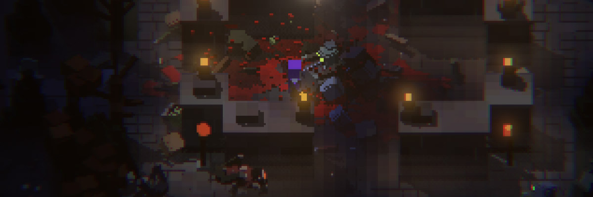
</p>

<h1 align="center">
Grave Robbers
</h1>

<p align="center">
<i>
Candy, candy, candy, CANDY, CANDY, CANDY 
</i>
</p>

A spooky top-down survival party game for Halloween nights. Up to 8 players rob graves, chop and mine, craft weapons, and build walls, lamps, and traps in a graveyard that's always dark.

The horde comes: zombies, vampires, ghosts, werewolves, necromancers, and more, worse under a blood moon. Candy from graves and blood from monsters buy skill tree upgrades.

<p align="center">
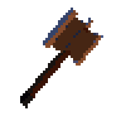
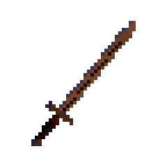
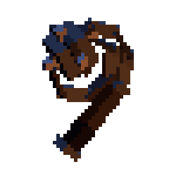
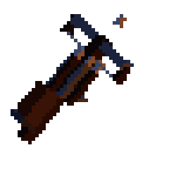
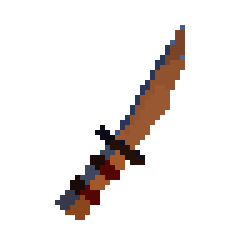
</p>

## Play from the couch

- **One screen is the window.** A TV (or any big screen) shows the whole graveyard.
- **Every phone is a controller.** Scan the QR code on the TV, pick a name and a color, and you rise from the grave.
- **Drop in, drop out.** There are no rounds. Join mid-night, put your phone down, come back tomorrow: your character waits where you left them.

This whole project was meant as a joke, but also to see how far Claude has come. The TV at the party will be playing music from Spotify, displaying the album art and name large. The map behind is filled with zombies and hopefully will look more like scenery.

Guests will notice a small QR code in the corner (or not), which will throw them into the map, and turn their phone into a controller. Inventory, crafting, knowledge tree, all on the phone. If wanted, we can hook a controller to the computer and it can be connected to a player.

The more they play, the more they'll realize how much is built out.

With that said the map displayed in full on the TV and not zoomed in. I didn't want that to be the only way to enjoy it, so I made a separate page where you can be zoomed in, use mouse, keyboard or controller, and have inventory and all that on screen.

Maps are also allowed to be generated large, no need to limit it.

<p align="center">
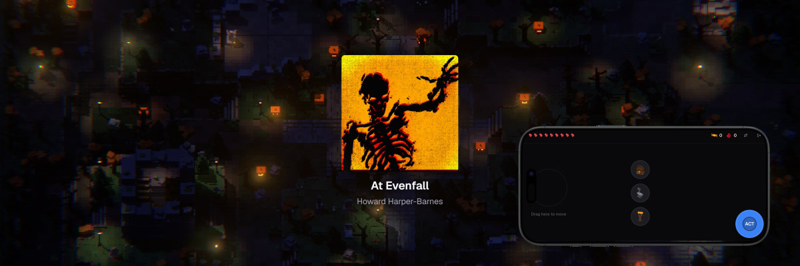
</p>

## The Rest is Controlled Hell

Create occult alters, research weapons, automate resource gathering, create assembly lines, defend your base with automated flame throwers. The monsters get meaner and meaner.

<p align="center">
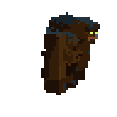
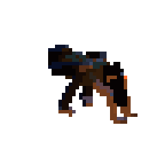
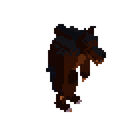
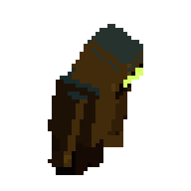
</p>

<p align="center">
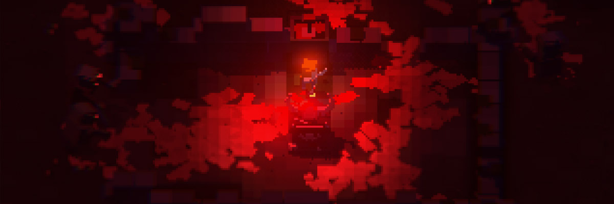
</p>


<p align="center">
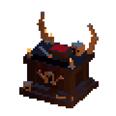
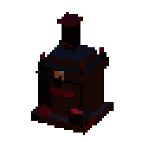
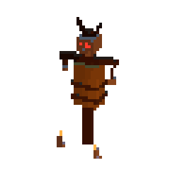
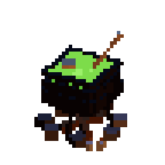
</p>

<p align="center">
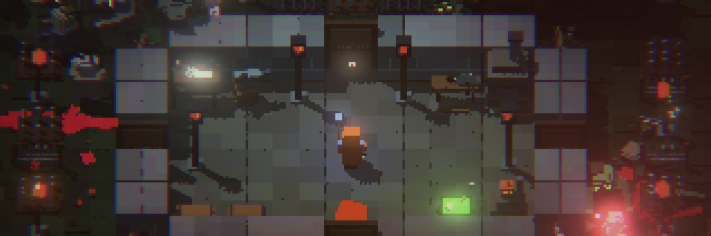
</p>

<p align="center">
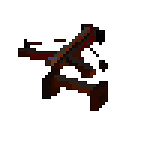
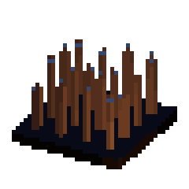
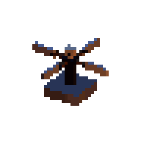
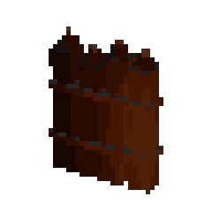
</p>

<p align="center">
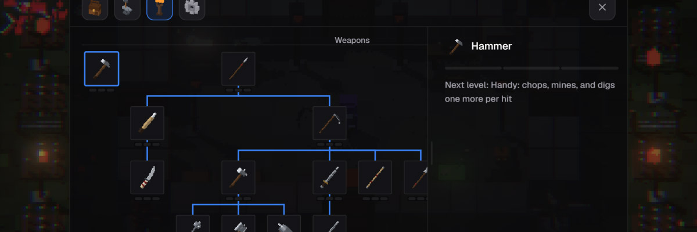
</p>

<p align="center">
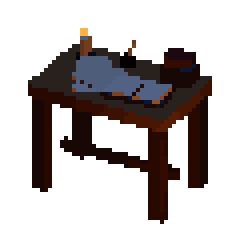
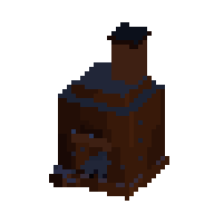
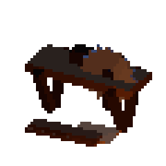
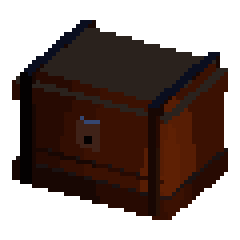
</p>

<p align="center">
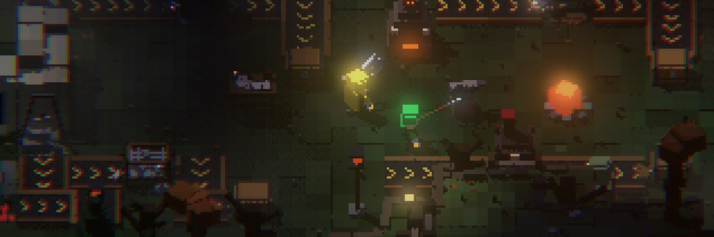
</p>

<p align="center">
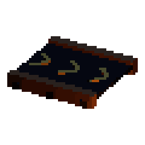
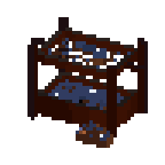
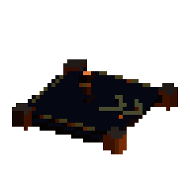
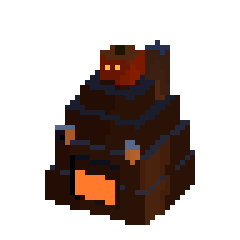
</p>

# Setup

#### Requirements

- Node.js 22 or newer (developed on Node 24) and npm.
- A computer to run the server and show the TV page.
- Phones on the same Wi-Fi network as that computer.

```sh
% npm install
```

One install at the root covers every workspace (`shared`, `server`, `packages/*`, `apps/*`).

## Running locally

```sh
% npm run dev
```

This starts:

- the game server on port **3021** (Express + WebSocket, restarts on file changes), and
- a Vite dev server per app (hot reload, proxies `/ws` to the game server, listens on your LAN): the phone on **5181**, which also passes `/tv`, `/play`, and `/admin` through to the TV (5182), play (5183), and admin (5184) servers, so everything opens from 5181.

Then:

1. On the TV machine, open **http://localhost:5181/tv**.
2. Scan the small QR code in the bottom left of the TV with a phone: white squares on a dark glow, which phone cameras read fine (hovering it with the mouse brightens it and shows the URL; it stays up during Incognito). The QR swaps `localhost` for this computer's LAN address and always points at the phone app, so it reads something like `http://192.168.1.20:5181/` in dev even if the TV was opened on its own port (5182; the dev servers pass it in as `__PHONE_PORT__`, see `apps/vite.base.ts`).
3. Pick a name and color, then turn the phone sideways.

## Phones can't connect?

- Make sure the phone is on the same network (not mobile data, not a guest network that isolates devices).
- On Windows, allow Node.js through the firewall for private networks when prompted, or add an inbound rule for TCP 5181 (dev) and 3021 (production).
- If the QR shows the wrong IP (VPNs and virtual adapters can confuse it), type the right address into the phone's browser by hand. The server prefers `192.168.x`, then `10.x`, then `172.x` addresses and skips WSL, Docker, Hyper-V and VPN adapters (`server/src/net/helpers/lan-address.ts`, adapter rules in `net/config/lan.ts`).

## Production-style run

```sh
% npm run party 
```

Open **http://localhost:3021/tv** on the TV, phones use the QR as before.

# Sound and music

Browsers keep audio off until someone interacts with the page. On the TV, click or press any key once (a faded "Click for sound" sits in the bottom right until then). For a kiosk setup, start Chrome with `--autoplay-policy=no-user-gesture-required`.

Phones turn sound on with their first touch.

## Sound Effects

Synthesized in code, so they work out of the box. The TV plays world sounds panned to where they happen (swings, hits, chopping, building, breaking, monster groans, deaths, the blood moon horn). Each phone plays its own player's chops, hits, pickups, builds, hurts, and death.

### Your own SFX

Drop `<name>.mp3` into `server/media/sfx/` to replace that sound. Getting hit has its own sound (`hurt`: a crunchy thud and a pained grunt), on the TV and on the hurt player's phone.

Names: `swing`, `chop`, `mine`, `hit`, `hurt`, `monster-hit`, `bite`, `build`, `break`, `pickup`, `drop`, `refuel`, `snuff`, `error`, `death`, `respawn`, `monster-death`, `blood-moon`, `zombie-groan`, `vampire-hiss`, `ghost-moan`, `equip`, `craft`, `shadow-step`, `ghoul-hiss`, `ghoul-screech`, `shoot`, `splat`, `drink`, `fountain-catch`.

## Music

*Media lives on the server, not in the client bundle: everything under `server/media/` is served at `/media` and listed by `/api/media`, read fresh on each request, so new files show up on the next page load with no rebuild or restart. Phones never download music.

**Incognito** (Music tab) turns the TV into what looks like a now-playing screen with an animated background: the album art big in the middle, title and artist below, the live graveyard (monsters and all) behind it, the QR and kill feed hidden, game sounds muted. It fades back to the graveyard as soon as a phone joins (or press Escape). It's off when the TV page opens; press **I** on the TV to toggle it. Album art comes from Spotify, or from the cover embedded in an mp3's ID3 tag.

### Music (Spotify)

1. Create an app at https://developer.spotify.com/dashboard with the Web Playback SDK and Web API enabled, and add the redirect URI `http://127.0.0.1:3021/auth/spotify/callback` (Spotify doesn't accept `localhost`).
2. Put `SPOTIFY_CLIENT_ID` and `SPOTIFY_CLIENT_SECRET` in `server/.env` (gitignored; the server's `dev` and `start` scripts load it). Add `SPOTIFY_REDIRECT_URI` if you use a different address.
3. Either set `SPOTIFY_REFRESH_TOKEN` in `server/.env` too, which links that account from startup with no login (and wins over any login saved from the TV), or on the TV open the sidebar, click **Connect Spotify** in the Music tab's Spotify card. A TV login is kept in `server/data/spotify.json` until you click **Disconnect**; copy its `refreshToken` into `.env` to make it the default. With an env token, **Disconnect** only lasts until the server restarts.
4. Pick a playlist in the Music tab's Spotify card (it shows each playlist's cover).

### Custom songs

Drop mp3s into `server/media/music/`, or a song split into parts as a folder of mp3s in `server/media/music/<song>/` (`bass`, `drums`, `instruments`, `melody`, played together in step) with its cover as `cover.jpg` (else `art.jpg`; the bundled covers are square crops of the original `art.jpg`).

They play shuffled, named by a `meta.json` in the song's folder (`{ "title": ..., "artist": ... }`, either optional), else their ID3 tags, else the file or folder name in title case.

Part songs follow the game: everything plays while nobody's connected; once players are in, exploring keeps instruments and bass with a hushed melody, and a fight (a monster within 6 tiles of a living player, or a hit in the last 6 seconds) brings in the drums and the full melody, which fade back out afterwards. The blood moon keeps some drums going.

## Ambience

`server/media/ambience/*.mp3` loops quietly under everything on the TV, always, at its own volume (the Ambience slider).

## What plays

The TV keeps its own queue. With **Spotify playback** ticked, whatever is queued on the linked Spotify account (from your phone, or guests in a Spotify Jam) plays first, in Spotify's order, so additions and moves there show up on the TV. After that come the **Spotify playlist** (shuffled by the TV) and the **Custom songs** (shuffled in). 

With both ticked, a slider under each sets how often it's picked against the other (3 to 1 for the playlist by default). Spotify tracks play one at a time and fade out at the end; Spotify pauses while a custom song plays. Spotify playback needs the `user-read-currently-playing` scope: if Up next never shows your queued songs, click **Disconnect Spotify** and connect again.

The **Music** tab (TV sidebar) has cards: **Music** (checkboxes for Spotify playback, Spotify playlist, and Custom songs), **Spotify** (connect, playlist, disconnect), **Volume** (music, ambience, sound effects; saved per TV), and **Now playing** (cover, play/pause, skip, Incognito), and **Up next** (where each song comes from; the TV's own songs can move up or down or come out, songs queued on Spotify stay). Music dips briefly when someone dies and when the blood moon rises.

Only one TV page plays music: the newest one opened. Any other open TV page goes quiet and its Music tab shows **Play music here** to take it back.

## World, saves, and resets

- The world and every character are saved under `server/data/saves/` (gitignored) every 30 seconds, after a reset, and on shutdown, with hourly backups. Each world slot is a folder; the admin's **Worlds** page makes and switches them. See [docs/architecture.md](docs/architecture.md#persistence).
- Characters come back after a restart where they stood, with everything they had: phones reconnect on their own. A name belongs to its character; another device needs the transfer code from the phone's move button.
- To start a new world:
  - pick a map in the TV sidebar's **Game** tab (hover the top-right corner of the TV and click the chevron to open the sidebar), tick **Replace this world**, and press **New world**, or
  - run `npm run dev:fresh`, which deletes every save (all slots, characters, and backups) before starting, or
  - stop the server and delete `server/data/saves/`.
- New worlds start on the **King of the Hill** map preset (`server/presets/king-of-the-hill.json`: a generated map, hand-edited: a lumpy, wooded hill with a higher crown on the middle right, the pit's stairs moved to its top right corner, rocks in the walled courtyard, a round well plaza, and extra graves), unless the Game tab picks **Random map**. `WORLD_PRESET` picks another preset file by name; any `.json` dropped into `server/presets/` shows up in the Game tab's list.
- Saves from older versions of the game still load: anything missing gets its default, anything that no longer exists is dropped, and the server logs what it fixed. Only a file that isn't readable at all is set aside as `*.unreadable-<time>` (never deleted).

## Testing

There are no automated tests yet. Before committing, run:

```sh
npm run typecheck   # shared, server, packages, and every app
npm run build       # catches anything the bundler rejects
```

### Testing without a room full of phones

Each browser profile holds one player (the player token lives in `localStorage` under `graveyard.token`), so two tabs in the same browser are the same player. To get several players on one computer:

- use different browsers, or a mix of normal and private/incognito windows, or separate Chrome profiles;
- open `http://localhost:5181/` in each and join with a different name;
- in Chrome DevTools, turn on the device toolbar (Ctrl+Shift+M), pick a phone, and rotate it to landscape. Portrait shows a "Turn your phone sideways" screen.

The mouse works for the joystick and buttons. Keep the TV page open in another window to watch the result.

### Debugging

- The server logs its port and the world seed on start.
- The TV renders straight from server snapshots, so if the TV looks wrong but the phone works, check the browser console on the TV page.
- `npm run dev` runs the server and the four apps with labeled output (`server`, `mobile`, `tv`, `play`, `admin`). If a port is already taken, stop whatever holds it, or set `PORT` (server), `GAME_PORT`, and `APPS_PORT` (the apps).

## Project layout

```
shared/   game data and rules by topic folder (protocol/, world/, gear/, monsters/, ...), imported by both sides
server/   authoritative simulation (game/, one folder per subsystem) and socket routing (net/)
apps/     one Vite + React app per screen: mobile (/), tv (/tv), play (/play), admin (/admin)
packages/ client code the apps share: ui, renderer, game-ui, controls
docs/     design and architecture, one file per topic
```

See [CLAUDE.md](CLAUDE.md) for an index of the docs, [docs/architecture.md](docs/architecture.md) for code layout and class hierarchies, and [docs/organization.md](docs/organization.md) for where new code goes.
