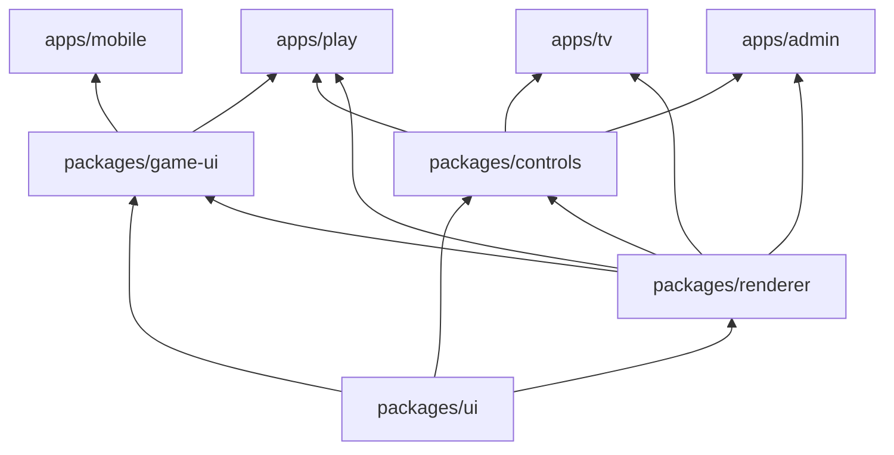
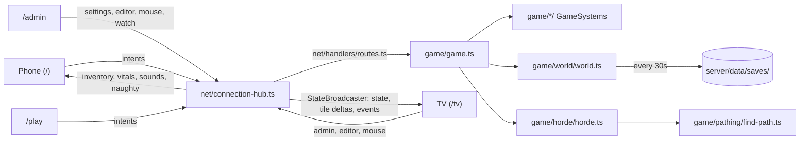

# Architecture

npm workspaces, one install at the root. Where new code goes (folders, file naming, base classes, size limits) is in [organization.md](organization.md).

| Workspace | What it is |
|---|---|
| `shared/` | Raw TS game data and rules in topic folders, imported as `@halloween/shared/<folder>/<file>` by both sides. No barrel. |
| `server/` | Express + `ws`, run by `tsx`. The authoritative simulation. |
| `apps/mobile/` | The phone controller (`/`). |
| `apps/tv/` | The TV (`/tv`): the world, split screen, music, the join QR, incognito, sound. |
| `apps/play/` | A screen of its own played with a game controller or keyboard and mouse (`/play`). |
| `apps/admin/` | The remote console (`/admin`): the world, following any player, and the TV's controls without music. See [admin.md](admin.md). |
| `packages/ui/` | Theme CSS and Tailwind preset, kit components, hooks (`useSocket`, `useHold`, `useWakeLock`), storage keys and helpers, gamepad reading, audio (SFX, music, Spotify). |
| `packages/renderer/` | The three.js world (`world/world-renderer.ts` and its scene parts), avatars, the graveyard builder and painters, item and gear models, icons, the `WorldView` component. |
| `packages/game-ui/` | The player's menus shared by the phone and /play: bag, craft, tree, item details and icons, join form, death and naughty screens, pickup toasts, stash, `useControllerSession`. |
| `packages/controls/` | The control sidebar shared by the TV and admin: `ControlPanel` and its tabs, roster, stats, game panel, map editor, music panel, kill feed, TV mouse (`useTvMouse`), TV view presets. |

### Apps and packages



- **Apps never import each other**, only packages and `@halloween/shared`. Packages only import packages below them in the diagram.
- Packages are raw TS imported as `@halloween/<package>/<path>` (`@halloween/ui/hooks/use-socket`, `@halloween/renderer/world/world-renderer`). Vite resolves them with aliases (`apps/vite.base.ts`) and TypeScript with `paths` (`tsconfig.base.json`); `shared` stays a normal workspace package.
- Each app is a Vite + React app with its own `index.html`, `src/main.tsx`, Vite, Tailwind, PostCSS, and tsconfig. Every app's Vite config comes from `appConfig` in `apps/vite.base.ts`; every Tailwind config uses the preset in `packages/ui/src/styles/tailwind-preset.cjs` and scans `packages/*/src`.
- One screen per app, so there's no router. Each app builds with its route as Vite's `base`.



## Server

### Tick loop

- 30 Hz fixed steps. `server.ts` wakes several times per tick and runs however many steps real time calls for (at most `MAX_CATCH_UP`, `server/src/config/server.ts`), since Windows timers are too coarse for a plain 33ms interval.
- Clients send intent only (joystick vector, Action down/up, aim, block, drop). The server owns every position.
- Displays say hello as a TV, an admin console (`admin: true`), or a viewer (`viewer: true`, the /play view). Only TVs are handed the music and report their game controllers for phones to claim; viewers can't edit the map.
- After each tick `StateBroadcaster` (`net/broadcast/state-broadcaster.ts`) sends displays: players, monsters, shots, puddles, ground patches (`patches`, from `PatchSystem`), items, lights, one-off events, settings, and stats, after draining the game's `Outbox`. Tile changes go as deltas; the full map goes on hello and after editor batches.
- Every client message is routed by its `t` through the table from `buildRoutes` (`net/handlers/routes.ts`) to a `MessageHandler`. The table has no prototype, so unknown types (even `constructor`) are ignored.

### Staying up

Whatever breaks, the game keeps running and recovers on its own.

| Layer | What happens |
|---|---|
| A tick part throws | `Game.step` runs each part under `guard` (`server/src/game/helpers/guard.ts`): the error is logged (once per 10s per place, `GUARD_LOG_EVERY_MS`, with a count of the rest) and every other part still runs. `server.ts` guards the step and the broadcast the same way |
| One monster throws | `Horde.step` guards each monster's update; one that throws 3 times (`MONSTER_FAULTS`) is removed (`Horde.fault`) |
| Building state for clients throws | `StateBroadcaster` sends the displays' state and the phones' updates in two guarded halves |
| A message handler throws | `ConnectionHub` guards each message, socket close, and the ping round; bad JSON is dropped |
| Ticks run slow | `LoadGovernor` (`game/core/load-governor.ts`) smooths how long a tick takes. Over 20ms (`LOAD_HIGH_MS`) it lowers the share of the monster caps spawning fills by 10% a second, down to 35% (`HordeContext.loadScale`, used by `Spawner`). Over the whole 33ms budget (`LOAD_SEVERE_MS`) it also sheds 6 monsters a second, the farthest from players first (`Horde.shed`). Under 12ms the caps creep back 3% a second. It logs each change as `[load]` |
| Anything else throws | `uncaughtException` and `unhandledRejection` are logged, not fatal |
| A socket dies without closing | The server drops a socket that hasn't answered a ping in 20s (`PONG_TIMEOUT_MS`, `PingTracker.pingAll`); a page reopens its socket after 6s without hearing anything (`SOCKET_STALE_MS`, `useSocket`), then reconnects with backoff |
| A page throws | Each app's root is wrapped in `CrashReload` (`packages/ui/src/components/layout/crash-reload.tsx`): a render error shows a note and reloads after 3s, and players rejoin with their saved token. A frame the renderer fails to draw is logged and the next one tries again (`WorldScene._loop`) |
| The process dies | `npm run party` builds the apps and runs the server under `server/scripts/keep-alive.ts`, which restarts it 2s after any exit (10s once it has crashed 5 times in a minute). The world saves every 30s (`SAVE_INTERVAL_MS`) and on Ctrl+C, with atomic writes, so a restart loses at most that much. On the droplet, systemd does the restarting (see [deploy.md](deploy.md)) |

### Latency

How the game copes with players far from the server.

| Piece | Where | What it does |
|---|---|---|
| Ping | `PingTracker.pingAll`, `useSocket` | The server pings every socket once a second; the page answers `pong` and gets the smoothed round trip back (`rtt`). Each player's shows as `PlayerState.ping`; screens show their own. |
| Compression | `server.ts` | WebSocket `permessage-deflate` on messages over 1 KB (the per-tick state), at the fastest zlib level. Updates stay at 30 a second. |
| Prediction | `apps/play/src/prediction/predictor.ts` | /play walks its own player right away with the server's rules (`shared/src/players/walk.ts`: `steerOf`, `walkSpeed`, `walk`), comparing each snapshot with where it had the player one ping ago and fixing a quarter of the difference (a jump over 1.5 tiles snaps). |
| Instant swings | `WorldRenderer.predictSwing` | /play starts a melee swing on the press (respecting the weapon's cooldown); the server's matching swing within 0.8s doesn't start it again. Hits, blood, and damage still wait for the server. |
| Interpolation | `WorldRenderer.setInterpolation`, `SnapshotInterpolator` | A screen whose ping is over `INTERP_PING_MS` (60) draws other players and monsters `INTERP_DELAY` (0.1s) in the past, blended between snapshots, instead of easing toward the latest. |
| Melee rewind | `MeleeSystem.lagOf`, `Horde.targetsAt`, `RewindBuffer` | A player's melee is judged against where monsters stood their round trip ago, plus their screen's interpolation delay (or about 0.05s of easing), at most `REWIND_KEEP` (0.25s). |

- The Overview shows each player's ping (red over 120 ms), this screen's ping, and how much each screen is sent per second before compression (`ServerStats.displayKBps`, counted by `StatsWindow`).
- Phones on a TV don't predict: their input still goes to the server and back before their TV shows it. A far-away player gets the most from /play.

### Huge worlds

How a 256x256 world stays cheap (see [world.md](world.md#sizes)).

| Piece | Where | What it does |
|---|---|---|
| Interest | `StateBroadcaster.sendState`, `net/broadcast/helpers/interest.ts`, `watch` message | On a huge world a display that sent `watch` (player ids) gets only monsters, shots, puddles, items, and lights within `INTEREST_RADIUS` (40) of those players. One that watches nobody gets everything. /play watches its own player; the TV watches its panes. |
| Watched | `state.watched` | The players some /play screen watches, so the TV leaves them out of its split screen. |
| Local monsters | `Spawner.spawnNear`, `Spawner.despawnStrays` | Monsters spawn around players and vanish once out of everyone's reach ([monsters.md](monsters.md#spawning-and-pacing)). |
| Bounded paths | `findPath` `within`, `budget` | Monster searches stop `MONSTER_SEARCH` (48) tiles out and look at no more than `budget` tiles, ending on the best tile found so far; scratch arrays grow to the map and reset by stamp instead of clearing. |
| Chase budgets | `Walker.chaseBudget`, `Walker.backOffIfShort`, `horde/config/ai.ts` | A chase searches up to `CHASE_BUDGET` (1500) tiles, or `LOST_BUDGET` (200) when its goal surely can't be reached. A path that stops short of an unreachable goal waits `FAILED_REPATH` (2.5s) before searching again, not the usual 0.3 to 0.6s. Before these, one failed chase looked at every tile in range (about 25ms on a huge world) and a horde chasing someone up a cliff could eat every tick. |
| Reach map | `ReachMap` (`horde/senses/reach-map.ts`, on `HordeContext.reach`) | Floods backwards from a chase goal under a zombie's rules (the most forgiving), out to a radius that tunes itself between `REACH_RADIUS_MIN` and `REACH_RADIUS_MAX` (16 to 40) so a flood takes about `REACH_FLOOD_MS` (4ms), kept `REACH_TTL` (1s), at most `REACH_FLOODS_PER_TICK` (1) new a tick. A flood also answers for any goal it marked, so a moving player reuses one. Never says "can't" wrongly; with no answer it says "can". |
| Light index | `WorldLights.lightSpots`, `TileGrid.listen` | Pumpkins and lamp posts are found once per map and kept up to date as tiles change, instead of `activeLights` scanning every tile each tick. `TileGrid.listen` calls a listener on every tile change. |
| Chunks | `TerrainChunks.ensure` | Clients build the map in 16x16 chunks around the camera ([tv.md](tv.md#world-voxels)). |

## Modules

### shared/src

| Folder | Owns |
|---|---|
| `protocol/` | Every wire message (`messages/client-message.ts`, `controller-message.ts`, `display-message.ts`, `server-message.ts`) and state shape (`state/`), `GameSettings`, game events, server stats, network constants (`INTEREST_RADIUS`, interpolation), pads, TV tools |
| `world/` | `TileGrid` (storage, encoding, changes) and `WorldMap` (height geometry: `elevationAt`, `canStep`, `roundTrip`), tiles, dimensions, ramps, trees, targeting (`facingTile`, `buildTarget`), tile codec, `collision.ts` |
| `players/` | Player constants: speed, health, PvP share, death toll, spawn protection, the roster palette, and `walk.ts` (how a player walks, shared so /play can predict) |
| `goods/`, `loot/`, `inventory/` | Candy, blood, materials, ground items; gatherables, graves, chests, pumpkins, monster drops; bag items, item keys, affordability |
| `gear/` | `GEAR` (`gear-catalog.ts`, from `defs/`), melee and ranged rules, `damageTo`, `WEAPON_TRICKS`, `WEAPON_PERKS` (`perks/`), infusions (`infusions/`: essences, packages, `VARIANTS`, path and cost helpers), gear types |
| `structures/` | `STRUCTURES` (`structure-catalog.ts`), lights, stations, traps, turrets, automation, placement, occult |
| `crafting/` | Recipes, material recipes, `craftCost`, `MAX_CRAFT` |
| `skill-tree/` | The tree's nodes and branches, progress and depth, upgrade costs, and what levels do (`upgrades/`: `weaponStats`, `gearGuard`, structure upgrades) |
| `monsters/` | Monster stats, kinds, attack styles, sight, movement, spawn pacing, armor; each kind's own constants in `kinds/` |
| `difficulty/` | Hidden player and world levels and what they do to the horde |
| `world-events/` | `WORLD_EVENTS` (the blood moon in `kinds/`), `EventEffect` and `EventModifiers` types, `resolveEffects` |
| `map-gen/`, `map-editor/` | Random map knobs; the TV's map editor (`map-edit.ts`, brush, palette, `blend/`) |
| `audio/` | `AudioSettings`, music status, media manifest, Spotify shapes, phone sounds, TV control |
| `helpers/` | `seededRandom`, math |

### server/src

| Folder | Owns |
|---|---|
| `server.ts` | Express, the WebSocket server, the tick loop, saving |
| `config/` | `paths.ts` (every file path, with its env override: `SAVE_DIR`, `WORLD_SAVE` (the old single-file save, imported once), `PRESET_DIR`, `MEDIA_DIR`, `SPOTIFY_SAVE`), `server.ts` (port, save interval, app routes) |
| `game/game.ts` | `Game`: holds the roster, `World`, `Horde`, `GameSettings`, and one field per `GameSystem`, and runs `step` |
| `game/core/` | `GameSystem` (the base), `PlayerRoster`, `Outbox` (what the hub drains each step), `GameHordeHooks` (how the horde reaches back; `died` runs each death's on-kill effects through `InfusionSystem.onDeath`) |
| `game/players/` | The `Player` chain, joining and leaving (`JoinSystem`), input (`ControlSystem`), life and death (`LifeSystem`), per-tick upkeep (`PlayerTickSystem`), the wire view (`ViewSystem`) |
| `game/movement/` | Walking and collision (`MovementSystem`), panic (`PanicSystem`) |
| `game/combat/` | Actions (`ActionSystem`), melee (`MeleeSystem`), damage (`DamageSystem`), turrets (`turrets/`: `TurretSystem` and the `TurretFire` family), infusion tricks (`infusions/`: `MeleeTricksSystem` for swing tricks, `InfusionSystem` for on-kill effects), ground patches (`patches/`: `PatchSystem` for scorch, fire trails, and incense) |
| `game/ranged/` | Shooting and reloads (`RangedSystem`, which owns the Hellmouth's `FlameSpraySystem` as `spray`), lock-on (`AimingSystem`), shots in flight (`ShotSystem`, which owns `GlaiveSystem` as `glaives` and `MirrorShieldSystem` as `shields`), puddles (`PuddleSystem`), `helpers/bounce-off.ts` (Bone Choir bounces) |
| `game/jobs/` | `TileJobSystem` and one `TileJob` per kind of tile work (gather, dig, rob, smash, break down; load, water, and offer, which USE runs) |
| `game/inventory/` | The bag, hands, pickups, drops, monster spoils, storage chests, USE (`UseSystem`); `helpers/hands-clash.ts` (`handsClash`: what can't share the hands) |
| `game/building/` | Placing structures (`BuildSystem`), crafting and infusing (`CraftSystem`, `CraftSystem.infuse`) |
| `game/progression/` | World events (`WorldEventSystem`), hidden levels (`LevelSystem`) |
| `game/tv/` | The Game tab (`GameTabSystem`), spawning from it (`ConjureSystem`), the TV mouse (`TvHandSystem`) |
| `game/bots/` | The test player (`TestBotSystem`, `test-player.ts`, `TaskPicker`, the `BotTask` family) |
| `game/world/` | `World`: tiles, terrain, structures (store, queries, damage, ticking features), ground items and belts, stations, regrowth, the map editor, saving; each part a `WorldFeature` |
| `game/horde/` | `Horde`: spawning (`Spawner`), sight (`Sight`), wards (`Wards`), statuses from outside a hit (`Afflictions`), heat and light fields, the `MonsterRoster`, the `RewindBuffer`, and the `Monster` hierarchy (`monsters/`, kinds in `monsters/kinds/`, statuses in `monsters/state/`). Every death goes out through `HordeHooks.died` as a `MonsterDeath` (`types/death.ts`) |
| `game/pathing/` | 8-way A* (with `to`) and Dijkstra (without) over tiles of any map size, never cutting corners, optionally bounded (`within`) |
| `game/world-gen/` | The seeded generators: `generate-world.ts` (classic, `classic/` passes and landmarks) and `generate-huge-world.ts` (`huge/` passes), see [world.md](world.md) |
| `game/storage/` | Loading and saving the world (`world-save-file.ts`) and map presets (`presets.ts`) |
| `net/connection-hub.ts` | `ConnectionHub`: owns the hub parts and dispatches each message through the route table |
| `net/handlers/` | `routes.ts` and one `MessageHandler` per group of message types |
| `net/sessions/`, `net/pads/` | Sessions by socket (`SessionRegistry`), pings (`PingTracker`), who plays music (`MusicOwner`), TV game controllers (`PadRegistry`) |
| `net/broadcast/` | `StateBroadcaster` (per-tick state, interest filtering), `StatsWindow` (bytes sent, ticks) |
| `net/media/`, `net/spotify/` | Serves `server/media/` at `/media` with a manifest at `/api/media`; Spotify OAuth and short-lived access tokens |
| `net/helpers/` | LAN address for the join QR, session and world message helpers |

### packages/renderer/src

| Folder | Owns |
|---|---|
| `world/` | `WorldScene` (the scene and its parts), `WorldRenderer` (adds input, prediction, editor), `FrameLoop`, `WorldContext`, `ScenePart`, `world-view.tsx` |
| `world/actors/`, `world/camera/`, `world/chunks/` | Avatar sets and interpolation; the camera rig and follow; terrain chunks, scenery, tile animations |
| `world/effects/`, `world/lights/`, `world/editor/`, `world/build/`, `world/picking/` | Projectiles, event effects, reticles; light and fog stamps, sky; edit cursor and stairs ghost; build preview; screen picking |
| `avatars/` | `Avatar`, `PlayerAvatar` and its parts (rig, gear with `HeldModels` and `PlayerOffhand`, swing, locomotion, `motions/`), `MonsterAvatar` and its parts (`MonsterAfflictions`, `MonsterGlow`, `MonsterSwoosh`, `helpers/flail-limbs.ts`) and kinds (`monsters/kinds/`), shared swoosh trails and dangling |
| `graveyard/` | `graveyard-builder.ts` (tiles to voxels), ground and stairs, outskirts, shrubs, the tower, `painters/` (one `TilePainter` per tile kind), palettes in `config/palette/` |
| `effects/` | Gore, chip bursts, pickup popups, health bars, altar gauges, fountain victims (`FountainVictims`), puddles, ground patches (`GroundPatches`), infusion layers (`ChainBolts`, `ShockRings`, `Fissures`), flames, tree sway, post-processing (`post/`) |
| `lighting/` | The light map texture and the fog (`fog/`) |
| `items/` | Ground item piles and their `GroundDrop` kinds |
| `models/`, `icons/` | Gear and item voxel models, infused variants (`models/gear/infusions/`: `infuseModel`, the `EssenceLook` kinds, `VARIANT_SHAPES`); the item icon renderer and cache |
| `space/world-coords.ts` | Tile to world coordinates (module state, set per map) |

### packages/ui, game-ui, controls

| Folder | Owns |
|---|---|
| `ui/src/audio/` | `sfx/` (engine, recipes, overrides, ambience), `music/` (`MusicPlayer` and its sources), `media/`, `spotify/` (see [audio.md](audio.md)) |
| `ui/src/hooks/`, `ui/src/input/`, `ui/src/components/` | `useSocket`, `useHold`, `useWakeLock`; gamepad reading; kit components |
| `game-ui/src/components/` | Bag, craft, Armory (`armory/`: `ArmoryPanel`), tree, item details, items, HUD, screens, stash |
| `game-ui/src/stats/` | `StatSheet` kinds and `statsOf` (the details' stat bars) |
| `game-ui/src/assets/stat-icons/`, `game-ui/scripts/` | The details' pre-rendered stat and trait icons and bar blocks, and the script that renders them (see [phone.md](phone.md#stat-and-trait-icons)) |
| `game-ui/src/session/`, `game-ui/src/tree/` | `PlayerCommands` (what a controller sends); `TreeLayout` |
| `controls/src/components/` | Control panel, overview, game, map editor, music, kill feed |
| `controls/src/editing/` | `MapEditController`, `EditBatcher`, `TilePicker`, the `EditTool` family (`tools/`) |
| `controls/src/mouse/`, `controls/src/display/` | The TV mouse modes (`MapPointerMode`); `WorldCache` |

### apps

| App | Notable folders |
|---|---|
| `apps/mobile/src/` | `components/pad/` (the controller pad), `components/sticks/`, `hooks/` (input sampling, panels, gesture blocking) |
| `apps/tv/src/` | `audio/` (`SoundDirector`, `SoundStage`, `watchers/`), `input/` (`PadRelay`, `PadLogger`), `components/`, `hooks/` (panes, keys, music, pads) |
| `apps/play/src/` | `input/` (`PlayInputLoop`, `modes/`), `prediction/`, `nav/` (`SpatialNav`), `components/` (HUD, menu, settings) |
| `apps/admin/src/` | `components/` (sidebar, world, follow panel), `hooks/use-admin-camera.ts` |

## Class hierarchies

The base classes (`GameSystem`, `Monster`, `HordePart`, `WorldFeature`, `GenPass`, `ScenePart`, `Avatar`, `TilePainter`, and the client families) and their subclasses are diagrammed in [class-hierarchies-server.md](class-hierarchies-server.md) (game, players, jobs, turrets, hub, monsters, horde, world, world-gen, shared) and [class-hierarchies-client.md](class-hierarchies-client.md) (renderer, avatars, painters, UI, audio, input).

## Identity

- Phones join with a name and color and get a secret token, kept in localStorage. A `/play` screen joins the same way with a game controller (see [play.md](play.md)). Each character is saved with its token (see Persistence).
- On reconnect the phone sends the token in `hello-controller` and resumes the same player (`ControllerSessionHandler`, `JoinSystem.resume`). If that player isn't in the game (they left, or the server restarted), their saved character comes back where they stood, with everything they had (`JoinSystem.bringBack`; at a spawn if they were dead or their tile is now solid).
- A phone that drops (put down, screen off) leaves its player slumped where they stood, still hunted, until it comes back or presses Leave.
- Leaving saves the character (`PlayerRoster.putAway`) and frees their place in the game.
- **Names are reserved** (case-insensitive, `PlayerRoster.holderOf`). Joining under a name that has a character needs proof, else `join-error` with `needsCode` and the join form asks for a code:
  - a token this device held for that character: every token a device is given is kept in `<tokenKey>-known` (the newest `MAX_KNOWN_TOKENS`, 16) and sent with `join`, so pressing Leave and joining again on the same phone just works;
  - or a **transfer code** from the device that has it: the phone's move button (or /play's Gameplay settings) sends `transfer-code` and shows a 6-character code (`TransferCodes`, `TRANSFER_CODE_LENGTH`), good once, for 10 minutes (`TRANSFER_CODE_SECONDS`).
- A character someone is playing right now (phone connected) can't be taken. The admin can release a character for good, freeing the name (Worlds page, `character-release`).
- The test player is never saved: turning it off releases it (`TestBotSystem.toggle`).

## Persistence

Everything is saved as a folder of files under `server/data/saves/` (`SAVE_DIR`), one folder per **world slot**. `SaveKeeper` (`game/storage/save-keeper.ts`) owns the slots (`WorldSlots`) and the game played from the active one.

```
saves/
  server.json                   which slot is being played
  worlds/<slot>/
    slot.json                   name, created, last saved, size, characters
    world.json                  everything but the terrain (WorldSave)
    chunks/<cx>.<cy>.bin        32 x 32 tiles of terrain each
    players/<id>.json           one character each (PlayerSave)
  backups/<slot>/<time>-<why>/  copies of a slot folder
```

| Saved | Not saved |
|---|---|
| Terrain: tiles, levels, turns, in chunks | Monsters |
| Seed, blend areas, view, clock, structures, node yields, timers, regrowth targets, ground items (`world.json`) | Who owns a dead player's spill (`GroundItem.ownerId`) |
| `GameSettings` (difficulty, switches) and the world level, per slot | Transfer codes |
| Each character: token, name, color, spot, health, candy and blood, bag, tree, time online | The test player |

- **When:** on start, every 30s (`SAVE_INTERVAL_MS`), after a reset, when switching slots, and on SIGINT/SIGTERM. A failed save is logged and the game plays on; the next one tries again (its chunks are marked changed again).
- **Only what changed:** `TileGrid.watch` hears every write to a tile, level, or turn, and `ChunkTracker` (`World.chunks`) marks its chunk. A save writes `world.json` (a couple of KB), the changed chunks (`encodeChunk`: a byte each for tile, level, and turn), every player in the game, and every away character that changed (`PlayerRoster.changed`). Building `world.json` takes well under a millisecond; a save that changed nothing takes about 5 ms on Windows, almost all of it file system calls.
- **All or nothing:** `commitFolder` (`save-folder.ts`) writes everything to `pending/`, then `pending/commit.json`, then moves the files into place. `recoverFolder` runs before every read: a committed save is finished, an unfinished one thrown away. So a world and its characters never come back from different moments (no duplicated or lost items).
- **Loading:** `readSlot` (`slot-files.ts`) rebuilds the map from its chunks and reads every character into `PlayerRoster.away`. Nobody is in the game until their phone resumes.
- **Saves repair instead of failing.** While the game is in development, its data changes often, so loading never throws a save away for being out of date. Every field is checked on its own and anything missing or bad gets its default; one line per file logs what was fixed (`RepairLog`), and a repaired file is written back clean on the next save.

| Part | What loading does with it (`helpers/revive-*.ts`) |
|---|---|
| `world.json` | `reviveWorld`: each field typed and kept in range, else its default; bad list entries (timers, ground items, blend areas) dropped; unknown fields ignored. Only a world with no size is unusable |
| Lost `world.json` | Rebuilt from the chunks at the size `slot.json` remembers, with default settings |
| Chunks | `decodeChunks` reads with the `palette`, `chunkSize`, and `minLevel` they were written with (in `world.json`), so changing the tile list, `CHUNK_SIZE`, or `MIN_LEVEL` doesn't scramble a world; if any differs, every chunk is written again on the next save (`LoadedWorld.rewrite`). A tile that no longer exists becomes grass; a missing or short chunk is left as grass; levels and turns are kept in range |
| Structures | `reviveStructures`: each is its kind's fresh state (`freshStructure`) with the saved fields on top, so a field added to a kind comes in at its default. One whose tile isn't built any more is dropped; a built tile with no state gets a fresh one |
| Settings | `reviveSettings`: each switch kept if it's the right type, else its default, so new switches start at their defaults |
| Player files | `revivePlayer`: a bad color becomes the first color, a bad spot sends them to a spawn, health is kept to 0..`MAX_HP`. Only a file with no id, token, or name is unusable |
| Bags and goods | `reviveGear`, `reviveBagItem`, `reviveBundle`: items, goods, and materials that no longer exist are dropped, stacks kept to their limits, a bag that changed size keeps its items (overflow moves to empty slots), gear equipped in a slot it no longer fits goes into the bag |
| Skill trees | `reviveTree`: unknown nodes dropped, levels kept to 0..`MAX_UPGRADE_LEVEL` |
| `slot.json` | Missing or unreadable: rebuilt (named after the folder), so the slot never drops off the list |

- **Upgrades:** `world.json` and player files carry a `version` (`WORLD_SAVE_VERSION`, `PLAYER_SAVE_VERSION`). Adding or removing a field needs nothing: the revivers handle it. Only a renamed field or a changed meaning needs an upgrade step in `migrateWorld` or `migratePlayer` (`helpers/migrate.ts`). A save with no step for its version, or from a newer version, is still loaded as best it can be.
- **Unreadable files:** only a file that isn't JSON at all is set aside, renamed `*.unreadable-<time>` (never deleted), and the slot carries on. A second file for the same character is skipped.
- **The old save:** the first time the server starts with no slots, `server/data/world.json` (version 8, `WORLD_SAVE`) is brought into the first slot, **Main**, and renamed `world.json.imported` (`importLegacy`).
- **Slots:** the admin's Worlds page makes, plays, and deletes slots, and releases characters (`SlotHandler`, see [admin.md](admin.md)). Playing another slot saves and backs up this one, then `Game.load` swaps in the other: everyone in the game goes back to the join form, and the other slot's characters come back as their phones resume. A new slot starts on the default preset.
- **Backups:** `WorldSlots.backup` copies the slot folder to `backups/<slot>/` every hour (`BACKUP_EVERY_MIN`), before a reset, before switching slots, and before a slot is deleted. Each slot keeps its newest 24 (`BACKUPS_KEPT`). To restore one, stop the server and copy its contents over `worlds/<slot>/`.

## Running

| Command | What it does |
|---|---|
| `npm run dev` | Server on :3021 and a Vite server per app: mobile :5181, TV :5182, play :5183, admin :5184. Mobile's passes `/tv`, `/play`, and `/admin` to the others, so open everything from :5181 (`http://localhost:5181/tv`). All proxy `/ws`, `/api`, `/auth`, `/media` to the server; `host: true` for LAN phones. `APPS_PORT` moves the four ports (counting up from it) and `GAME_PORT` the server they proxy to. |
| `npm run dev:fresh` | Deletes the world save first |
| `npm run typecheck` | `shared`, `server`, the packages, the Vite configs, and each app |
| `npm run build` | Builds every app into `apps/<name>/dist` |
| `npm run party` | Builds every app, then runs the server under `keep-alive.ts` so it restarts on its own after any crash (see [Staying up](#staying-up)). Use this on a laptop for a party |
| `npm start` | Server only; serves each built app at its route (`APPS` in `server/src/config/server.ts`: `/tv`, `/play`, `/admin`, and the phone at `/` for everything else) |

- New worlds start from a map preset, `WORLD_PRESET` (default `king-of-the-hill`), unless the TV picks a random map. See [world.md](world.md#presets).
- `server/.env` is loaded by the server scripts (Spotify keys).

## Conventions

- frontend-bootstrap, `studio` theme (`.claude/arw-frontend.json`, tokens in `packages/ui/src/styles/arw.css`), dark-only (`class="dark"` on `<html>`). Geist for all UI text and Geist Mono for numbers, loaded from Google Fonts (offline, the system UI font stands in). Tailwind v3 with `.cjs` configs.
- UI chrome uses token utilities only. Game colors (player palette, voxel colors) are game data and live in `shared/` or the renderer.
- kebab-case files, `// Packages` / `// Local Imports` / `// Types` import groups, JSDoc on every function, class, method, and field, single-quoted JSX attributes. The full set of folder and file rules is in [organization.md](organization.md).
- The server is authoritative, and everything acts on the facing tile.
