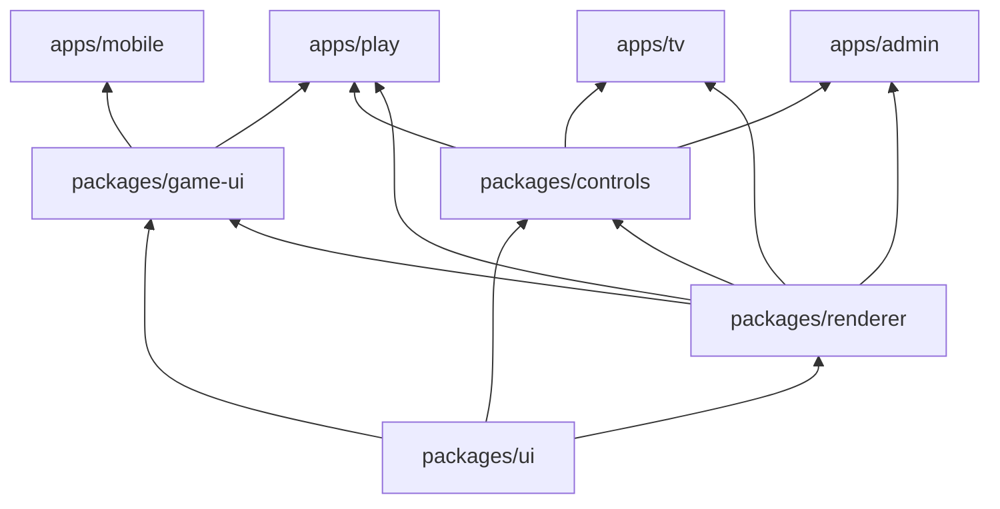

# Architecture

npm workspaces, one install at the root. Where new code goes (folders, file naming, base classes, size limits) is in [organization.md](organization.md).

| Workspace | What it is |
|---|---|
| `shared/` | Raw TS game data and rules in topic folders, imported as `@halloween/shared/<folder>/<file>` by both sides. No barrel. |
| `server/` | Express + `ws`, run by `tsx`. The authoritative simulation. |
| `apps/mobile/` | The phone controller (`/`). |
| `apps/tv/` | The TV (`/tv`): the world, split screen, music, the join QR, incognito, sound. |
| `apps/play/` | A screen of its own played with a game controller or keyboard and mouse (`/play`). |
| `apps/admin/` | The remote console (`/admin`): the world, following any player, and the TV's controls without music. See [admin.md](admin.md). |
| `packages/ui/` | Theme CSS and Tailwind preset, kit components, hooks (`useSocket`, `useHold`, `useWakeLock`), storage keys and helpers, gamepad reading, audio (SFX, music, Spotify). |
| `packages/renderer/` | The three.js world (`world/world-renderer.ts` and its scene parts), avatars, the graveyard builder and painters, item and gear models, icons, the `WorldView` component. |
| `packages/game-ui/` | The player's menus shared by the phone and /play: bag, craft, tree, item details and icons, join form, death and naughty screens, pickup toasts, stash, `useControllerSession`. |
| `packages/controls/` | The control sidebar shared by the TV and admin: `ControlPanel` and its tabs, roster, stats, game panel, map editor, music panel, kill feed, TV mouse (`useTvMouse`), TV view presets. |

### Apps and packages

- **Apps never import each other**, only packages and `@halloween/shared`. Packages only import packages below them in the diagram.
- Packages are raw TS imported as `@halloween/<package>/<path>` (`@halloween/ui/hooks/use-socket`, `@halloween/renderer/world/world-renderer`). Vite resolves them with aliases (`apps/vite.base.ts`) and TypeScript with `paths` (`tsconfig.base.json`); `shared` stays a normal workspace package.
- Each app is a Vite + React app with its own `index.html`, `src/main.tsx`, Vite, Tailwind, PostCSS, and tsconfig. Every app's Vite config comes from `appConfig` in `apps/vite.base.ts`; every Tailwind config uses the preset in `packages/ui/src/styles/tailwind-preset.cjs` and scans `packages/*/src`.
- One screen per app, so there's no router. Each app builds with its route as Vite's `base`.

## Server

### Tick loop

- 30 Hz fixed steps. `server.ts` wakes several times per tick and runs however many steps real time calls for (at most `MAX_CATCH_UP`, `server/src/config/server.ts`), since Windows timers are too coarse for a plain 33ms interval.
- Clients send intent only (joystick vector, Action down/up, aim, block, drop). The server owns every position.
- Displays say hello as a TV, an admin console (`admin: true`), or a viewer (`viewer: true`, the /play view). Only TVs are handed the music and report their game controllers for phones to claim; viewers can't edit the map.
- After each tick `StateBroadcaster` (`net/broadcast/state-broadcaster.ts`) sends displays: players, monsters, shots, puddles, items, lights, one-off events, settings, and stats, after draining the game's `Outbox`. Tile changes go as deltas; the full map goes on hello and after editor batches.
- Every client message is routed by its `t` through the table from `buildRoutes` (`net/handlers/routes.ts`) to a `MessageHandler`. The table has no prototype, so unknown types (even `constructor`) are ignored.

### Latency

How the game copes with players far from the server.

| Piece | Where | What it does |
|---|---|---|
| Ping | `PingTracker.pingAll`, `useSocket` | The server pings every socket once a second; the page answers `pong` and gets the smoothed round trip back (`rtt`). Each player's shows as `PlayerState.ping`; screens show their own. |
| Compression | `server.ts` | WebSocket `permessage-deflate` on messages over 1 KB (the per-tick state), at the fastest zlib level. Updates stay at 30 a second. |
| Prediction | `apps/play/src/prediction/predictor.ts` | /play walks its own player right away with the server's rules (`shared/src/players/walk.ts`: `steerOf`, `walkSpeed`, `walk`), comparing each snapshot with where it had the player one ping ago and fixing a quarter of the difference (a jump over 1.5 tiles snaps). |
| Instant swings | `WorldRenderer.predictSwing` | /play starts a melee swing on the press (respecting the weapon's cooldown); the server's matching swing within 0.8s doesn't start it again. Hits, blood, and damage still wait for the server. |
| Interpolation | `WorldRenderer.setInterpolation`, `SnapshotInterpolator` | A screen whose ping is over `INTERP_PING_MS` (60) draws other players and monsters `INTERP_DELAY` (0.1s) in the past, blended between snapshots, instead of easing toward the latest. |
| Melee rewind | `MeleeSystem.lagOf`, `Horde.targetsAt`, `RewindBuffer` | A player's melee is judged against where monsters stood their round trip ago, plus their screen's interpolation delay (or about 0.05s of easing), at most `REWIND_KEEP` (0.25s). |

- The Overview shows each player's ping (red over 120 ms), this screen's ping, and how much each screen is sent per second before compression (`ServerStats.displayKBps`, counted by `StatsWindow`).
- Phones on a TV don't predict: their input still goes to the server and back before their TV shows it. A far-away player gets the most from /play.

### Huge worlds

How a 256x256 world stays cheap (see [world.md](world.md#sizes)).

| Piece | Where | What it does |
|---|---|---|
| Interest | `StateBroadcaster.sendState`, `net/broadcast/helpers/interest.ts`, `watch` message | On a huge world a display that sent `watch` (player ids) gets only monsters, shots, puddles, items, and lights within `INTEREST_RADIUS` (40) of those players. One that watches nobody gets everything. /play watches its own player; the TV watches its panes. |
| Watched | `state.watched` | The players some /play screen watches, so the TV leaves them out of its split screen. |
| Local monsters | `Spawner.spawnNear`, `Spawner.despawnStrays` | Monsters spawn around players and vanish once out of everyone's reach ([monsters.md](monsters.md#spawning-and-pacing)). |
| Bounded paths | `findPath` `within` | Monster searches stop `MONSTER_SEARCH` (48) tiles out; scratch arrays grow to the map and reset by stamp instead of clearing. |
| Chunks | `TerrainChunks.ensure` | Clients build the map in 16x16 chunks around the camera ([tv.md](tv.md#world-voxels)). |

## Modules

### shared/src

| Folder | Owns |
|---|---|
| `protocol/` | Every wire message (`messages/client-message.ts`, `controller-message.ts`, `display-message.ts`, `server-message.ts`) and state shape (`state/`), `GameSettings`, game events, server stats, network constants (`INTEREST_RADIUS`, interpolation), pads, TV tools |
| `world/` | `TileGrid` (storage, encoding, changes) and `WorldMap` (height geometry: `elevationAt`, `canStep`, `roundTrip`), tiles, dimensions, ramps, trees, targeting (`facingTile`, `buildTarget`), tile codec, `collision.ts` |
| `players/` | Player constants: speed, health, PvP share, death toll, spawn protection, the roster palette, and `walk.ts` (how a player walks, shared so /play can predict) |
| `goods/`, `loot/`, `inventory/` | Candy, blood, materials, ground items; gatherables, graves, chests, pumpkins, monster drops; bag items, item keys, affordability |
| `gear/` | `GEAR` (`gear-catalog.ts`, from `defs/`), melee and ranged rules, `damageTo`, `WEAPON_TRICKS`, `WEAPON_PERKS` (`perks/`), gear types |
| `structures/` | `STRUCTURES` (`structure-catalog.ts`), lights, stations, traps, turrets, automation, placement, occult |
| `crafting/` | Recipes, material recipes, `craftCost`, `MAX_CRAFT` |
| `skill-tree/` | The tree's nodes and branches, progress and depth, upgrade costs, and what levels do (`upgrades/`: `weaponStats`, `gearGuard`, structure upgrades) |
| `monsters/` | Monster stats, kinds, attack styles, sight, movement, spawn pacing, armor, blood moon timings; each kind's own constants in `kinds/` |
| `difficulty/` | Hidden player and world levels and what they do to the horde |
| `map-gen/`, `map-editor/` | Random map knobs; the TV's map editor (`map-edit.ts`, brush, palette, `blend/`) |
| `audio/` | `AudioSettings`, music status, media manifest, Spotify shapes, phone sounds, TV control |
| `helpers/` | `seededRandom`, math |

### server/src

| Folder | Owns |
|---|---|
| `server.ts` | Express, the WebSocket server, the tick loop, saving |
| `config/` | `paths.ts` (every file path, with its env override: `WORLD_SAVE`, `PRESET_DIR`, `MEDIA_DIR`, `SPOTIFY_SAVE`), `server.ts` (port, save interval, app routes) |
| `game/game.ts` | `Game`: holds the roster, `World`, `Horde`, `GameSettings`, and one field per `GameSystem`, and runs `step` |
| `game/core/` | `GameSystem` (the base), `PlayerRoster`, `Outbox` (what the hub drains each step), `GameHordeHooks` (how the horde reaches back) |
| `game/players/` | The `Player` chain, joining and leaving (`JoinSystem`), input (`ControlSystem`), life and death (`LifeSystem`), per-tick upkeep (`PlayerTickSystem`), the wire view (`ViewSystem`) |
| `game/movement/` | Walking and collision (`MovementSystem`), panic (`PanicSystem`) |
| `game/combat/` | Actions (`ActionSystem`), melee (`MeleeSystem`), damage (`DamageSystem`), turrets (`turrets/`: `TurretSystem` and the `TurretFire` family) |
| `game/ranged/` | Shooting and reloads (`RangedSystem`), lock-on (`AimingSystem`), shots in flight (`ShotSystem`), puddles (`PuddleSystem`) |
| `game/jobs/` | `TileJobSystem` and one `TileJob` per kind of tile work (gather, dig, rob, open, refuel, load, water, offer) |
| `game/inventory/` | The bag, hands, pickups, drops, monster spoils, storage chests |
| `game/building/` | Placing structures (`BuildSystem`), crafting (`CraftSystem`) |
| `game/progression/` | The blood moon (`BloodMoonSystem`), hidden levels (`LevelSystem`) |
| `game/tv/` | The Game tab (`GameTabSystem`), spawning from it (`ConjureSystem`), the TV mouse (`TvHandSystem`) |
| `game/bots/` | The test player (`TestBotSystem`, `test-player.ts`, `TaskPicker`, the `BotTask` family) |
| `game/world/` | `World`: tiles, terrain, structures (store, queries, damage, ticking features), ground items and belts, stations, regrowth, the map editor, saving; each part a `WorldFeature` |
| `game/horde/` | `Horde`: spawning (`Spawner`), sight (`Sight`), wards (`Wards`), heat and light fields, the `MonsterRoster`, the `RewindBuffer`, and the `Monster` hierarchy (`monsters/`, kinds in `monsters/kinds/`) |
| `game/pathing/` | 8-way A* (with `to`) and Dijkstra (without) over tiles of any map size, never cutting corners, optionally bounded (`within`) |
| `game/world-gen/` | The seeded generators: `generate-world.ts` (classic, `classic/` passes and landmarks) and `generate-huge-world.ts` (`huge/` passes), see [world.md](world.md) |
| `game/storage/` | Loading and saving the world (`world-save-file.ts`) and map presets (`presets.ts`) |
| `net/connection-hub.ts` | `ConnectionHub`: owns the hub parts and dispatches each message through the route table |
| `net/handlers/` | `routes.ts` and one `MessageHandler` per group of message types |
| `net/sessions/`, `net/pads/` | Sessions by socket (`SessionRegistry`), pings (`PingTracker`), who plays music (`MusicOwner`), TV game controllers (`PadRegistry`) |
| `net/broadcast/` | `StateBroadcaster` (per-tick state, interest filtering), `StatsWindow` (bytes sent, ticks) |
| `net/media/`, `net/spotify/` | Serves `server/media/` at `/media` with a manifest at `/api/media`; Spotify OAuth and short-lived access tokens |
| `net/helpers/` | LAN address for the join QR, session and world message helpers |

### packages/renderer/src

| Folder | Owns |
|---|---|
| `world/` | `WorldScene` (the scene and its parts), `WorldRenderer` (adds input, prediction, editor), `FrameLoop`, `WorldContext`, `ScenePart`, `world-view.tsx` |
| `world/actors/`, `world/camera/`, `world/chunks/` | Avatar sets and interpolation; the camera rig and follow; terrain chunks, scenery, tile animations |
| `world/effects/`, `world/lights/`, `world/editor/`, `world/build/`, `world/picking/` | Projectiles, event effects, reticles; light and fog stamps, sky; edit cursor and stairs ghost; build preview; screen picking |
| `avatars/` | `Avatar`, `PlayerAvatar` and its parts (rig, gear, swing, locomotion, `motions/`), `MonsterAvatar` and its kinds (`monsters/kinds/`), shared swoosh trails and dangling |
| `graveyard/` | `graveyard-builder.ts` (tiles to voxels), ground and stairs, outskirts, shrubs, the tower, `painters/` (one `TilePainter` per tile kind), palettes in `config/palette/` |
| `effects/` | Gore, chip bursts, pickup popups, health bars, altar gauges, puddles, flames, tree sway, post-processing (`post/`) |
| `lighting/` | The light map texture and the fog (`fog/`) |
| `items/` | Ground item piles and their `GroundDrop` kinds |
| `models/`, `icons/` | Gear and item voxel models; the item icon renderer and cache |
| `space/world-coords.ts` | Tile to world coordinates (module state, set per map) |

### packages/ui, game-ui, controls

| Folder | Owns |
|---|---|
| `ui/src/audio/` | `sfx/` (engine, recipes, overrides, ambience), `music/` (`MusicPlayer` and its sources), `media/`, `spotify/` (see [audio.md](audio.md)) |
| `ui/src/hooks/`, `ui/src/input/`, `ui/src/components/` | `useSocket`, `useHold`, `useWakeLock`; gamepad reading; kit components |
| `game-ui/src/components/` | Bag, craft, tree, item details, items, HUD, screens, stash |
| `game-ui/src/stats/` | `StatSheet` kinds and `statsOf` (the details' stat bars) |
| `game-ui/src/session/`, `game-ui/src/tree/` | `PlayerCommands` (what a controller sends); `TreeLayout` |
| `controls/src/components/` | Control panel, overview, game, map editor, music, kill feed |
| `controls/src/editing/` | `MapEditController`, `EditBatcher`, `TilePicker`, the `EditTool` family (`tools/`) |
| `controls/src/mouse/`, `controls/src/display/` | The TV mouse modes (`MapPointerMode`); `WorldCache` |

### apps

| App | Notable folders |
|---|---|
| `apps/mobile/src/` | `components/pad/` (the controller pad), `components/sticks/`, `hooks/` (input sampling, panels, gesture blocking) |
| `apps/tv/src/` | `audio/` (`SoundDirector`, `SoundStage`, `watchers/`), `input/` (`PadRelay`, `PadLogger`), `components/`, `hooks/` (panes, keys, music, pads) |
| `apps/play/src/` | `input/` (`PlayInputLoop`, `modes/`), `prediction/`, `nav/` (`SpatialNav`), `components/` (HUD, menu, settings) |
| `apps/admin/src/` | `components/` (sidebar, world, follow panel), `hooks/use-admin-camera.ts` |

## Class hierarchies

The base classes (`GameSystem`, `Monster`, `HordePart`, `WorldFeature`, `GenPass`, `ScenePart`, `Avatar`, `TilePainter`, and the client families) and their subclasses are diagrammed in [class-hierarchies-server.md](class-hierarchies-server.md) (game, players, jobs, turrets, hub, monsters, horde, world, world-gen, shared) and [class-hierarchies-client.md](class-hierarchies-client.md) (renderer, avatars, painters, UI, audio, input).

## Identity

- Phones join with a name and color and get a secret token, kept in localStorage. A `/play` screen joins the same way with a game controller (see [play.md](play.md)).
- On reconnect the phone sends the token in `hello-controller` and resumes the same player (`ControllerSessionHandler`, `JoinSystem`).
- A phone that drops (put down, screen off) leaves its player slumped where they stood, still hunted, until it comes back or presses Leave.
- Leaving keeps belongings, tree, and id (`PlayerRoster.departed`); they're handed back when someone joins under the same name (case-insensitive).
- Players are in memory only. A server restart sends phones back to the join form, name prefilled.

## Persistence

| Saved (`server/data/world.json`, `WORLD_SAVE_PATH`) | Not saved |
|---|---|
| Seed, tiles, terrain levels, ramps, blend areas | Players and their trees |
| Structures: HP, fuel, floor, builder level and owner | Monsters |
| Node yields, dig progress, stump and mound timers | `GameSettings` |
| Unlocked blueprints, tree target, ground items | Who owns a dead player's spill (`GroundItem.ownerId`) |

- Saved on start, every 30s (`SAVE_INTERVAL_MS`), after a reset, and on SIGINT/SIGTERM. `World.save` builds the save; `saveWorld` and `loadWorld` (`game/storage/world-save-file.ts`) write and read it.
- A save with an old `version` (`WORLD_SAVE_VERSION`), or whose tiles don't make a whole grid at its `width`, is ignored and a new world is generated.
- Saves are plain JSON. A huge world's is about 200 KB and writes in under a millisecond, so it isn't compressed.

## Running

| Command | What it does |
|---|---|
| `npm run dev` | Server on :3021 and a Vite server per app: mobile :5181, TV :5182, play :5183, admin :5184. Mobile's passes `/tv`, `/play`, and `/admin` to the others, so open everything from :5181 (`http://localhost:5181/tv`). All proxy `/ws`, `/api`, `/auth`, `/media` to the server; `host: true` for LAN phones. `APPS_PORT` moves the four ports (counting up from it) and `GAME_PORT` the server they proxy to. |
| `npm run dev:fresh` | Deletes the world save first |
| `npm run typecheck` | `shared`, `server`, the packages, the Vite configs, and each app |
| `npm run build` | Builds every app into `apps/<name>/dist` |
| `npm start` | Server only; serves each built app at its route (`APPS` in `server/src/config/server.ts`: `/tv`, `/play`, `/admin`, and the phone at `/` for everything else) |

- New worlds start from a map preset, `WORLD_PRESET` (default `king-of-the-hill`), unless the TV picks a random map. See [world.md](world.md#presets).
- `server/.env` is loaded by the server scripts (Spotify keys).

## Conventions

- frontend-bootstrap, `studio` theme (`.claude/arw-frontend.json`, tokens in `packages/ui/src/styles/arw.css`), dark-only (`class="dark"` on `<html>`). Geist for all UI text and Geist Mono for numbers, loaded from Google Fonts (offline, the system UI font stands in). Tailwind v3 with `.cjs` configs.
- UI chrome uses token utilities only. Game colors (player palette, voxel colors) are game data and live in `shared/` or the renderer.
- kebab-case files, `// Packages` / `// Local Imports` / `// Types` import groups, JSDoc on every function, class, method, and field, single-quoted JSX attributes. The full set of folder and file rules is in [organization.md](organization.md).
- The server is authoritative, and everything acts on the facing tile.
