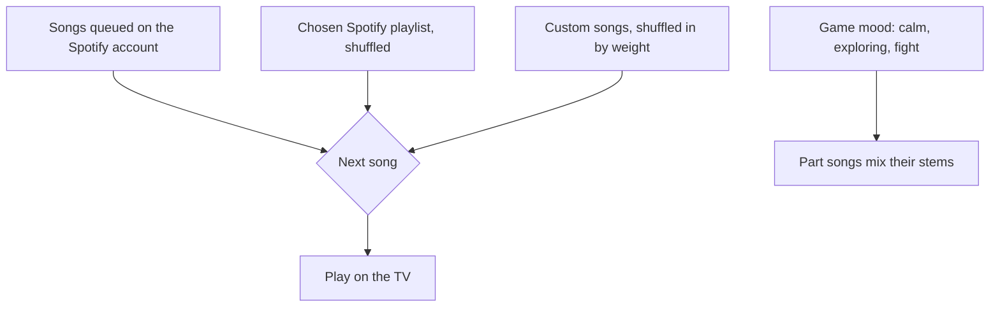

# Audio

Client audio lives in `packages/ui/src/audio/`; media is served by the server.

## Files

| File (`packages/ui/src/audio/`) | Does |
|---|---|
| `sfx/synth.ts`, `sfx/recipes/` | WebAudio recipes for every `SfxName` (`RECIPES` from `player-recipes.ts`, `monster-recipes.ts`, `world-recipes.ts`) |
| `sfx/sfx.ts`, `sfx/sfx-engine.ts` | The page's one `sfx` engine (`SfxEngine`), boosted by `SFX_BOOST` through a limiter |
| `sfx/sfx-overrides.ts` | A `sfx/<name>.mp3` from the media folder overrides a recipe |
| `sfx/ambience-loop.ts` | Plays the TV's ambience tracks in turn, each crossfading into the next over `AMBIENCE_FADE` (4s) so the loop never gaps |
| `media/media.ts` | Fetches the media manifest once (`loadMedia`) |
| `media/id3.ts` | Titles, artists, and art from mp3 tags, fetched by Range (`readId3`) |
| `music/music-player.ts` | `MusicPlayer`, the TV's music: controls over `MusicPlayback` (songs taking turns) over `MusicState` (settings, now playing, queue) |
| `music/music-queue.ts`, `music/music-ducker.ts`, `music/track-tags.ts` | What plays next, ducking, custom songs' tags |
| `music/custom-song-source.ts`, `music/spotify-source.ts` | The two `MusicSource`s: custom songs and Spotify tracks |
| `music/song-player.ts` | Plays a song's parts in step, each eased to a level from the game's mood |
| `spotify/spotify-sdk.ts`, `spotify/spotify-api.ts`, `spotify/spotify-account.ts` | Spotify Web Playback SDK, Web API calls, the account status |

The TV's sound lives in `apps/tv/src/audio/`:

| File | Does |
|---|---|
| `sound-director.ts` | `SoundDirector` turns TV snapshots, events, and tile changes into panned SFX, and sets the music mood, through its watchers |
| `sound-stage.ts` | `SoundStage`: what the watchers share (map, engine, music, last hit) and panning by map position |
| `watchers/` | One `SoundWatcher` each: `PlayerSounds` and `MonsterSounds` (both `EntityWatcher`s), `ShotSounds`, `EventSounds`, `TileSounds`, `MoodWatcher` |

## Sound effects

- **TV:** world sounds panned by map position. Guns play a heavy `gunshot` (deeper for the musket); the morning star a loud `whip-crack` as the lash lands. Each attack's hit sound is timed to its windup; brutes and ghouls growl while they hunt. A hammer job plays a swing, never a shot.
- **Phones:** a `sounds` message plays the player's own actions; hurt, death, and respawn come from vitals.

## Music

- Only one TV page plays music: the server hands it to the newest (`MusicOwner`, `server/src/net/sessions/music-owner.ts`); others go quiet and offer Play music here (`claim-music`).
- The panel's choices are `AudioSettings` in `shared/src/audio/audio-settings.ts`. Only the TV controls its music (the admin console has no Music tab). The server still relays `tv-control` to TVs and `tv-status` back, but nothing sends `tv-control` now.
- Spotify tracks play one at a time on the SDK device, fading out just before their end unless the account has something queued. Spotify pauses for custom songs.
- Songs split into parts mix with the game: all parts with nobody around, a quieter bed while exploring, drums and melody in a fight.
- Music ducks briefly under deaths and the blood moon.
- Only one song exists at a time, tracked on `globalThis`, so songs from before a hot reload are stopped too (`globalThis.graveyardMusic`, `globalThis.graveyardSongs`).

## Media

`server/media/` is not bundled (`MEDIA_DIR` in `server/src/config/paths.ts`). `mountMedia` (`net/media/media-routes.ts`) serves it at `/media` (Vite proxies it), with a manifest at `/api/media` read fresh per request (`net/media/media-manifest.ts`).

| Folder | Holds |
|---|---|
| `music/` | Single mp3s, or part folders with `cover.jpg` and an optional `meta.json` (title and artist beat ID3) |
| `sfx/` | `<name>.mp3` overrides for synth recipes |
| `ambience/` | Tracks played under everything in turn, crossfaded, at their own volume |

`server/media/music` is gitignored.

## Spotify

- `mountSpotify` (`net/spotify/spotify-routes.ts`) does the OAuth code flow; `SpotifyAccount` keeps the refresh token in `server/data/spotify.json` (`SPOTIFY_SESSION_PATH`, `SPOTIFY_SAVE` overrides), or takes `SPOTIFY_REFRESH_TOKEN` (which wins). `spotify-playlists.ts` lists the account's playlists.
- `server/.env` holds `SPOTIFY_CLIENT_ID` and `SPOTIFY_CLIENT_SECRET`.
- The TV only gets short-lived access tokens from `/api/spotify/token`. Vite proxies `/api` and `/auth`.
