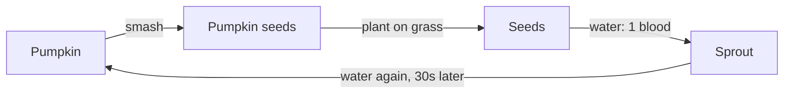
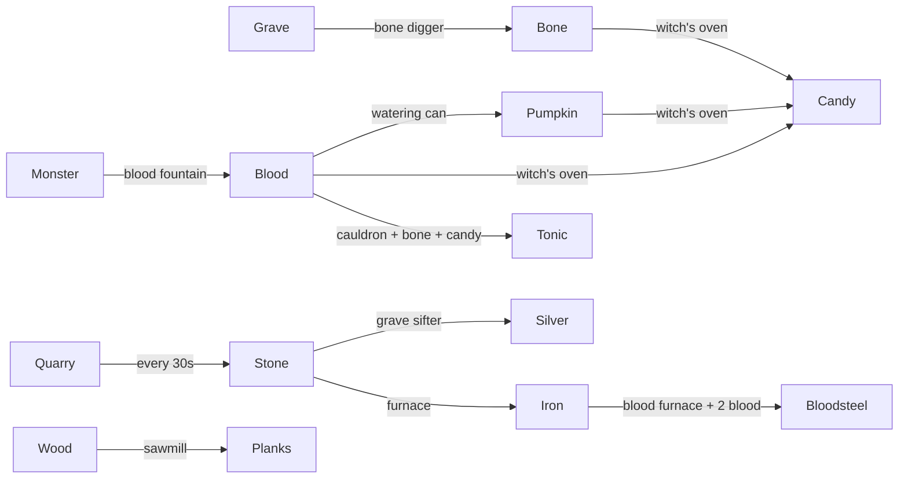

# Resources, inventory, and building

Catalog and numbers: `shared/src/goods/` (goods), `shared/src/loot/` (gatherables, graves, chests, pumpkins, monster drops), `shared/src/inventory/` (the bag), `shared/src/structures/` (`STRUCTURES` in `structure-catalog.ts`, lights, stations, traps, turrets, automation), `shared/src/crafting/` (recipes). The server side is `game/inventory/` (bag, pickups, drops, stash), `game/building/` (`BuildSystem`, `CraftSystem`), and the world's structure features (`game/world/structures/`).

## Goods

| Kind | Goods | Where they live |
|---|---|---|
| Counters | Candy, blood | Unlimited counters (`Inventory`); spent only on skill tree upgrades |
| Materials | Wood, planks, stone, iron, bolts, arrows, bone, silver, bloodsteel, tonic, ectoplasm, chain, cursed core, pumpkin, blood watering can, and the infusion essences: holy water, brute tendon, ghoul fang, hex shard, brimstone | Stacks of up to 99 in the bag |

- **The bag** has 24 slots (`BAG_SLOTS`) plus 3 equipped slots (weapon, off-hand, armor). It also holds crafted structures as stacks of up to 99. It's big on purpose: managing it isn't part of the game.
- **Picking up:** walk over piles, gear, and crates. There's no Grab button. Gear goes into the bag, never straight into a hand.
- **Dropping** a material stack leaves a pile. Candy and blood can't be dropped from the phone.
- **Infused gear** (`GearItem.infusion`) keeps its infusion everywhere it goes: bag, hands, storage chest, the ground, and saves. An infused torch is its own gear item and never folds into the torch stack (`BagSystem.store`, `HandsSystem.stackTorches` only fold plain torches). See [infusions.md](infusions.md).
- **Tonics** are drunk by tapping them in the bag (+4 hearts).
- **A blood watering can** in the bag waters pumpkin seeds (see [Pumpkin farming](#pumpkin-farming)); it's never used up.

## Where things come from

| Source | Gives |
|---|---|
| Tree | 5 hits, then 2 wood when it comes down, leaving a stump |
| Rock | 5 hits, then 3 stone |
| Hedge | 2 hits, then 1 wood |
| Grave (headstone or cross), 3 digs | 2 to 3 candy; half the time 1 to 2 wood; 80% 1 to 4 bones (`DIG_BONE_CHANCE`, `DIG_BONES`); 25% 1 to 2 stone of headstone rubble (`DIG_STONE_CHANCE`); 25% a blueprint |
| Statue / crypt / mausoleum, 5 digs | 6 to 10 / 8 to 14 / 4 to 8 candy, 1 to 4 bones, 50% a blueprint (never gear); the whole building is robbed at once and can be robbed again after 10 minutes |
| Chest, 1 hit | Raw goods only, a little better for a stronger opener (see [Chests](#chests)) |
| Pumpkin, 2 hits | 1 pumpkin and 1 to 2 pumpkin seeds (`PUMPKIN_SEEDS`); 30% 1 to 2 candy (`PUMPKIN_CANDY_CHANCE`); never gear |
| Lamp post | Breaks into an oil lantern |
| Monsters | Blood and bones (see [monsters.md](monsters.md#roster)); armored ones sometimes iron; ghosts 1 ectoplasm (`MONSTER_ECTOPLASM`), however they go, soul cages included; essences for [infusions](infusions.md) (`MONSTER_ESSENCE`): brutes always 1 brute tendon, ghouls a ghoul fang 35% of the time, witches a hex shard 50%, demons always 1 brimstone, necromancers always 1 hex shard, werewolves always 1 ghoul fang |
| Bone digger on a grave | What digging the grave by hand gives (no blueprints, `rollGrave`), every 240s at Lv 0 down to 120s at Lv 3, kept for its builder |
| Blood fountain | 0.4 blood per point of damage it slowly drains from monsters standing in it |
| Stations | Planks, iron, silver, bloodsteel, tonics, candy (witch's oven), stone (quarry) |

- **Monster drops** (blood, bones, iron scrap, the weapon it carried) go straight into the killer's bag. Kills by traps, sentries, or bleeding go to the nearest living player within 8 tiles (`MonsterSpoilsSystem.claimer`, `DROP_CLAIM_RADIUS`); only with nobody near do they land on the ground.
- Gathering pays out all at once when the node comes down. What's dug, robbed, opened, or killed goes straight into the bag (`PickupSystem.award`), a pile only for what won't fit.
- Each hammer level gathers, digs, and robs one more per swing.

### Chests

A chest holds only raw goods (`CHEST_LOOT` in `shared/src/loot/chests.ts`, rolled by `rollChest` in `server/src/game/helpers/loot-rolls.ts`). Each line rolls on its own. Chance and amount grow with the opener's player level (see [difficulty.md](difficulty.md#player-level)), counted at most to 20 (`CHEST_LEVEL_CAP`), so a chest never gets too good.

| Goods | Chance at level 0 | Per level | At most | Amount at level 0 | Top grows | Top at most |
|---|---|---|---|---|---|---|
| Wood | always | | | 1 to 3 | +1 per 5 levels | 6 |
| Candy | always | | | 1 to 4 | +1 per 7 levels | 6 |
| Stone | 50% | +1.5% | 80% | 1 to 2 | +1 per 10 levels | 3 |
| Bone | 40% | +1% | 60% | 1 to 2 | +1 per 10 levels | 3 |
| Iron | 4% | +0.8% | 20% | 1 | | |
| Silver | 1% | +0.25% | 6% | 1 | | |
| Ectoplasm | 1% | +0.15% | 4% | 1 | | |
- **Blueprints** open a random blueprint node in the finder's skill tree; the TV feed says who found what. Each player has their own chance until they've found every blueprint (`DiggingJob.findBlueprint` checks only the finder's `tree.found`).
- **Breaking structures:** any structure comes down in 3 swings in a row (`BREAK_HITS`), back into the breaker's bag as a crate (`StructureJob.knock`, `PickupSystem.pocket`). Stop for 2 seconds (`BREAK_RESET_SECONDS`) and it's whole again. Action only hits: feeding, relighting, loading, offering, watering, and collecting are USE's (below), so a swing on a station or light always breaks it down. A storage chest is the exception: swings don't touch it, and only its keeper can take it down, from its panel, once empty. Monsters still wear structures down by their hit points.
- **USE** (`UseSystem` in `server/src/game/inventory/use-system.ts`, a `use` message: the phone's USE button, right click or A on /play, A on a TV controller) acts on the first thing it finds within 2.2 tiles (`USE_REACH`) the way the player points (toward the mouse on /play, else the facing; `useTarget` in `shared/src/world/use-target.ts`, stopped by anything solid), or else the facing tile, and never hurts it:

| Facing | USE |
|---|---|
| Your own storage chest | Opens it (see [Storage chests](#storage-chests)) |
| Your own bone digger | Opens its panel: what it dug up out of 60, its next dig, and Collect (`use-collect`) |
| A station (sawmill, furnace, sifter, bloodforge, quarry, cauldron, oven) | Opens its panel: what it turns into what, batches queued out of 5 and the current one's progress, what it pulled from piles, and Feed 1 / Feed all from the bag (`use-feed`) |
| A belt sorter | Opens its panel: what goes out each side (see [Belt sorters](#belt-sorters)) |
| A research table | Opens the skill tree (`pad-menu`) |
| An anvil | Opens the Armory |
| A chest | Opens it, like a swing |
| A sleeping altar, a turret with room, seeds or a sprout with a watering can, a snuffed light | Offers, loads, waters, relights (`AltarJob`, `TurretLoadJob`, `WateringJob`, `WorldLights.relight`) |

- A digger or station panel (`UsePanel` in `shared/src/protocol/state/use-panel.ts`, sent as `using` whenever it changes, `UseSystem.refresh`) closes on Back or once the player is more than 2.5 tiles off (`STASH_REACH`).
- **Found gear** is partly worn (only matters for the stake).

## Crafting

- The phone's Craft list shows everything unlocked; tap one, pick a count (up to what you can afford), press Craft.
- What's made goes into the bag; costs come out of the bag and pockets.
- **Parts:** some structures build gear in (`StructureDef.parts`, `recipeParts`): the bolt turret and ballista each use up a crossbow. It must be a plain (uninfused) one in the bag, not in hand (`partsCount`, `CraftSystem.craft`). Cost rows show it with the materials, red when you don't carry it.
- **Prices** are set so a base takes a grind: walls and doors 4 wood, spikes 5 wood and 2 stone, a campfire 12 wood and 12 stone. Every turret needs iron, and the stronger ones (flamethrower, ballista, blood sentry) silver too; the flamethrower also needs brimstone, which only demons drop.
- **Material recipes** (`MAT_RECIPES`) make a stack of a material:

| Recipe | Cost | Makes | Opens with | Anvil |
|---|---|---|---|---|
| Arrows | 1 wood | 4 | start | |
| Bolts | 1 wood | 3 | CrossBones (`opens`) | |
| Chain | 2 iron | 1 | Anvil | yes |
| Cursed core | 1 bloodsteel, 1 silver | 1 | Anvil | yes |
| Blood watering can | 2 iron, 1 bone | 1 | Witch's oven | |
| Holy water | 1 silver, 4 blood | 1 | Grave sifter | |

- **The anvil:** late gear and parts (`needsAnvil`: chain, cursed cores, and weapons marked "(anvil)" in [weapons.md](weapons.md)) are only crafted within `ANVIL_RADIUS` (2.5) of an anvil. Each level of the best anvil in reach takes `ANVIL_DISCOUNT_PER_LEVEL` (15%) off their materials, rounded up (`anvilCost`, used by `craftCost` and by `infusionCost`). The phone gets the anvil's level with its inventory (`Carried.anvil`), dims what it can't make, and the details say "Craft beside an anvil".
- **Infusing:** an anvil also infuses weapons, the shield, and the torch with silver and an essence (`CraftSystem.infuse`, the Armory panel). No skill tree unlock is needed. See [infusions.md](infusions.md#infusing).
- Structures are placed from the bag. See [phone.md](phone.md#building).

## Structures

HP grows 30% per builder level. Each structure keeps its builder's level.

### Fortifications

| Structure | Cost | HP | Unlock | Notes |
|---|---|---|---|---|
| Fence | 2 wood | 10 | start | Cheap low barrier |
| Wood wall | 4 wood | 20 | Fence Lv 1 | Zombies chew through it |
| Door | 4 wood | 20 | Fence Lv 1 | Players pass, monsters don't (vampires smash it) |
| Scarecrow | 10 wood, 2 stone, 5 blood, 5 candy | 30 | Fence Lv 1 | Decoy: zombies within 8 tiles go for it first |
| Spikes | 5 wood, 2 stone | 15 | Fence Lv 1 | 2 dmg/s to monsters standing on it (+30% a level) |
| Iron spikes | 2 iron, 4 wood, 2 stone | 30 | Spikes Lv 1 | Twice the damage |
| Barbed wire | 4 wood, 1 iron | 20 | Spikes Lv 1 | Barely cuts; monsters slowed to 40%, players to 60% unharmed |
| Platform | 6 wood | 25 | Wood wall Lv 1 | Wooden deck a level up, climbed by steps |
| Steps | 3 wood | 15 | Wood wall Lv 1 | Ramp up to the highest tile beside it |
| Palisade | 4 wood | 35 | Wood wall Lv 1 | Zombies that chew it take 1 damage a bite |
| Stone wall | 6 stone | 50 | Palisade Lv 1 | |
| Bone wall | 6 bone, 2 stone | 70 | Stone wall Lv 1 | |

### Turrets

Weakest to strongest. Each acts on its own every `cooldown` against monsters in range (`TURRETS`, `TurretSystem.fireTurrets`, each firing through a `TurretFire`: `ShotTurretFire`, `SweepTurretFire`, `FlameTurretFire`), never hurts players, never targets a risen ally (Grave Fists, see [infusions.md](infusions.md)), and gives its kills to the nearest player like a trap. Damage grows 20% a level (`turretDamage`).

| Turret | Cost | HP | Unlock | Ammo | Does |
|---|---|---|---|---|---|
| Bolt turret | 6 planks, 4 iron, 1 crossbow | 25 | Spikes Lv 1 | 1 bolt a shot (holds 30) | Shoots the nearest monster within 6 tiles every 1.5s for 4.5 |
| Sword swiper | 6 planks, 8 iron, 4 bone | 40 | Bolt turret Lv 1 | none | Blades sweep round every 1s, hitting every monster within 1.5 tiles for 3 |
| Blood sentry | 1 cursed core, 6 iron, 2 silver, 4 bone, 4 planks | 30 | Blunderbuss Lv 1 | 1 blood for 3 shots (holds 30) | Shoots the nearest within 6 tiles every 1.2s for 3 |
| Flamethrower | 8 iron, 6 stone, 4 planks, 1 silver, 1 brimstone | 35 | Bolt turret Lv 2 | 1 wood for 6 gouts (holds 48) | Every 0.35s, fire hits every monster within 3.5 tiles and 0.45 rad of the nearest for 0.7, and sets them burning (the same burn status as Enflamed weapons: 1.5 a second for 2s, `FLAME_BURN_SECONDS`, not ghosts) |
| Ballista | 8 planks, 10 iron, 2 chain, 2 silver, 1 crossbow (anvil) | 45 | Bolt turret Lv 3 | 1 bolt a shot (holds 20) | A huge bolt at the nearest within 9 tiles every 2.5s for 18, piercing 3 more |

- **Loading:** USE on a turret spends one ammo from the bag (or pockets, for blood) for a load, if a whole load still fits (`TurretAmmo.load`).
- **Feeding:** a turret also loads itself from piles within `STATION_REACH` (`TurretAmmo.tick`), so a conveyor belt ending at it keeps it stocked.
- Shooters fire real shots (bolts count as crossbow bolts, so holy x3 to vampires). Swipers and flamethrowers hit directly; the TV shows a whirl of blade glints or a gout of fire (`turret` events).

### Lights

Lights never burn out. A ghost can snuff one, and a blood moon puts them all out (see [world-events.md](world-events.md)); USE relights it for free. Each upgrade widens a light 15% and brightens it 10%.

| Light | Cost | HP | Radius | Unlock | Notes |
|---|---|---|---|---|---|
| Torch | 2 wood | 5 | 3 | start | Also held in the off hand |
| Oil lantern | 2 wood, 2 stone | 15 | 4.5 | Torch Lv 1 | |
| Ghost lamp | 1 iron, 2 bone, 1 silver, 1 ectoplasm | 25 | 6 | Oil lantern Lv 1 | Ghosts can't snuff it |
| Campfire | 12 wood, 12 stone | 30 | 6.5 | blueprint | Heals within 2 tiles: all 10 hearts in a minute (1 per 6s, `CAMPFIRE_HEAL_PER_SECOND`), 10% faster a level (`CAMPFIRE_HEAL_PER_LEVEL`) |
| Soul fire | 10 stone, 6 bone, 8 blood | 45 | 8.5 | Campfire Lv 1 | Ghostproof, heals like a campfire |

Vampires won't enter the brighter 75% of any light. Pumpkins and lamp posts light the map too.

### Tables and stations

| Structure | Cost | HP | Unlock | Does |
|---|---|---|---|---|
| Research table | 12 wood, 6 stone | 30 | start | Upgrades within 2.5 tiles cost 25% less (+10% a level) |
| Storage chest | 12 wood | 30 | start | 16 slots of private storage; see below |
| Coffin | 15 wood | 30 | blueprint | Its builder respawns beside it |
| Sawmill | 16 wood, 8 stone | 30 | Research table Lv 1 | 1 wood in, 1 plank every 4s |
| Furnace | 20 stone, 8 wood | 40 | Research table Lv 2 | 1 stone in, 1 iron every 6s |
| Grave sifter | 12 wood, 8 planks | 25 | Furnace Lv 1 | 2 stone in, 1 silver every 7s |
| Bone digger | 12 bone, 12 wood, 1 iron | 25 | Sawmill Lv 1 | Only goes on a grave (`DIGGER_FLOORS`). Digs it again every `DIGGER_SECONDS` (240s, about as long as a dug grave takes to fill; a third faster per level, twice as fast at Lv 3, `diggerSeconds`), turning up what digging the grave by hand would (`rollGrave`, no blueprints; about 2 bones a dig, so 1 bone a minute at Lv 3). It hands that to a station in reach or a belt leading away, else keeps it (`hoard`, up to `DIGGER_CAPACITY` 60 goods, then it stops digging). Its builder collects everything from its USE panel; broken, it spills its hoard for them alone. The grave under it can't be dug by hand until the digger is broken off, and a mound under it starts filling again |
| Conveyor belt | 1 planks, 1 iron | 15 | Sawmill Lv 1 | Walkable; carries one thing to a tile the way it was laid, pulling from chests, diggers, and stations behind it (see [Automation](#automation)) |
| Belt sorter | 2 planks, 1 iron | 15 | Conveyor belt Lv 1 | Walkable; a belt tile that sends the things you pick out other sides (see [Automation](#automation)) |
| Quarry | 8 iron, 4 chain, 16 planks | 50 | Furnace Lv 2 | Takes nothing; cuts 1 stone every 30s for good (a station with an empty input, so it keeps its own queue full) |
| Anvil | 12 iron, 12 stone | 50 | Furnace Lv 1 | Late gear and parts are crafted beside it (see [Crafting](#crafting)) |

Stations work 50% faster per level and glow while working.

### Occult

| Structure | Cost | HP | Unlock | Does |
|---|---|---|---|---|
| Effigy | 6 wood, 2 bone | 20 | start | Slows monsters within 3 tiles (+0.5 a level) to 70% |
| Cauldron | 12 stone, 8 wood, 4 bone | 30 | Effigy Lv 1 | 3 candy, 1 blood, and 1 bone in, 1 tonic every 6s |
| Soul cage | 3 iron, 5 bone, 1 silver | 35 | Cauldron Lv 1 | Destroys a ghost within 3 tiles (+0.5 a level), one every 6s |
| Sacrificial altar | 6 stone, 4 bone | 40 | Effigy Lv 1 | USE on a sleeping altar offers 2 hearts (never your last) as a fresh wound (`Player.wound`) and wakes it for 60s (while awake, swings break it down instead) (`ALTAR_AWAKE_SECONDS`), its trough filling with glowing blood. It gives no blood itself: monsters dying within 4 tiles of an awake altar bleed x2 (+0.5 a level, `altarBleed`, `StructureQueries.awakeAltarNear`) |
| Blood furnace | 16 stone, 8 iron | 40 | Altar Lv 1 | 1 iron and 2 blood in, 1 bloodsteel every 8s |
| Blood fountain | 4 stone, 2 cursed cores, 2 bloodsteel, 8 blood | 40 | Altar Lv 2 | A basin monsters walk into (a trap, `TRAPS`): slowly drains 0.5 damage a second (+30% a level) from each monster in it and pumps out 0.4 blood per damage (`FOUNTAIN_BLOOD`, `Fountains.pump`), about 12 blood a minute per monster held in it. Monsters path around it if they can, so lure them through. Heals players like a campfire, never hurts them. Holds one monster at a time as its victim (see [The blood fountain's victim](#the-blood-fountains-victim)) |
| Witch's oven | 16 stone, 4 iron, 8 bone | 40 | Cauldron Lv 1 | 1 pumpkin, 2 bone, and 1 blood in, 4 candy every 10s |
| Cursed obelisk | 8 stone, 4 bone | 60 | Effigy Lv 2 | Monsters within 4 tiles (+0.5 a level) take 25% more damage |
| Silver bell | 2 silver, 1 wood, 1 ectoplasm | 20 | Grave sifter Lv 1 | Ghosts can't come within 3.5 tiles (+0.5 a level) |
| Blood sentry | 1 cursed core, 6 iron, 2 silver, 4 bone, 4 planks | 30 | Blunderbuss Lv 1 | A turret (see [Turrets](#turrets)): 1 blood loads 3 shots (holds 30); shoots monsters within 6 tiles every 1.2s for 3 damage (+20% a level); never hits players |

Glowing occult works are `GHOSTPROOF`.

The cursed mirror is gone. A save that still has one loads it as grass (the save loader turns tiles that no longer exist into grass and drops their structure state), and a `build:mirror` tree node in a character save is dropped.

### The blood fountain's victim

- **Holding:** the first bodied monster standing in a fountain becomes its victim (`Fountains.hold`, called from `Monster.update` beside `Fountains.pump`). It stays the victim while it keeps standing there, and for `VICTIM_HOLD` (0.5s, `server/src/game/world/config/fountains.ts`) after, so a knockback doesn't let it go. Only then can another monster in the fountain take its place.
- **Catching:** a new victim sends a `catch` game event (tile and monster kind), which the TV plays as `fountain-catch`, panned to the fountain (see [audio.md](audio.md)).
- **On the wire:** the state message carries `victims` (`VictimState`: tile index, monster id, kind; `Fountains.victimStates`), left out when no fountain holds anything, and cut to the interest radius on huge worlds like lights.
- **On the TV:** a fountain's basins are painted dry and dark (`BloodFountainPainter`). While it holds a victim, `FountainVictims` (`packages/renderer/src/effects/fountain-victims.ts`) fills them with blood, adds the spout's trickle, and floats the victim's own head in front of the spout, built like its avatar (`Avatar.head` of a fresh `createMonsterAvatar` from the monster's state, so a zombie keeps its skin, hair, and helmet), bobbing and rocking gently (`effects/config/fountain-victims.ts`). The victim's body is hidden while it's held (`MonsterAvatars`), and shows again if it walks out, is lifted by the TV's mouse, or bursts apart when it dies.

## Pumpkin farming

- Pumpkin seeds are a stack of structures (`seeds`, `StructureDef.wild`: never in the Craft list or the tree), planted from the bag on grass only.
- USE on seeds or a sprout with a blood watering can in the bag spends `WATER_BLOOD` (1) blood from the pockets to water it (`Gardens.water`). Each watering must wait `GROW_SECONDS` (30) after the last; too soon just errors.
- Without a can, a hit picks the seeds (or the sprout, as seeds) back up.
- The grown pumpkin is a normal pumpkin: smash it for a pumpkin and more seeds.

## Storage chests

A storage chest (`stash`) belongs to whoever built it, by name (`StructureState.keeper`), so it survives a restart and nobody else can open or damage it.

| Action | Result |
|---|---|
| USE on your own chest | Opens it on the phone (`StashPanel`): your bag on the left, the chest on the right (a swing does nothing to it) |
| Tap an item on either side | Moves it across, onto matching stacks first (`StashSystem.stashMove`, `putInto`) |
| Pick up (only when empty) | Takes the chest back as a crate |
| Walk more than 2.5 tiles away | Closes it (`STASH_REACH`) |
| Monsters break it | Its contents spill around it for the owner alone (`StructureDamage.takeSpilledStashes`) |

Contents are saved with the world (`StructureState.stash`).

## Wall looks and rotation

Wood walls, stone walls, and bone walls come in a few looks to build in (`WALL_STYLES`, `shared/src/structures/wall-styles.ts`). Only the look changes: health, cost, and collision are the same.

| Wall | Looks |
|---|---|
| Wood wall | Upright planks, Boarded up (boards nailed across two posts behind an X brace), Stacked logs |
| Stone wall | Laid brick, Fieldstone (rough stones under a capstone), Crumbling ruin (stones missing, moss on its face, fallen bricks in front) |
| Bone wall | Packed bones, Ribcage (ribs hung from a spine), Skull pile |

- While building one, a popup lists every look, each drawn by the wall's own painter (icon key `style:<wall>:<n>`) with its name, the picked one outlined (`WallStylePopup` in `packages/game-ui`): bottom left on the phone (tap one to pick it), bottom right on /play (G or the D-pad's left and right step through them; clicking one picks it too).
- **The preview is the wall itself:** where it'll go, the TV and /play draw the wall in the picked look, turned, and joined to the walls beside the spot, a little see-through (`WallGhosts`, painted once per look, way, and neighbors and kept), instead of the white box other structures get. Where it can't go, it's the light red box as before. The pick reaches every screen as `PlayerState.buildStyle`. The pick is kept per wall on the device (`useWallStyle`, `WALL_STYLE_STORAGE_KEY`) and sent as `build-style` (`ControlSystem.pickStyle`, `PlayerKit.buildStyles`).
- **Rotating walls:** walls are `TURNED` like belts, so they're placed facing the builder's facing or the way they rotated it. A wall standing alone runs across the way it faces; a wall that joins others runs along them as before (`WallPainter.runs`), and its facing picks which side the front is (skulls, the X brace, moss, and fallen stones face out, `WallPainter.wallRuns`).
- **Where the look lives:** in the tile's turn, one number per tile: 0 for none, else 1 + the way + 4 x the look (`turnCode`, `turnDir`, `turnStyle` in `shared/src/world/ramps.ts`, at most `MAX_STYLES` 8 looks). So it saves, loads, and reaches every screen wherever the turn does (chunk files, presets, the `world` message, `TileChange.turn`). `TileGrid.styleOf` reads it; `encodeRamps` writes one base-36 digit per tile.

## Automation

A station pulls what it needs from piles within 1.6 tiles of its middle (`STATION_REACH`), and hands what it makes to another station that close which takes it. Otherwise, with a belt beside it leading away, it holds what it made for the belt to pull (`StructureState.out`, up to `OUTPUT_HOLD` 10; a full station stops working until the belt takes some), else drops it beside itself. Each holds up to two batches of each input waiting, plus a queue of 5. Bone diggers and blood fountains hand off the same way (`StationOutput.deliver`); when their hold is full they drop the rest beside them.

### Belts

- **Laying:** belts (`belt`) and sorters (`sorter`) are laid facing the way they carry (the builder's facing, or the way they rotated it, `PlayerKit.buildFacing`, snapped to a side, kept as the tile's turn: `TURNED`, `TileGrid.turnOf`, sent with tile changes as `TileChange.turn`).
- **One thing to a tile:** a belt or sorter tile (`CONVEYORS`) holds one thing: a pile, or a dropped piece of gear or stack. It moves `BELT_SPEED` (1.5) tiles a second, pulled to the middle, and passes to the next tile only if that one is free (`Conveyor.convey`). Otherwise it waits at the edge, and so does everything behind it: the line jams.
- **Pulling:** every `BELT_PULL_SECONDS` (0.6s), an empty belt takes one thing out of whatever is behind or beside it, never in front where it leads (`Conveyor.pull`): what a station, digger, or fountain holds for it, a bone digger's hoard, then the first thing in a storage chest. Goods come out up to `BELT_PULL_STACK` (10) of one kind at a time; a chest gives a whole slot. A jammed line's first belt is never empty, so it stops pulling. Whoever has the chest open sees it empty (`StashSystem.refreshTouched`).
- **The end of a line:** things run off onto open floor, or wait at the edge of anything solid, where a station takes them in (and while it can't, the line jams).
- Players and monsters walk over belts; players still pick up what they walk over.

### Belt sorters

A sorter is a belt tile that sends each thing out the side picked for it, and everything else straight on (its forward side). USE on one opens its panel: one row per side, Up, Down, Left, and Right as seen on the TV, each with what goes that way (`SorterPanel`, `use-route`, `UseSystem.route`).

- **What you can pick:** only things you've unlocked (`sortableKeys` in `shared/src/structures/sorting.ts`): gear, structures, and materials whose skill tree node is open, goods everyone knows from the start (`KNOWN_GOODS`: wood, stone, bone, pumpkins, ectoplasm), and candy and blood. So the list gives nothing away. The server checks it too.
- **One side each:** a thing goes out one side; picking it for another takes it off the first. The forward side takes everything else and can't be set.
- **What a thing is:** a dropped piece of gear or stack is its own item; a pile is the good there's most of (`sortKeyOf`).
- Routes are saved with the sorter (`StructureState.routes`) and repaired on loading like everything else (`reviveRoutes`).

So a bone digger on a grave and a blood fountain at a chokepoint, belted into a witch's oven, turn graves, monsters, and pumpkins into candy on their own.
