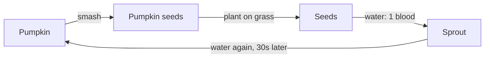
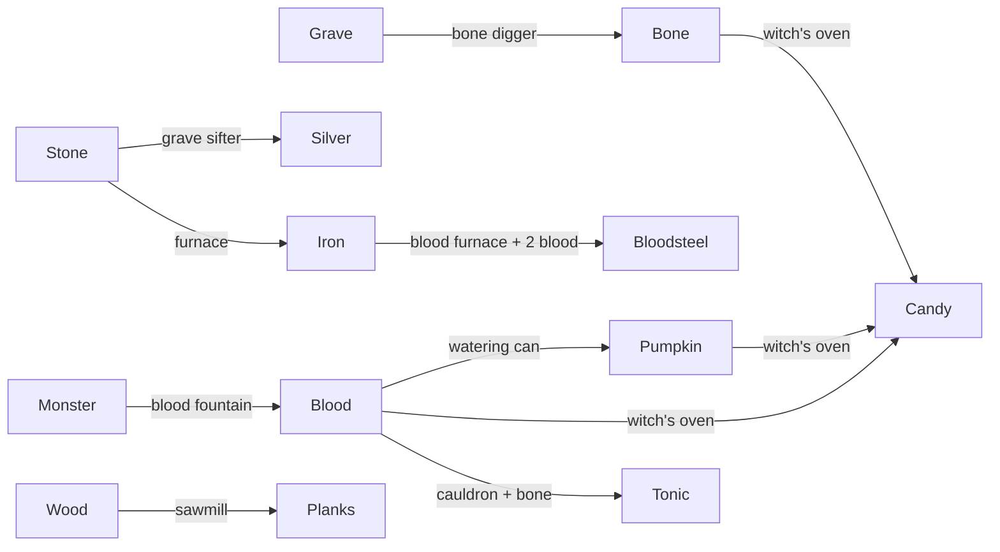

# Resources, inventory, and building

Catalog and numbers: `shared/src/goods/` (goods), `shared/src/loot/` (gatherables, graves, chests, pumpkins, monster drops), `shared/src/inventory/` (the bag), `shared/src/structures/` (`STRUCTURES` in `structure-catalog.ts`, lights, stations, traps, turrets, automation), `shared/src/crafting/` (recipes). The server side is `game/inventory/` (bag, pickups, drops, stash), `game/building/` (`BuildSystem`, `CraftSystem`), and the world's structure features (`game/world/structures/`).

## Goods

| Kind | Goods | Where they live |
|---|---|---|
| Counters | Candy, blood | Unlimited counters (`Inventory`); spent only on skill tree upgrades |
| Materials | Wood, planks, stone, iron, bolts, arrows, bone, silver, bloodsteel, tonic, ectoplasm, chain, cursed core, pumpkin, blood watering can | Stacks of up to 99 in the bag |

- **The bag** has 24 slots (`BAG_SLOTS`) plus 3 equipped slots (weapon, off-hand, armor). It also holds crafted structures as stacks of up to 99. It's big on purpose: managing it isn't part of the game.
- **Picking up:** walk over piles, gear, and crates. There's no Grab button. Gear goes into the bag, never straight into a hand.
- **Dropping** a material stack leaves a pile. Candy and blood can't be dropped from the phone.
- **Tonics** are drunk by tapping them in the bag (+4 hearts).
- **A blood watering can** in the bag waters pumpkin seeds (see [Pumpkin farming](#pumpkin-farming)); it's never used up.

## Where things come from

| Source | Gives |
|---|---|
| Tree | 5 hits, then 2 wood when it comes down, leaving a stump |
| Rock | 5 hits, then 2 stone |
| Hedge | 2 hits, then 1 wood |
| Grave (headstone or cross), 3 digs | 2 to 5 candy; half the time 1 to 2 wood; 60% 1 to 3 bones; 25% a blueprint |
| Statue / crypt / mausoleum, 5 digs | 6 to 10 / 8 to 14 / 4 to 8 candy, bones, 30% gear, 50% a blueprint; robbed again after 10 minutes |
| Chest, 1 hit | A piece of gear, wood, candy, and sometimes bolts |
| Pumpkin, 2 hits | 1 pumpkin and 1 to 2 pumpkin seeds (`PUMPKIN_SEEDS`); 4% chance of hidden gear |
| Lamp post | Breaks into an oil lantern |
| Monsters | Blood and bones (see [monsters.md](monsters.md#roster)); armored ones sometimes iron; ghosts 1 ectoplasm (`MONSTER_ECTOPLASM`), however they go, soul cages included |
| Bone digger on a grave | 1 to 3 bones every 120s (faster with levels), 5% of the time 1 to 2 candy too |
| Blood fountain | 1 blood per point of damage it drains from monsters standing in it |
| Stations | Planks, iron, silver, bloodsteel, tonics, candy (witch's oven) |

- **Monster drops** (blood, bones, iron scrap, junk) go straight into the killer's bag. Kills by traps, sentries, or bleeding go to the nearest living player within 8 tiles (`MonsterSpoilsSystem.claimer`, `DROP_CLAIM_RADIUS`); only with nobody near do they land on the ground.
- Gathering pays out all at once when the node comes down. What's dug, robbed, opened, or killed goes straight into the bag (`PickupSystem.award`), a pile only for what won't fit.
- Each hammer level gathers, digs, and robs one more per swing.
- **Blueprints** open a random blueprint node in the finder's skill tree; the TV feed says who found what.
- **Breaking your own structures** puts them back in your bag as a crate (`PickupSystem.pocket`). Built lights come down in one hit.
- **Found gear** is partly worn (only matters for the stake).

## Crafting

- The phone's Craft list shows everything unlocked; tap one, pick a count (up to what you can afford), press Craft.
- What's made goes into the bag; costs come out of the bag and pockets.
- **Material recipes** (`MAT_RECIPES`) make a stack of a material:

| Recipe | Cost | Makes | Opens with | Anvil |
|---|---|---|---|---|
| Arrows | 1 wood | 4 | start | |
| Bolts | 1 wood | 3 | start | |
| Chain | 2 iron | 1 | Anvil | yes |
| Cursed core | 1 bloodsteel, 1 silver | 1 | Anvil | yes |
| Blood watering can | 2 iron, 1 bone | 1 | Witch's oven | |

- **The anvil:** late gear and parts (`needsAnvil`: chain, cursed cores, and weapons marked "(anvil)" in [weapons.md](weapons.md)) are only crafted within `ANVIL_RADIUS` (2.5) of an anvil. Each level of the best anvil in reach takes `ANVIL_DISCOUNT_PER_LEVEL` (15%) off their materials, rounded up (`craftCost`). The phone gets the anvil's level with its inventory (`Carried.anvil`), dims what it can't make, and the details say "Craft beside an anvil".
- Structures are placed from the bag. See [phone.md](phone.md#building).

## Structures

HP grows 30% per builder level. Each structure keeps its builder's level.

### Fortifications

| Structure | Cost | HP | Unlock | Notes |
|---|---|---|---|---|
| Fence | 1 wood | 10 | start | Cheap low barrier |
| Wood wall | 1 wood | 20 | Fence Lv 1 | Zombies chew through it |
| Door | 2 wood | 20 | Fence Lv 1 | Players pass, monsters don't (vampires smash it) |
| Scarecrow | 2 wood | 30 | Fence Lv 1 | Decoy: zombies within 8 tiles go for it first |
| Spikes | 1 wood, 1 stone | 15 | Fence Lv 1 | 2 dmg/s to monsters standing on it (+30% a level) |
| Iron spikes | 1 wood, 2 iron | 30 | Spikes Lv 1 | Twice the damage |
| Barbed wire | 1 wood, 1 iron | 20 | Spikes Lv 1 | Barely cuts; monsters slowed to 40%, players to 60% unharmed |
| Platform | 2 wood | 25 | Wood wall Lv 1 | Wooden deck a level up, climbed by steps |
| Steps | 1 wood | 15 | Wood wall Lv 1 | Ramp up to the highest tile beside it |
| Palisade | 3 planks | 35 | Wood wall Lv 1 | Zombies that chew it take 1 damage a bite |
| Stone wall | 2 stone | 50 | Palisade Lv 1 | |
| Bone wall | 4 bone, 1 stone | 70 | Stone wall Lv 1 | |

### Turrets

Weakest to strongest. Each acts on its own every `cooldown` against monsters in range (`TURRETS`, `TurretSystem.fireTurrets`, each firing through a `TurretFire`: `ShotTurretFire`, `SweepTurretFire`, `FlameTurretFire`), never hurts players, and gives its kills to the nearest player like a trap. Damage grows 20% a level (`turretDamage`).

| Turret | Cost | HP | Unlock | Ammo | Does |
|---|---|---|---|---|---|
| Bolt turret | 2 wood, 2 planks, 1 stone | 25 | Spikes Lv 1 | 1 bolt a shot (holds 30) | Shoots the nearest monster within 6 tiles every 1.5s for 2 |
| Sword swiper | 2 planks, 3 iron, 1 bone | 40 | Bolt turret Lv 1 | none | Blades sweep round every 1s, hitting every monster within 1.5 tiles for 3 |
| Blood sentry | see [Occult](#occult) | 30 | Blunderbuss Lv 1 | 1 blood for 3 shots (holds 30) | Shoots the nearest within 6 tiles every 1.2s for 3 |
| Flamethrower | 3 stone, 3 iron, 2 planks | 35 | Bolt turret Lv 2 | 1 wood for 6 gouts (holds 48) | Every 0.35s, fire hits every monster within 3.5 tiles and 0.45 rad of the nearest for 0.7, and sets them burning (1.5 a second for 2s, not ghosts) |
| Ballista | 4 planks, 4 iron, 2 chain (anvil) | 45 | Bolt turret Lv 3 | 1 bolt a shot (holds 20) | A huge bolt at the nearest within 9 tiles every 2.5s for 12, piercing 3 more |

- **Loading:** Action on a turret spends one ammo from the bag (or pockets, for blood) for a load, if a whole load still fits (`TurretAmmo.load`).
- **Feeding:** a turret also loads itself from piles within `STATION_REACH` (`TurretAmmo.tick`), so a conveyor belt ending at it keeps it stocked.
- Shooters fire real shots (bolts count as crossbow bolts, so holy x3 to vampires). Swipers and flamethrowers hit directly; the TV shows a whirl of blade glints or a gout of fire (`turret` events).

### Lights

Lights never burn out. A ghost can snuff one; Action relights it for free. Each upgrade widens a light 15% and brightens it 10%.

| Light | Cost | HP | Radius | Unlock | Notes |
|---|---|---|---|---|---|
| Torch | 1 wood | 5 | 3 | start | Also held in the off hand |
| Oil lantern | 1 wood, 1 stone | 15 | 4.5 | Torch Lv 1 | |
| Ghost lamp | 1 iron, 2 bone, 1 silver, 1 ectoplasm | 25 | 6 | Oil lantern Lv 1 | Ghosts can't snuff it |
| Campfire | 2 wood, 2 stone | 30 | 6.5 | blueprint | Heals 1 heart per 4s within 2 tiles |
| Soul fire | 2 stone, 4 bone, 2 blood | 45 | 8.5 | Campfire Lv 1 | Ghostproof, heals like a campfire |

Vampires won't enter the brighter 75% of any light. Pumpkins and lamp posts light the map too.

### Tables and stations

| Structure | Cost | HP | Unlock | Does |
|---|---|---|---|---|
| Research table | 2 wood, 1 stone | 30 | start | Upgrades within 2.5 tiles cost 25% less (+10% a level) |
| Storage chest | 3 wood | 30 | start | 16 slots of private storage; see below |
| Coffin | 4 planks, 2 bone | 30 | blueprint | Its builder respawns beside it |
| Sawmill | 2 wood, 1 stone | 30 | Research table Lv 1 | 1 wood in, 1 plank every 4s |
| Furnace | 3 stone, 1 wood | 40 | Research table Lv 2 | 1 stone in, 1 iron every 6s |
| Grave sifter | 2 wood, 2 planks | 25 | Furnace Lv 1 | 2 stone in, 1 silver every 7s |
| Bone digger | 3 bone, 2 wood, 1 iron | 25 | Sawmill Lv 1 | Only goes on a grave (`DIGGER_FLOORS`). Digs it again every `DIGGER_SECONDS` (120s, about as long as a grave takes to fill): 1 to 3 bones, rarely candy |
| Conveyor belt | 1 planks, 1 iron | 15 | Sawmill Lv 1 | Walkable; carries whatever lies on it the way it was laid (see [Automation](#automation)) |
| Anvil | 4 iron, 2 stone | 50 | Furnace Lv 1 | Late gear and parts are crafted beside it (see [Crafting](#crafting)) |

Stations work 50% faster per level and glow while working.

### Occult

| Structure | Cost | HP | Unlock | Does |
|---|---|---|---|---|
| Effigy | 2 wood, 1 bone | 20 | start | Slows monsters within 3 tiles (+0.5 a level) to 70% |
| Cauldron | 2 stone, 2 wood, 1 bone | 30 | Effigy Lv 1 | 2 blood and 1 bone in, 1 tonic every 6s |
| Soul cage | 2 iron, 3 bone, 1 silver | 35 | Cauldron Lv 1 | Destroys a ghost within 3 tiles (+0.5 a level), one every 6s |
| Sacrificial altar | 2 stone, 2 bone | 40 | Effigy Lv 1 | Action offers 2 hearts (never your last) for 3 blood (+1 a level); monsters dying within 4 tiles bleed double |
| Blood furnace | 3 stone, 2 iron | 40 | Altar Lv 1 | 1 iron and 2 blood in, 1 bloodsteel every 8s |
| Blood fountain | 3 stone, 1 cursed core, 4 blood | 40 | Altar Lv 2 | A basin monsters walk into (a trap, `TRAPS`): drains 1 damage a second (+30% a level) from each monster in it and pumps out that much blood (`FOUNTAIN_BLOOD`, `Fountains.pump`). Monsters path around it if they can, so lure them through. Heals players like a campfire, never hurts them |
| Witch's oven | 4 stone, 1 iron, 2 bone | 40 | Cauldron Lv 1 | 1 pumpkin, 2 bone, and 1 blood in, 4 candy every 10s |
| Cursed obelisk | 3 stone, 2 bone | 60 | Effigy Lv 2 | Monsters within 4 tiles (+0.5 a level) take 25% more damage |
| Cursed mirror | 2 planks, 1 stone, 2 silver, 2 ectoplasm | 25 | Obelisk Lv 1 | Turns hostile shots within 1.6 tiles back on monsters; shatters potions |
| Silver bell | 2 silver, 1 wood, 1 ectoplasm | 20 | Grave sifter Lv 1 | Ghosts can't come within 3.5 tiles (+0.5 a level) |
| Blood sentry | 1 cursed core, 2 iron, 3 bone, 3 planks | 30 | Blunderbuss Lv 1 | A turret (see [Turrets](#turrets)): 1 blood loads 3 shots (holds 30); shoots monsters within 6 tiles every 1.2s for 3 damage (+20% a level); never hits players |

Glowing occult works are `GHOSTPROOF`.

## Pumpkin farming

- Pumpkin seeds are a stack of structures (`seeds`, `StructureDef.wild`: never in the Craft list or the tree), planted from the bag on grass only.
- Action on seeds or a sprout with a blood watering can in the bag spends `WATER_BLOOD` (1) blood from the pockets to water it (`Gardens.water`). Each watering must wait `GROW_SECONDS` (30) after the last; too soon just errors.
- Without a can, a hit picks the seeds (or the sprout, as seeds) back up.
- The grown pumpkin is a normal pumpkin: smash it for a pumpkin and more seeds.

## Storage chests

A storage chest (`stash`) belongs to whoever built it, by name (`StructureState.keeper`), so it survives a restart and nobody else can open or damage it.

| Action | Result |
|---|---|
| ACT on your own chest | Opens it on the phone (`StashPanel`): your bag on the left, the chest on the right |
| Tap an item on either side | Moves it across, onto matching stacks first (`StashSystem.stashMove`, `putInto`) |
| Pick up (only when empty) | Takes the chest back as a crate |
| Walk more than 2.5 tiles away | Closes it (`STASH_REACH`) |
| Monsters break it | Its contents spill around it for the owner alone (`StructureDamage.takeSpilledStashes`) |

Contents are saved with the world (`StructureState.stash`).

## Automation

A station pulls what it needs from piles within 1.6 tiles of its middle (`STATION_REACH`), and hands what it makes to another station that close which takes it, else onto a belt beside it leading away, else drops it beside itself. Each holds up to two batches of each input waiting, plus a queue of 5. Bone diggers and blood fountains hand off the same way (`StationOutput.deliver`).

- **Conveyor belts** (`belt`) are laid facing the way they carry (the builder's facing, or the way they rotated it with R or LB / RB, `PlayerKit.buildFacing`, snapped to a side, kept as the tile's turn: `TURNED`, `TileGrid.turnOf`, sent with tile changes as `TileChange.turn`).
- Everything lying on a belt (piles of any goods, blood and candy included, and dropped gear) moves `BELT_SPEED` (1.5) tiles a second along it and is pulled to its middle (`Conveyor.convey`). At the end it runs off onto open floor, or waits at the edge of anything solid, where a station takes it in.
- Players and monsters walk over belts; players still pick up what they walk over.

So a bone digger on a grave and a blood fountain at a chokepoint, belted into a witch's oven, turn graves, monsters, and pumpkins into candy on their own.
