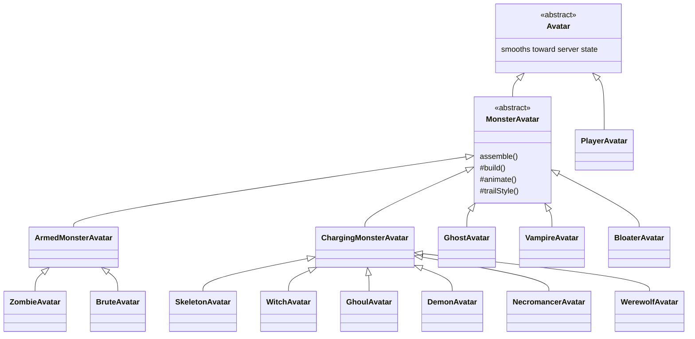
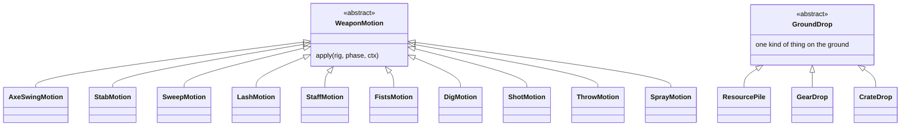
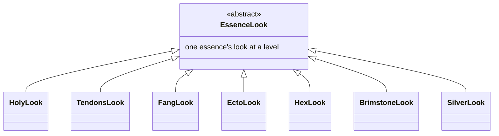
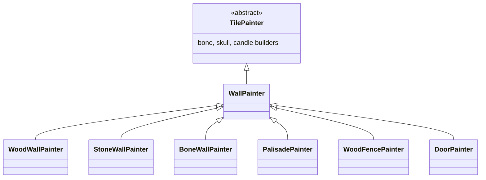
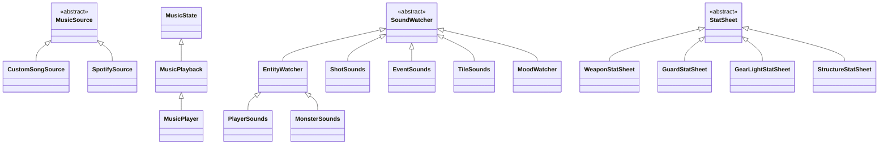
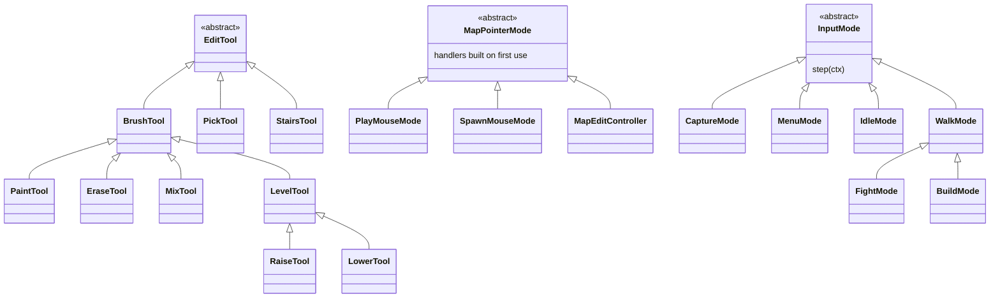

# Class hierarchies: client

Every base class in client and what extends it, as mermaid class diagrams. The server side is in [class-hierarchies-server.md](class-hierarchies-server.md). Module layout is in [architecture.md](architecture.md#modules); the folder rules are in [organization.md](organization.md).

## ScenePart

Every renderer manager extends `ScenePart` (`world/scene-part.ts`), holding the `WorldContext` and reading `scene`, `camera`, and `map` live. Effects that are one group stepped each frame extend `EffectLayer`.

```mermaid
classDiagram
  class ScenePart {
    <<abstract>>
    #_ctx: WorldContext
    #scene
    #camera
    #map
  }
  ScenePart <|-- FrameLoop
  ScenePart <|-- CameraRig
  ScenePart <|-- CameraFollow
  ScenePart <|-- TerrainChunks
  ScenePart <|-- MapOverview
  ScenePart <|-- Scenery
  ScenePart <|-- TileAnimations
  ScenePart <|-- PlayerAvatars
  ScenePart <|-- MonsterAvatars
  ScenePart <|-- SnapshotInterpolator
  ScenePart <|-- ActorLift
  ScenePart <|-- Projectiles
  ScenePart <|-- EventEffects
  ScenePart <|-- InfusionEventEffects
  ScenePart <|-- CrossbowReticles
  ScenePart <|-- LightCollector
  ScenePart <|-- FogStampCollector
  ScenePart <|-- SkyLighting
  ScenePart <|-- WorldEventLook
  ScenePart <|-- BuildPreview
  ScenePart <|-- EditCursor
  ScenePart <|-- StairsGhost
  ScenePart <|-- ScreenPicker
  class WorldScene {
    scene, parts, rAF loop
  }
  WorldScene <|-- WorldRenderer
  class EffectLayer {
    <<abstract>>
    group
    update(dt)
    dispose()
  }
  EffectLayer <|-- Gore
  EffectLayer <|-- ChipBursts
  EffectLayer <|-- PickupPopups
  EffectLayer <|-- ChainBolts
  EffectLayer <|-- Fissures
  EffectLayer <|-- ShockRings
```

`WorldRenderer extends WorldScene` so the scene can be embedded without any input layer. `Flames`, `Puddles`, `GroundPatches`, `HealthBars`, `AltarGauges`, `FountainVictims`, and `TreeSway` keep their own update signatures and don't extend `EffectLayer`. `InfusionEventEffects` (`world/effects/`) draws the infusion events; `EventEffects` hands it every event. `FogGrid extends FogField` (`lighting/fog/`).

## Avatars

`MonsterAvatar`'s constructor never calls the overridable `build`; `createMonsterAvatar` makes the kind and then calls `assemble()`.

- **Composed parts** (not subclasses): `MonsterAvatar` owns `MonsterAfflictions` (status tints and pieces), `MonsterGlow` (hurt flash, ward pulse, afflictions tint), and `MonsterSwoosh` (the attack streak), with the flail motion in `helpers/flail-limbs.ts`. `PlayerGear` owns `HeldModels` (models built on first show, cached per kind and infusion) and `PlayerOffhand` (lantern, torches, shields).

## WeaponMotion and GroundDrop

Motions are stateless, one shared instance per kind, picked by `pickMeleeMotion` and `pickShotMotion` (see [tv.md](tv.md#avatars)). `ReloadMotion` is a separate class with its own `apply(rig, age)`.

## EssenceLook

`infuseModel` (`models/gear/infusions/infuse-model.ts`) builds an infused model in three steps: the plain builder through a color-remapped box factory, the essence's `EssenceLook` (registered in `config/essence-looks.ts`), then the variant's own shape from `VARIANT_SHAPES`, which works through a `VariantDecor`. Level 2 builds on level 1.

## TilePainter

`graveyard/painters/` has one `TilePainter` per tile kind, grouped in folders and looked up by `painter-registry.ts`. Painters are seeded per tile so rebuilds look the same.

| Folder | Painters |
|---|---|
| `landmarks/` | Tombstone, cross, crypt, mausoleum, statue, ruin, tower, well, tree, stump, rock, hedge, fence, lamp, pumpkin, chest |
| `stations/` | Altar, anvil, bloodforge, cauldron, coffin, furnace, oven, quarry, research table, sawmill, sifter, stash |
| `turrets/` | Bolt turret, swiper, flamethrower, ballista, sentry |
| `wards/` | Bell, effigy, ghost lamp, obelisk, scarecrow, soul cage, soul fire |
| `traps/` | Spikes, iron spikes, barbed wire, blood fountain |
| `lights/`, `floors/`, `farming/`, `automation/` | Torch, lantern, campfire; platform, steps; seeds, sprout; belt, belt sorter, digger |

## Client families

- `MusicPlayer` (`packages/ui/src/audio/music/`) layers controls over `MusicPlayback` over `MusicState`, and plays through its two `MusicSource`s.
- `SoundWatcher`s are the TV's sound parts (`apps/tv/src/audio/watchers/`), run by `SoundDirector`.
- `StatSheet`s (`packages/game-ui/src/stats/`) draw the details' stat bars; `statsOf(recipe, tree, infusion)` picks one. `WeaponStatSheet` and `GearLightStatSheet` take an optional infusion (the Brimstone Torch's Light bar includes its `lightMult`).
- `EditTool`s (`packages/controls/src/editing/tools/`) are the map editor's tools, listed in `edit-tools.ts`. `MapPointerMode`s (`controls/src/mouse/`) are what the TV mouse does over the map; the admin's `SpawnMouseMode` lives in `apps/admin/src/mouse/`.
- `InputMode`s are /play's input states (see [play.md](play.md#the-input-loop)).
