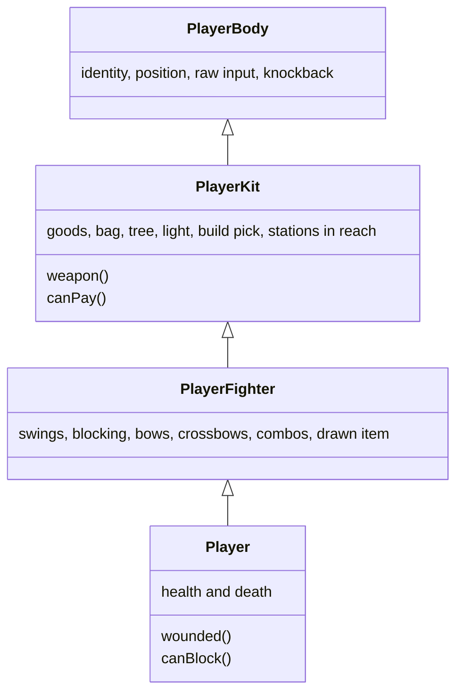
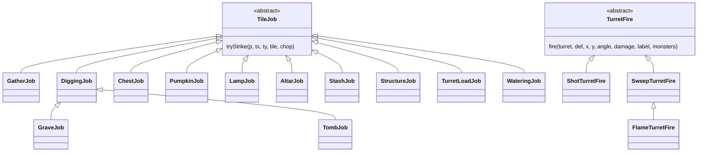
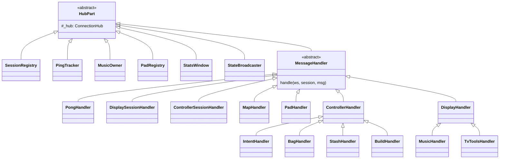
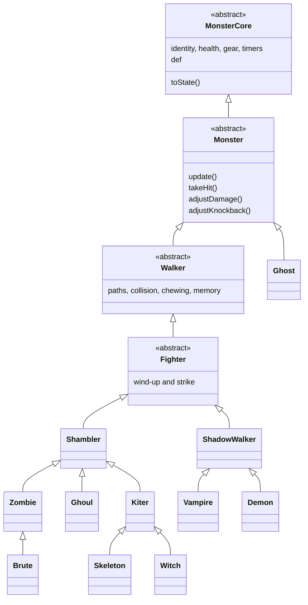
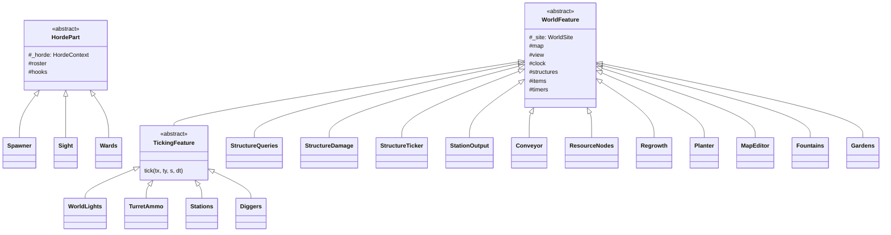
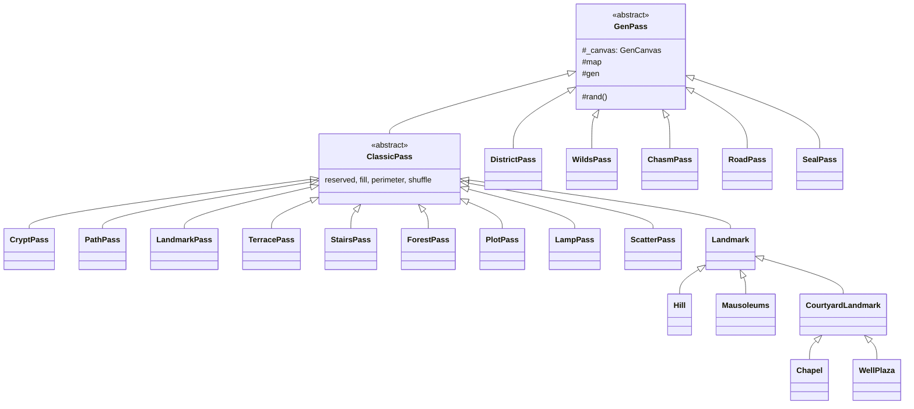
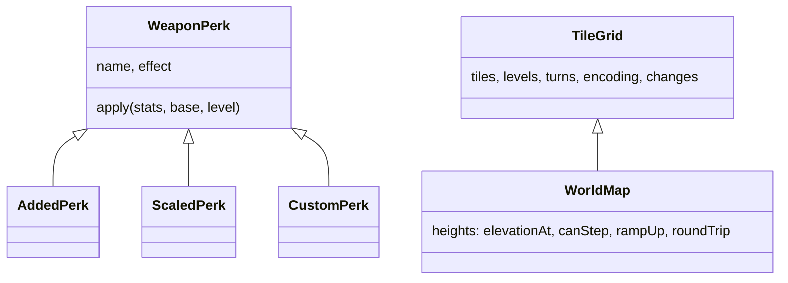

# Class hierarchies: server

Every base class in server and what extends it, as mermaid class diagrams. The client side is in [class-hierarchies-client.md](class-hierarchies-client.md). Module layout is in [architecture.md](architecture.md#modules); the folder rules are in [organization.md](organization.md).

## GameSystem

Every `Game` subsystem extends `GameSystem` (`game/core/game-system.ts`), which holds `_game` and exposes `world`, `horde`, `players`, `outbox`, and `settings` as getters. `Game` creates them as field initializers in dependency order, so their constructors never touch `world` or `horde`.

```mermaid
classDiagram
  class GameSystem {
    <<abstract>>
    #_game: Game
    #world
    #horde
    #players
    #outbox
    #settings
  }
  GameSystem <|-- Outbox
  GameSystem <|-- GameHordeHooks
  GameSystem <|-- ViewSystem
  GameSystem <|-- JoinSystem
  GameSystem <|-- ControlSystem
  GameSystem <|-- LifeSystem
  GameSystem <|-- PlayerTickSystem
  GameSystem <|-- MovementSystem
  GameSystem <|-- PanicSystem
  GameSystem <|-- ActionSystem
  GameSystem <|-- MeleeSystem
  GameSystem <|-- DamageSystem
  GameSystem <|-- TurretSystem
  GameSystem <|-- RangedSystem
  GameSystem <|-- AimingSystem
  GameSystem <|-- ShotSystem
  GameSystem <|-- PuddleSystem
  GameSystem <|-- TileJobSystem
  GameSystem <|-- BagSystem
  GameSystem <|-- HandsSystem
  GameSystem <|-- PickupSystem
  GameSystem <|-- DropSystem
  GameSystem <|-- MonsterSpoilsSystem
  GameSystem <|-- StashSystem
  GameSystem <|-- BuildSystem
  GameSystem <|-- CraftSystem
  GameSystem <|-- BloodMoonSystem
  GameSystem <|-- LevelSystem
  GameSystem <|-- GameTabSystem
  GameSystem <|-- ConjureSystem
  GameSystem <|-- TvHandSystem
  GameSystem <|-- TestBotSystem
  GameSystem <|-- TileJob
  GameSystem <|-- TurretFire
```

## Player

`Player` is built in layers so its fields stay flat (`p.x`) and match `PlayerState`. No layer redeclares another's field.

The test player's steps are a small family too: `BotTask` (`game/bots/tasks/`) with `WalkTask`, `SwingTask`, and `BuildTask`, picked by `TaskPicker`.

## TileJob and TurretFire

`TileJobSystem` asks each `TileJob` in turn to `tryStrike` the facing tile. `TurretSystem.fireTurrets` hands each ready turret to its `TurretFire`.

## Message handlers

Every hub part extends `HubPart` (`net/core/hub-part.ts`: `game`, `sessions`, `stats`, `pings`, `music`, `pads` getters). `ControllerHandler` and `DisplayHandler` check the session kind before `handleFor`.

## Monster

Monsters hold the `HordeContext` as `_ctx`. Traits are rolled before `new` (`rollTraits`, `horde/helpers/traits.ts`) and `createMonster` (`monster-factory.ts`) picks the kind's class.

Per-monster state helpers (`monsters/state/`: `Bleeding`, `Knockback`, `LastSeen`) are composed, not inherited.

## HordePart and WorldFeature

- `HeatMap` and `LightField` (`horde/senses/`) are plain classes held by the `HordeContext` (`horde-context.ts`, as `heat` and `light`).
- `World` holds `StructureStore`, `GroundItems`, `WorldClock`, and the features as `readonly` fields (`world.items`, `world.structures`, `world.growth`, `world.editor`, ...).

## GenPass

Each generator step is a `GenPass` over one `GenCanvas` (map, seeded rand, knobs). Bodies run in a fixed order so the seed gives the same map.

## Shared families

- `WeaponPerk` (`shared/src/gear/perks/`): the base changes nothing (the stake's upgrade is more uses); `WEAPON_PERKS` maps each weapon to one.
- `TileGrid` (`shared/src/world/tile-grid.ts`) is the storage half of a map; `WorldMap` adds the height geometry.
