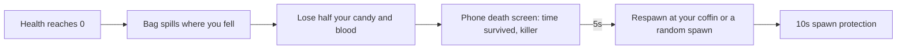
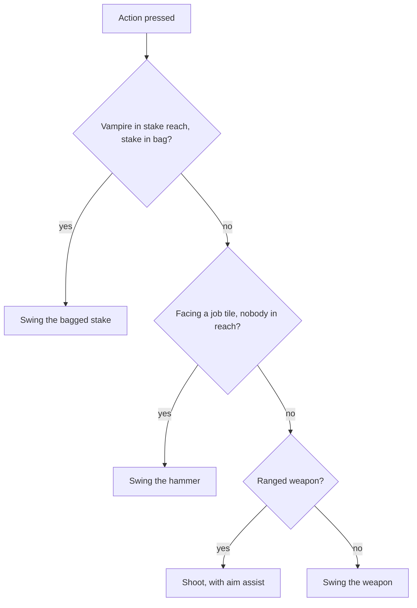

# Players and combat

## Health

- 10 hearts (`MAX_HP`). No regeneration.
- Damage from the last 10 seconds (`FRESH_WOUND_SECONDS`) can't be healed yet. Every hit and every altar offering is one (`Player.wound`).
- Fresh wounds show as cracked, scab-red hearts with a slow heartbeat at the end of the row on the phone and /play (`ui:heart-wound`, `.wound-throb`), and a hatched dark-red end on the TV health bar (`WOUND_FILL`, `WOUND_STRIPE`).

| Healing | Amount |
|---|---|
| Rest within 2 tiles of a burning campfire, soul fire, or blood fountain | 1 heart per 6s (all 10 in a minute), 10% faster per level of the best one in reach (`CAMPFIRE_HEAL_PER_LEVEL`, `WorldLights.litCampfireLevel`) |
| Drink a tonic from the bag | +4 hearts (refused when nothing could heal) |
| Kill with the ritual knife | 4 hearts over 8s per kill (+2 per level); Bloodletter and Heart Devourer pay double for a monster that was bleeding, and a bleed they opened feeds too |
| Kill with Reaper's Call or Death's Harvest (scythe) | 1 heart at once (`killHeal`) |
| Last hit of a Bishop's Crozier combo | 1 heart, once a swing (`finishHeal`) |
| Standing in Thurible of Judgment incense | 0.25 a second (`PatchSystem`) |

- **Kill healing** runs through `LifeSystem.mend`, from `InfusionSystem.onDeath` (the horde's `died` hook, `GameHordeHooks.died`). The knife's feast (`Player.feast`, paid out in `LifeSystem.rest`) is added there too, not in the swing, so a kill by the wielder's own bleed can feed.

### Overheal

Heart Devourer and Death's Harvest turn healing past full into overheal (`WeaponStats.overheal`, see [infusions.md](infusions.md)).

- `LifeSystem.mend` and the feast payout put what's past `MAX_HP` into `Player.overheal`, up to `max` (2 hearts), and restart its clock (`Player.overhealUntil`).
- It runs out `seconds` (15) after the last top-up, and is cleared on death and respawn (`LifeSystem.rest`, `kill`, `respawn`).
- **Soak:** `DamageSystem.hurt` takes damage from overheal first, after difficulty scaling and the shield or armor guard. What's soaked isn't a wound.
- Shown as brass hearts after the red ones on the phone and /play (`Vitals.overheal`, rounded up to halves; `ui:heart-over` in `Hearts`). The outbox's vitals key includes it, so the phone hears when it changes.

## Death and respawn

- Equipped gear stays on you.
- The spill (one pile of materials, with gear and structure crates around it) can only be picked up by you.
- Spawn protection ends early when you attack or build. Monsters ignore protected players and disconnected phones.
- The TV kill feed shows every death.

## Player vs player

PvP is always on, but it's hard and it's naughty.

| Rule | Value |
|---|---|
| A player's hit or shot on another player | 25% damage (`PVP_DAMAGE`) |
| Killing another player | The killer loses all their candy |
| The victim's lost half of blood | Goes to the killer instead of vanishing |
| Looting | Impossible: a dead player's spill is theirs alone |

The killer's phone gets `{ t: 'naughty', candy }` and shows a huge shaking NAUGHTY with the candy count draining to 0 (`naughty-screen.tsx`).

## Melee

- A swing lands `STRIKE_DELAY` (0.22s) after the press, or after the weapon's `windup` for heavy weapons, and hits everything within reach in its arc.
- Hits knock back (half a tile for the hammer), throw sparks, shake the screen, and buzz the phone.
- Player hits never cancel a monster's attack, except the morning star's stagger, stuns (the quarterstaff, Hulking weapons, the Seraphic Chain, the Earthshaker), and pins (The Impaler, Hunter's Arbalest).
- **Knockback:** a hit with no knockback (a Hellmouth pulse, a chain jump) leaves a knockback already in progress alone (`Monster.takeHit` only sets `knock` when `knockback > 0`).
- **Infused weapons** add statuses (burn, poison, curse, slow, pin, turn) and swing and kill tricks (`MeleeTricksSystem`, `InfusionSystem`). Statuses are in [monsters.md](monsters.md#statuses), the tricks in [infusions.md](infusions.md).
- **Kill credit** comes from the hit's `by` (`HitEffects.by`, passed to `HordeContext.kill`), so bone armor's thorns kills go to its wearer, and a burn, poison, curse, or bleed kill goes to whoever opened it.
- **Risen allies** (Grave Fists) are left out of every player's targeting (`Horde.targets`, `Horde.targetsAt`): swings, shots, aim assist, chains, slams, blasts, the flame, and the glaive pass them by.

- **Lag:** a melee blow is judged against where monsters stood when the attacker's screen showed them (their ping plus their screen's smoothing, at most 0.25s back; `MeleeSystem.lagOf`, `Horde.targetsAt` over `RewindBuffer`), so hits land on what they saw.

### What a swing is made with

- **Job tiles:** anything gathered, dug, robbed, smashed, opened, refueled, or knocked down (`GATHERABLE`, structures, `HAMMER_JOBS`). The hammer does every job, whatever is equipped.
- **Drawn items** (the hammer or a bagged stake) show in hand for 1.2s (`PlayerState.drawn`), then the weapon comes back.
- **Digging a grave** (a headstone or cross) is still a hammer swing with the hammer's stats, but it's shown as digging (`PlayerState.digging`, `PlayerFighter.digUntil`): a spade instead of the hammer, and dirt tossed over the digger's shoulder.
- **Tile jobs never wear the weapon.**
- **Infusion tricks** only come from a swing of the equipped weapon: the hammer or a stake drawn for a swing (`PlayerFighter.swingWith`) sets off none of them.

### Heavy swings

The battle axe and warhammer have a `windup` (0.7s and 0.8s). The blow lands after it, and the swinger moves at 35% speed (`HEAVY_SWING_SLOW`) from the press until `HEAVY_FOLLOW_THROUGH` (0.35s) after the blow lands, so they leave you exposed. The TV stretches the swing animation to match, using the windup with the weapon's infusion applied (`PlayerSwing.duration`, so a Feral axe swings faster on screen too).

- **Headsman's Axe:** a swing that kills 2 or more sets `PlayerFighter.skipWindup`; the axe's own next swing has no windup and no slowdown (`MeleeSystem.swing` checks `multiKillSkip`, so a drawn hammer or stake neither uses nor spends it). That swing sends `PlayerState.quickSwing`, and the TV plays it at the plain swing pace (`SWING_TIME`).

### Ranged

- Shots carry their weapon (`Shot.weapon`) and the shooter's full stats (`Shot.stats`, from `p.weapon()`: tree levels and infusion), so holy and blood rules, packages, and statuses follow the weapon that fired them (`ShotSystem.hitMonster`). Turret shots have no stats.
- **Aim assist:** every shot bends toward the monster closest to straight ahead within 0.35 rad (`AIM_ASSIST`) and range.
- See [weapons.md](weapons.md) for draw, bursts, pellets, and piercing.

## Blocking and armor

| Defense | Effect |
|---|---|
| Shield, held up (phone's Block button) | Hits from the front x0.12 (3% less per level); you move at half speed and can't attack. Only beside a one-handed weapon. |
| Quarterstaff, held | Hits from the front x0.85 (10% less per level), no shield needed |
| Armor | Every hit times its guard (0.05 less per level); see [weapons.md](weapons.md#armor) |

- **Hands:** `handsClash` (`server/src/game/inventory/helpers/hands-clash.ts`) says what can't be held together: a shield beside any two-handed weapon, or a torch beside the infused hammer. `HandsSystem.settleHands` and `BagSystem.store` use it to bag the off-hand item.
- **Mirror Shield:** a raised block with it sends skeleton arrows, witch potions, and ghost ectoplasm back (`MirrorShieldSystem`, see [infusions.md](infusions.md)).
- The flail ignores a raised shield.
- On the TV, past halfway up the shield leaves the arm and stands square in front of the chest.

## Panic

The phone's Panic button runs the player from monsters within 4 tiles for 1 second along a path, then walks them back home once it's safe. It also closes whatever menu is open.
