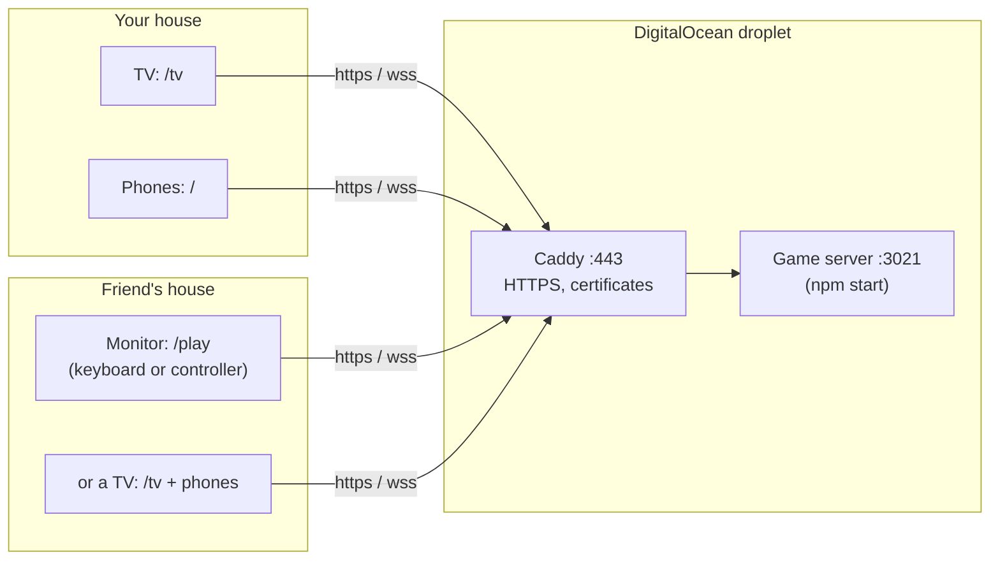

# Deploying to a server

How to run Grave Robbers on a DigitalOcean droplet so people in other places can play together over the internet.

## How it fits together



- One Node process (`npm start`) serves the built apps (`apps/<name>/dist`: the phone at `/`, `/tv`, `/play`, `/admin`), the WebSocket (`/ws`), media (`/media`), and Spotify auth (`/auth`). There's nothing else to run.
- [Caddy](https://caddyserver.com) sits in front and gets a free HTTPS certificate on its own. HTTPS matters here:

| Needs HTTPS (or localhost) | What breaks without it |
|---|---|
| Spotify Web Playback SDK and its OAuth redirect | No music on the TV |
| Screen Wake Lock | Phones fall back to `nosleep.js`'s hidden video |
| Gamepad API in some browsers | Controllers may not show up |

## What you need

| Thing | Notes |
|---|---|
| A DigitalOcean account | Any plan works; see the size below |
| An SSH key on your computer | `ssh-keygen -t ed25519` if you don't have one; add the `.pub` to DigitalOcean |
| The code pushed to GitHub | Commit and push first; the droplet clones from `github.com/andyruwruw/halloween-display` |
| A host name (optional) | A domain you own, or a free `sslip.io` name made from the droplet's IP (below) |

## 1. Create the droplet

In DigitalOcean: **Create → Droplets**.

| Setting | Pick |
|---|---|
| Region | The one between you and your friend (see [Latency](#latency) below). With one player on each coast, a central-ish region keeps it fair; with both in the east, `NYC`. |
| Image | Ubuntu 24.04 LTS |
| Size | Basic, Regular, **2 GB / 1 CPU** ($12/mo). 1 GB runs the game but can run out of memory while building the client; if you pick it, add swap in step 2. |
| Authentication | SSH key |

Note the droplet's IP address (say `203.0.113.5`).

## 2. Prepare the server

SSH in and update everything:

```bash
ssh root@203.0.113.5
apt update && apt upgrade -y
```

Make an account to run the game (not root):

```bash
adduser --disabled-password --gecos "" graveyard
```

Only on a 1 GB droplet, add 2 GB of swap so the build doesn't run out of memory:

```bash
fallocate -l 2G /swapfile && chmod 600 /swapfile && mkswap /swapfile && swapon /swapfile
echo '/swapfile none swap sw 0 0' >> /etc/fstab
```

Install Node 24 (the server needs Node 22.9 or newer for `--env-file-if-exists`), git, and Caddy:

```bash
curl -fsSL https://deb.nodesource.com/setup_24.x | bash -
apt install -y nodejs git debian-keyring debian-archive-keyring apt-transport-https
curl -1sLf 'https://dl.cloudsmith.io/public/caddy/stable/gpg.key' | gpg --dearmor -o /usr/share/keyrings/caddy-stable-archive-keyring.gpg
curl -1sLf 'https://dl.cloudsmith.io/public/caddy/stable/debian.deb.txt' > /etc/apt/sources.list.d/caddy-stable.list
apt update && apt install -y caddy
```

Open the firewall to SSH and the web only (the game's own port stays private behind Caddy):

```bash
ufw allow OpenSSH && ufw allow 80 && ufw allow 443 && ufw --force enable
```

## 3. Get the code and build it

```bash
su - graveyard
git clone https://github.com/andyruwruw/halloween-display.git app
cd app
npm ci
npm run build
```

If the repo is private, use a [personal access token](https://github.com/settings/tokens) as the password when git asks, or add a deploy key.

### Copy the media

Music isn't in git (`server/media/music` is ignored). From **your own computer**, in the repo folder:

```powershell
scp -r server/media/music graveyard@203.0.113.5:app/server/media/
```

The `sfx` and `ambience` folders come with the clone if they're committed; copy them the same way if not.

## 4. Pick a host name

Caddy needs a name to get a certificate for.

| Option | Host name | Setup |
|---|---|---|
| Free, no domain | `203-0-113-5.sslip.io` (the IP with dashes) | Nothing; sslip.io points it at your IP |
| Your own domain | `graveyard.example.com` | Add an **A record** for it pointing at the droplet's IP, and wait a few minutes |

The rest of this guide uses `203-0-113-5.sslip.io`; swap in yours.

## 5. Configure the game

Still as `graveyard`, create `app/server/.env` (`npm start` loads it):

```bash
nano ~/app/server/.env
```

```ini
PORT=3021
WORLD_PRESET=king-of-the-hill

# Only if you use Spotify on the TV:
SPOTIFY_CLIENT_ID=your-client-id
SPOTIFY_CLIENT_SECRET=your-client-secret
SPOTIFY_REDIRECT_URI=https://203-0-113-5.sslip.io/auth/spotify/callback
```

| Variable | What it does | Default |
|---|---|---|
| `PORT` | Port the game listens on (Caddy forwards to it) | 3021 |
| `WORLD_PRESET` | Map a new world starts from (`server/presets/<id>.json`) | `king-of-the-hill` |
| `WORLD_SAVE` | Where the world is saved | `server/data/world.json` |
| `MEDIA_DIR` | Music, SFX, ambience | `server/media` |
| `PRESET_DIR` | Map presets | `server/presets` |
| `SPOTIFY_*` | See [audio.md](audio.md); `SPOTIFY_REDIRECT_URI` must also be added under **Redirect URIs** in your app on the Spotify developer dashboard | |

## 6. Run it as a service

Back as root (`exit`), create `/etc/systemd/system/graveyard.service`:

```ini
[Unit]
Description=Grave Robbers game server
After=network.target

[Service]
User=graveyard
WorkingDirectory=/home/graveyard/app
ExecStart=/usr/bin/npm start
Restart=always
RestartSec=3
Environment=NODE_ENV=production

[Install]
WantedBy=multi-user.target
```

```bash
systemctl daemon-reload
systemctl enable --now graveyard
systemctl status graveyard
```

The server saves the world every 30s and on stop (SIGTERM), so restarts don't lose it.

## 7. Put Caddy in front

Replace `/etc/caddy/Caddyfile` with:

```caddy
203-0-113-5.sslip.io {
	encode gzip
	reverse_proxy localhost:3021
}
```

```bash
systemctl reload caddy
```

Caddy gets the certificate on the first visit and forwards WebSockets (`/ws`) without extra setup.

### Optional: a password

Anyone with the URL can join, and the TV sidebar and `/admin` can reset the world or summon a blood moon. To keep strangers out, put a password on the whole site:

```bash
caddy hash-password --plaintext 'pick-a-password'
```

```caddy
203-0-113-5.sslip.io {
	encode gzip
	basic_auth {
		friends <the hash it printed>
	}
	reverse_proxy localhost:3021
}
```

Every browser asks once (user `friends`), then remembers it.

## 8. Play

| Who | Opens |
|---|---|
| You, on the TV | `https://203-0-113-5.sslip.io/tv` |
| Phones in the room | Scan the TV's QR code (it shows the server's address) |
| Your friend, on a computer | `https://203-0-113-5.sslip.io/play` (keyboard and mouse, or a controller) |
| Your friend, with a TV and phones | `/tv` there too, and phones scan that TV's QR code |

- Only one TV plays the music: the newest one to open. The other TV's Music tab has **Play music here** to take it.
- Each `/play` screen is its own player.

## Updating

As `graveyard`:

```bash
cd ~/app
git pull
npm ci
npm run build
exit
```

Then as root: `systemctl restart graveyard`. Players' phones reconnect on their own, but a restart sends everyone back to the join form (players live in memory; the world is saved).

## Looking after it

| Task | Command |
|---|---|
| Live server logs | `journalctl -u graveyard -f` |
| Caddy logs (certificates, proxy errors) | `journalctl -u caddy -f` |
| Back up the world | `scp graveyard@203.0.113.5:app/server/data/world.json .` (from your computer) |
| Start a fresh world | TV sidebar → Game → Regenerate Map, or stop the service and delete `server/data/world.json` |

## Troubleshooting

| Symptom | Likely cause |
|---|---|
| Page loads but says it's reconnecting forever | The service is down (`systemctl status graveyard`) or Caddy isn't forwarding (check the Caddyfile host name) |
| Caddy can't get a certificate | Ports 80/443 closed (`ufw status`), or the DNS record doesn't point at the droplet yet |
| Build killed partway through | Out of memory: add swap (step 2) |
| No music | Spotify redirect URI missing on the dashboard, or not over HTTPS |
| Everything feels sluggish | See [Latency](#latency) |

## Latency

The server is authoritative: screens draw what it last sent, and controls go to it and back. Over a LAN that round trip is a few milliseconds; across the country it's 60 to 90 ms. The game hides most of it (see [architecture.md](architecture.md#latency)): /play moves your player and starts swings instantly, high-ping screens interpolate, melee is judged against what the attacker saw, and updates are compressed.

- **Check it:** each player's ping is in the TV's Overview roster, and /play shows yours in its top bar.
- **Pick the region** that keeps the **worst** player's ping lowest, since everyone shares one server.
- **Consider hosting at home** if most players are in one room: they get LAN speed, and only the far-away player crosses the internet (best on /play). Tailscale or a Cloudflare Tunnel avoids opening router ports.
