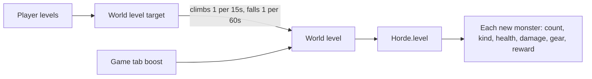

# Difficulty: hidden levels

The rules live in `shared/src/difficulty/`: `player-level.ts` (`playerLevel`), `world-level.ts` (`worldLevelTarget`, easing and boost limits), and `horde-scaling.ts` (what a level does to the horde). The server side is `LevelSystem` (`server/src/game/progression/level-system.ts`). Levels are hidden from phones; the TV's Overview tab shows them.

## Player level

A player's level is the sum of four parts:

| Part | How it's counted |
|---|---|
| Offense | 5 levels per doubling of their best weapon's damage per second over 5.5 (`OFFENSE_BASE_DPS`, the hammer's old damage per second) (upgrades included; ranged x1.3, health-costing x0.7) |
| Defense | 5 levels per doubling of effective health from armor and 30% of a shield's guard |
| Tree | Points / 10. Each node is worth its depth (1 for a start node, 2 for a blueprint, +1 per step down an upgrade chain) per level, plus once more for a found blueprint |
| Time online | 1 level per 8 minutes connected, at most 8 (kept on leave) |

## World level

- **Target:** 70% the strongest online player's level plus 30% the average of the rest.
- **Easing:** climbs 1 level per 15s, falls 1 per 60s, and stays put while nobody is connected.
- **Boost:** the Game tab's World level boost (`GameSettings.levelBoost`, 0 to 60 in steps of 5) adds on top and applies at once.
- `LevelSystem.advanceLevels` eases it and hands it to `Horde.level`; it applies as monsters spawn.

## What the world level does

At world level L:

| Effect | Formula |
|---|---|
| Extra monsters per player | +0.2 L |
| Spawn rate | x(1 + 0.04 L) |
| Monster health | x(1 + 0.04 L) |
| Monster damage | x(1 + 0.03 L) |
| Blood from kills | x(1 + 0.05 L) |
| Zombies carrying junk | 12% + 2% per level, at most 50% |
| Zombies and brutes in armor | 4% per level past 2, at most 60% |
| Share of armor that's plate | 5% per level past 8, at most 60% |

Armored kills leave iron: 30% of the time for a helmet, 80% for plate.

## Spawn weights by world level

| Monster | Weight | First appears |
|---|---|---|
| Zombie | 0.55 | always |
| Vampire | 0.3 x (1 + 0.04 L) | always |
| Skeleton | 0.03 per level past 1, at most 0.3 | L 2 |
| Brute | 0.025 per level past 3, at most 0.4 | L 4 |
| Ghoul | 0.03 per level past 3, at most 0.3 | L 4 |
| Witch | 0.02 per level past 5, at most 0.2 | L 6 |
| Demon | 0.01 per level past 9, at most 0.08 | L 10 |

Ghosts spawn on their own clock (see [monsters.md](monsters.md#spawning-and-pacing)).
