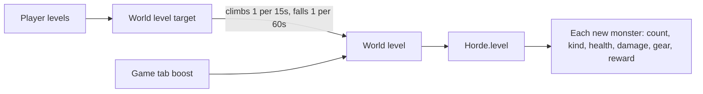

# Difficulty: hidden levels

The rules live in `shared/src/difficulty/`: `player-level.ts` (`playerLevel`), `world-level.ts` (`worldLevelTarget`, easing and boost limits), and `horde-scaling.ts` (what a level does to the horde). The server side is `LevelSystem` (`server/src/game/progression/level-system.ts`). Levels are hidden from phones; the TV's Overview tab shows them.

## Server difficulty

A setting, not a hidden level: the admin's Gameplay page sets it with a stepped slider (`DifficultyRow` in the Manipulate card, `GameSettings.difficulty`, 1 to 5, starting on 3). It scales damage only (`DIFFICULTY_LEVELS` in `shared/src/difficulty/difficulty.ts`):

| Level | Damage players take | Damage monsters take |
|---|---|---|
| 1 Easy | -30% | +30% |
| 2 Gentle | -15% | +15% |
| 3 Normal | 0 | 0 |
| 4 Hard | +37.5% | -15% |
| 5 Hardest | +75% | -30% |

- **Taken** (`DifficultyLevel.taken`): `DamageSystem.hurt` scales damage from monsters and the world (falls, traps, shots, puddles) before armor and shields guard it. Players hurting each other aren't scaled, and neither are health a player spends on purpose (altar offerings, the ritual knife).
- **Dealt** (`DifficultyLevel.dealt`): every way a monster loses health is scaled, through `HordeContext.dealt` (set by `GameTabSystem` with `Horde.setDealt`): hits (`Monster.takeHit`, after the monster's own adjustments), bleeding, traps, palisade thorns, and falls. It applies at once, to monsters already out.
- Nothing a player sees changes: weapon stats, armor, and the phone's numbers stay the same. Monsters just hit harder or seem to have more health.
- Like the other Game tab settings it lives in memory and resets when the server restarts.

## Player level

A player's level is the sum of four parts:

| Part | How it's counted |
|---|---|
| Offense | 5 levels per doubling of their best weapon's damage per second over 5.5 (`OFFENSE_BASE_DPS`, the hammer's old damage per second) (upgrades included; ranged x1.3, health-costing x0.7) |
| Defense | 5 levels per doubling of effective health from armor and 30% of a shield's guard |
| Tree | Points / 10. Each node is worth its depth (1 for a start node, 2 for a blueprint, +1 per step down an upgrade chain) per level, plus once more for a found blueprint |
| Time online | 1 level per 8 minutes connected, at most 8 (kept on leave) |

## World level

- **Target:** 70% the strongest online player's level plus 30% the average of the rest.
- **Easing:** climbs 1 level per 15s, falls 1 per 60s, and stays put while nobody is connected.
- **Boost:** the Game tab's World level boost (`GameSettings.levelBoost`, 0 to 60 in steps of 5) adds on top and applies at once.
- `LevelSystem.advanceLevels` eases it and hands it to `Horde.level`; it applies as monsters spawn.

## What the world level does

At world level L:

| Effect | Formula |
|---|---|
| Extra monsters per player | +0.2 L |
| Spawn rate | x(1 + 0.04 L) |
| Monster health | x(1 + 0.04 L) |
| Monster damage | x(1 + 0.03 L) |
| Blood from kills | x(1 + 0.05 L) |
| Zombies and brutes armed | 12% + 2% per level, at most 50% |
| Share of those with a craftable weapon instead of junk | 3% per level past 7, at most 40% (`craftedShare`), from the tiers in `ZOMBIE_WEAPON_TIERS` |
| Zombies and brutes in armor | 4% per level past 2, at most 60% |
| Share of armor that's plate | 5% per level past 8, at most 60% |

Armored kills leave iron: 30% of the time for a helmet, 80% for plate.

## Spawn weights by world level

The trickle's mix is set in percent at chosen world levels (`SPAWN_MIX` in `horde-scaling.ts`). Between two of them it blends in a straight line (`spawnWeights`), and past the last it holds. Each kind's share is also its share of the cap (`pickKind` in `horde/helpers/spawn-mix.ts`), around each player on a huge world.

| World level | Zombie | Vampire | Skeleton | Brute | Ghoul | Witch | Demon | Bloater | Necromancer |
|---|---|---|---|---|---|---|---|---|---|
| 0 | 60% | 15% | 25% | | | | | | |
| 4 | 50% | 15% | 20% | 5% | 10% | | | | |
| 8 | 49% | 10% | 13% | 5% | 15% | 5% | | 3% | |
| 10 | 45% | 10% | 12% | 5% | 15% | 8% | 1% | 4% | |
| 15 | 42% | 10% | 10% | 5% | 15% | 10% | 3% | 4% | 1% |
| 20 and up | 40% | 10% | 8% | 5% | 15% | 10% | 4% | 5% | 3% |

- Bloaters blend in from 0 at level 4 (about 1.5% by level 6); necromancers from 0 at level 10. A necromancer's raised skeletons come on top of the mix.
- Werewolves aren't in `SPAWN_MIX`: a blood moon adds them (8 weight on top of these 100, `extra` in `spawnWeights`).

Pace and cap by world level (the cap is at most 60). Outside a blood moon no spawn comes sooner than 6s after the last one anywhere (`CALM_SPAWN_GAP`), so the faster paces below only matter in events:

| World level | One spawn every | Cap (1 / 2 / 4 players) |
|---|---|---|
| 0 | 4.5s | 6 / 10 / 18 |
| 4 | 3.9s | 7 / 12 / 21 |
| 8 | 3.4s | 8 / 13 / 24 |
| 10 | 3.2s | 8 / 14 / 26 |
| 15 | 2.8s | 9 / 16 / 30 |
| 20 | 2.5s | 10 / 18 / 34 |
| 40 | 1.7s | 14 / 26 / 50 |
| 60 | 1.3s | 18 / 34 / 60 |

Ghosts spawn on their own clock (see [monsters.md](monsters.md#spawning-and-pacing)).
