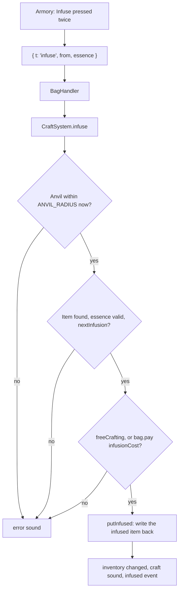

# Infusions

Weapon infusions at the anvil: silver and an essence turn a weapon (or the hammer, the shield, or the torch) into a named variant with its own model and a special ability. All of it is built: the variant catalog and stats in `shared/src/gear/infusions/`, the infuse flow (`CraftSystem.infuse`), every variant's effect on the server, the variant models and effects on the TV, and the Armory panel on the phone and /play (see [Code](#code)). Numbers are balanced against the spawn mix in `SPAWN_MIX` (`shared/src/difficulty/horde-scaling.ts`) and the weapon stats in [weapons.md](weapons.md); recheck both when either changes.

## Rules

- **The variants in [Weapons](#weapons) are the only upgrades.** There's no generic infusion: each weapon has its own fixed list of variants, each with set values.
- **Infused at an anvil**, within `ANVIL_RADIUS`. Each weapon has one or two paths, one essence each (`pathsFor`). No skill tree unlock is needed (see [Infusing](#infusing)).
- **Two levels per path** (one for the torch and shield), always the same essence: level 1, then level 2.
- **Permanent.** The first infusion locks the weapon into its path for good; there's no cleansing.
- **Every infusion costs silver.** The anvil discount (`ANVIL_DISCOUNT_PER_LEVEL`) applies.
- **Names:** each variant has its own name, with the essence's prefix (Ephemeral, Blessed, ...) shown under it.
- **Monsters never carry infused weapons.** High-level zombies keep carrying plain craftable ones (`ZOMBIE_WEAPON_TIERS`).
- **Every infusion changes the model**, not just the color (see [Look](#look)).
- **Renames:** the base spear becomes plain **Spear** (Ghoul Poker is now its infusion); the base greatsword becomes plain **Greatsword** (Hell's moves to Hell's Edge).
- **Rarer essences are a little stronger** on average (see [What a package is worth](#what-a-package-is-worth)).

## Monster supply

Shares are `spawnWeights` at each level (`SPAWN_MIX`). Kills per minute assume the group kills as fast as the trickle spawns (one every `SPAWN_INTERVAL` 4.5s ÷ `spawnSpeedup`, 1 + 0.04 L). `pickKind` also caps each kind at its share of the live cap, so a solo player at L15 has at most 1 brute, 1 witch, and 1 demon out at a time.

| Monster | Share L10 | Share L15 | Share L20 | Kills/min L10 | Kills/min L15 | Kills/min L20 |
|---|---|---|---|---|---|---|
| Zombie | 45% | 42% | 40% | 8.4 | 9.0 | 9.6 |
| Vampire | 10% | 10% | 10% | 1.9 | 2.1 | 2.4 |
| Skeleton | 12% | 10% | 8% | 2.2 | 2.1 | 1.9 |
| Brute | 5% | 5% | 5% | 0.9 | 1.1 | 1.2 |
| Ghoul | 15% | 15% | 15% | 2.8 | 3.2 | 3.6 |
| Witch | 8% | 10% | 10% | 1.5 | 2.1 | 2.4 |
| Demon | 1% | 3% | 4% | 0.2 | 0.6 | 1.0 |
| Bloater | 4% | 4% | 5% | 0.7 | 0.9 | 1.2 |
| Necromancer | 0% | 1% | 3% | 0 | 0.2 | 0.7 |
| Ghost | own clock | | | 1 to 3 | 1 to 3 | 1 to 3 |
| Werewolf | blood moon only (`EventModifiers.spawnMix`) | | | | | |

## Essences

Standard costs below. A variant row in [Weapons](#weapons) that lists its own cost overrides them.

| Essence | Source | Per min at L15 | Level 1 | Level 2 | Minutes at L15 (L1 / L2) | Rarity |
|---|---|---|---|---|---|---|
| Holy water | Crafted: 1 silver + 4 blood (`MAT_RECIPES['holy-water']`), opened by the grave sifter node | about 2 (silver-bound) | 4 silver, 9 holy water | 8 silver, 18 holy water | 4.5 / 9 | Common |
| Brute tendons | Brute, always 1 | 1.1 | 4 silver, 4 tendons | 8 silver, 9 tendons | 3.6 / 8.2 | Uncommon |
| Ghoul fang | Ghoul, 35%; werewolf, always 1 (blood moon only) | 1.1 (more in a blood moon) | 4 silver, 4 fangs | 8 silver, 9 fangs | 3.6 / 8.2 | Uncommon |
| Ectoplasm | Ghost, 1 (already drops) | about 1.5 | 4 silver, 6 ectoplasm | 8 silver, 12 ectoplasm | 4 / 8 | Uncommon (also spent on ghost lamps and bells) |
| Hex shard | Witch, 50%; necromancer, always 1 | 1.3 | 4 silver, 4 shards | 8 silver, 9 shards | 3.1 / 6.9 | Rare (witches from about L5, necromancers from about L11) |
| Brimstone | Demon, always 1 | 0.6 | 4 silver, 3 brimstone | 8 silver, 6 brimstone | 5 / 10 | Rarest (demons from about L9, 1% at L10) |

Drops go to the killer (`MonsterSpoilsSystem`), so the minutes are for one player getting every drop; split across a group they stretch.

### Essence packages

Each essence brings a fixed package of values at each level. A variant is its essence's package at its level plus its own twist, unless its row says otherwise. The packages aren't upgrades on their own; they're shorthand for the variant rows.

| Essence | Prefix | Level 1 package | Level 2 package |
|---|---|---|---|
| Holy water | Blessed | x1.75 to vampires and demons | x2.5 |
| Brute tendons | Hulking | +12% damage, x1.5 knockback, 12% chance to stun 1s (not brutes) | +25%, x2 knockback, 22% stun |
| Ghoul fang | Feral | Whole swing cycle (windup, cooldown, reload, draw) ÷1.2: exactly +20% DPS | ÷1.4: +40% DPS |
| Ectoplasm | Ephemeral | x1.6 to skeletons; ghosts take full damage (x4 the usual 25%) with 1x knockback instead of 2x | x2.2 to skeletons, ghosts x6, 0.5x knockback |
| Hex shard | Hexed | Curse 3s: 1 a second, slowed like the witch puddle, takes +15% from everyone | Curse 4s: 1.5 a second, +20% taken |
| Brimstone | Enflamed | Burn anything but ghosts (1.2 a second for 3s); x1.15 to zombies, brutes, ghouls | Burn 2 a second for 4s; x1.35 |

- **Hex chance scales with swing time:** 0.35 x the weapon's cycle in seconds at level 1, 0.6 x at level 2, so fast and slow weapons curse about equally often (about 65% and 90% uptime while swinging). The cycle (`swingCycle`) is the cooldown plus any draw, aim (`sight`), and the reload's share per shot (`reload / burst`); the chance is capped at 0.9 (`CURSE_CHANCE_CAP`). A cursed monster moves at 0.45 of its speed (`GHOST_SLOW`, like the witch puddle).
- **Hulking** multiplies damage and knockback and adds to the weapon's own `stun` chance; **Feral** divides cooldown, windup, reload, and draw.
- **Ephemeral on ghosts:** a ghost takes `ghostMult` x `GHOST_DAMAGE` of the hit (4 is full damage, 6 is 1.5x), and `ghostKnock` replaces `GHOST_KNOCKBACK`.
- **Burn refreshes, never stacks.** It's flat, so it lifts weak weapons most, and it lands on everything a sweep hits. Every status works this way: a new one keeps the higher rate and the later end (`Wound`, see [monsters.md](monsters.md#statuses)).
- **Curses on ghosts** tick at 25% (`GHOST_DAMAGE`) of their rate; their slow and `taken` still apply (`Afflicted.afflict`).
- **Blessed stacks** with a weapon's own `holy` or `blessed`, capped at x4 total (`BLESSED_CAP` in `damageTo`).
- **Level 2 keeps level 1's twist** unless its row replaces it (the Moonsilver Saber drops Silvered's x1.4 for the Blessed package).

### What a package is worth

DPS change from the package alone on a 7.5 DPS weapon, single target. "Mix" is the L15 horde mix; ghosts aren't in it.

| Essence | L1 mix | L1 favored | L2 mix | L2 favored |
|---|---|---|---|---|
| Holy water | +10% | +75% | +20% | +150% |
| Ectoplasm | +6% | skeletons +60%, ghosts x4 | +12% | skeletons +120%, ghosts x6 |
| Brute tendons | +12% and stuns | | +25% | |
| Ghoul fang | +20% | | +40% | |
| Hex shard | +19%, a slow, and team damage | | +36% | |
| Brimstone | +25% | +31% | +48% | +62% |

## Weapons

Every variant is its path's package at its level (see [Essence packages](#essence-packages)) plus what its row says. DPS is absolute (damage a second) at tree level 0: **Mix** is a single target against the L15 horde (`spawnWeights(15)`, through `damageTo`, so a weapon's own `holy` or `blessed` and a blood weapon's `VAMPIRE_BLOOD_RESIST` count; a necromancer's ward isn't counted), **Best** is against favored monsters or a crowd of 3 where the variant hits several. All hits are assumed to land. Ranged DPS uses the real firing cycle: a crossbow's cooldown runs inside its reload (`RangedSystem.startReload` starts it with the last shot), so CrossBones fires every reload + aim (1.75s) and Rattlebones a burst of 3 every 1.4s.

| Weapon (base DPS) | Variant | Path | What it does | Mix | Best |
|---|---|---|---|---|---|
| **Hammer** (3.6) | Monster Mash | Tendons 1 | Infused hammer (4.5 damage, 0.55s, two-handed); the package only | 9.2 | stuns |
| | Flesh-Sprung Maul | Tendons 2 | Infused hammer; arc widened to 200°, kicks up dust on the TV (`MAUL_DUST`) | 10.2 | about 15 in crowds |
| | Enflamed Hammer | Brimstone 1 | Infused hammer; the package only | 10.1 | 10.6 |
| | Hellfire Hammer | Brimstone 2 | Infused hammer; hits scorch the ground 4s (a 0.8-tile patch under each monster hit); zombies, brutes, ghouls standing in it keep burning | 12.0 | 13.1, more with ground fire |
| **Spear** (2.4) | Ghoul Poker | Fang 1 | 20% chance to poison (0.5 a second for 4s) | 3.7 | down the whole line |
| | The Impaler | Fang 2 | Keeps the poison; a monster on the tip (past `TIP_FROM` of its reach) is pinned 1.5s and takes +50% from other players | 4.2 | team +50% on the pinned target |
| **Short sword** (7.5) | Ephemeral Blade | Ecto 1 | The package only | 8.0 | skeletons 12, ghosts x4 |
| | Phantom Edge | Ecto 2 | 20% chance to put the ghost's ecto slow on what it hits | 8.4 | skeletons 16.5, ghosts x6 |
| | Silvered Shortsword | Holy 1 | x1.4 to vampires and ghouls instead of Blessed; costs 6 silver, 12 holy water | 8.3 | 10.5 |
| | Moonsilver Saber | Holy 2 | The Blessed level 2 package (not Silvered's x1.4); faint light (radius 1); one-shots a vampire or ghoul, 12s recharge (the blade dims); costs 12 silver, 24 holy water | about 9.5 | about 3x vs vampires |
| **Ritual knife** (11.4) | Bloodletter | Hex 1 | Hits bleed (1 a second); bleeding kills heal double, and a bleed it opened feeds when it kills | 13.3 | |
| | Heart Devourer | Hex 2 | Keeps the bleed (1 a second); kill heals past full become overheal, up to 2 hearts, gone 15s after the last top-up | 14.9 | plus overheal |
| **Scythe** (3.5 per target) | Ghostreaper | Ecto 1 | The package only | 3.7 | ghosts x4 across the sweep |
| | Wailing Sickle | Ecto 2 | Every 2 kills, the next sweep is a 3-tile wail shockwave all around: x1.5 damage, 2.5 knockback | 3.9 | about 5.2 per target in crowds |
| | Reaper's Call | Hex 1 | Kills steal 1 health | 4.5 | per target in the sweep |
| | Death's Harvest | Hex 2 | Stolen health overheals (up to 2 hearts, gone 15s after the last top-up); while overhealed, +10% damage | 5.5 | 6.0 overhealed |
| **Battle axe** (7.5) | Bonesplitter | Tendons 1 | Each extra monster in the swing adds +5% stun chance | 8.4 | more stuns in crowds |
| | Headsman's Axe | Tendons 2 | Keeps Bonesplitter's stun; a swing that kills 2+ makes the axe's own next swing skip its windup | 9.4 | about 10.5 in crowds |
| **Greatsword** (8.4) | Hell's Edge | Brimstone 1 | Monsters it sets burning give off light (radius 1.5) | 10.4 | 10.9 |
| | Infernal Mandate | Brimstone 2 | Keeps the light; burning kills explode for 3 within 1.5 tiles, at most 3 blasts a second | 12.2 | about 14 in crowds |
| | Doomblade | Hex 1 | Execution also counts cursed monsters, at x1.25 or the tree's `execute`, whichever is more | about 11.8 | |
| | Executioner's Oath | Hex 2 | Keeps Doomblade's execution; a cursed monster under 20% health dies outright | about 14, more with the 20% execute | |
| **Flail** (8.0) | Censer Flail | Holy 1 | Swings leave incense (1.2 tiles, 4s, at most 3 per player) ghosts won't enter and demons take 1 a second in | 8.8 | 14 |
| | Thurible of Judgment | Holy 2 | Incense lasts 6s and heals players in it 0.25 a second | 9.6 | 20 |
| **Mourning Star** (6.3) | Dawn's Scourge | Holy 1 | Hits chain lightning to 2 nearby for 1, each jump up to 2.5 tiles | 8.6 | about 11.1 in crowds |
| | The Seraphic Chain | Holy 2 | Chain jumps to 3 for 0.75, up to 3.5 tiles each, 15% stun | 9.0 | about 11.8 in crowds |
| | Requiem Lash | Brimstone 1 | Monsters it kills explode in righteous glory: 2 within 1.5 tiles, at most 3 blasts a second | 9.3 | about 10.3 in crowds |
| | Requiem Pyre | Brimstone 2 | Deaths explode for 3 within 2 tiles and set what they hit burning | 10.9 | about 12.2 in crowds |
| **Warhammer** (7.8) | Titan's Maul | Tendons 1 | Every strike is a ground slam: 30% damage and a 1.5-tile shove to monsters within 2 tiles that the blow itself missed | 8.7 | about 13 in crowds |
| | Earthshaker | Tendons 2 | Keeps the slam; every 3rd landed hit cracks a 4-tile fissure ahead (0.6 tiles either side): 50% damage, launches 1.5 tiles and stuns 1s (brutes just stagger) | 9.8 | about 16 in crowds |
| **Holy Quarterstaff** (6.7; 7.3 with its combo) | Pilgrim's Staff | Holy 1 | The combo's last hit does +40% (x1.82 in all) with +0.6 reach | 9.3 | 14.9 vs vampires and demons |
| | Bishop's Crozier | Holy 2 | The last hit does +75% (x2.28 in all, +0.6 reach) and heals 1 | 11.4 | 23.8 vs vampires and demons |
| **Cursed Glaive** (7.3) | Soulbound Glaive | Hex 1 | The stab becomes a throw that flies 5 tiles (12 a second) and back | 8.7 | at range |
| | Wraith Glaive | Hex 2 | The throw auto-aims and arcs 1.2 tiles out on the way back to hit more | 10.0 | about 11.3 in crowds |
| **Spiked gauntlet** (11.8) | Holy Gauntlets | Holy 1 | Glow gold while charged | 8.7 | 13.8 |
| | Archangel's Fists | Holy 2 | The super uppercut sends out a 3-tile holy nova that shoves demons 3 tiles, into the light | 9.4 | 19.8 |
| | Plague Knuckles | Hex 1 | 25% chance a bleeding zombie turns on other monsters for 3s | 9.3 | about 9.9 in crowds |
| | Grave Fists | Hex 2 | Keeps the turn; zombies that die from your bleed rise on your side for 3s | 10.7 | about 11 in crowds |
| **Bow** (7.8) | Spirit Bow | Ecto 1 | Arrows slow by 30% for 2s | 5.9 | skeletons 9, ghosts x4 |
| | Wraithstring | Ecto 2 | Keeps the slow; full-draw arrows pass through walls and cliffs | 6.3 | skeletons 12.3, ghosts x6 |
| | Flame Bow | Brimstone 1 | The package only | 7.3 | 7.6 |
| | Pyre Bow | Brimstone 2 | Arrows leave a trail of fire on the ground (0.5 tiles wide, 3s) | 8.8 | about 11 in crowds |
| **CrossBones** (5.7; 6.9 mix with its holy x3) | Silver Bolter | Holy 1 | Also x1.5 to ghouls | 5.6 | demons 7, vampires capped at x4 |
| | Hunter's Arbalest | Holy 2 | Keeps x1.5 to ghouls; a hit pins vampires and ghouls 1s, cancelling a dash or pounce; aim time halved | 6.3 | demons 11 |
| **Rattlebones** (10.7; 11.8 mix with its holy x2) | Bone Choir | Fang 1 | Bolts bounce once off walls | 8.5 | |
| | Bone Rattler | Fang 2 | Keeps the bounce; a kill banks a quick reload: the next reload takes half the time (one banked at a time, so reloading is at most 50% faster) | 10.0 | 15.6 with a kill every burst |
| **Blunderbuss** (13.6 point blank, about 8.2 typical with 3 of 5 pellets landing) | Brimstone Blunderbuss | Brimstone 1 | Each pellet sets what it hits burning | 9.5 typical | 15.1 point blank (16.9 vs zombies, brutes, ghouls) |
| | Hellmouth | Brimstone 2 | Becomes a flamethrower: hold Action to spray a 3-tile cone (0.5 rad) for 6.5 a second plus the burn, 1 blood every 0.5s. The flame reaches the first 3 monsters in the cone; the 2nd and 3rd take half (the front ones block it) | 9.4 | 10.8 favored, about 21 vs a crowd |
| **Musket** (11.1) | Ephemeral Musket | Ecto 1 | The shot passes through walls, structures, trees, cliffs, and anything else in the way | 10.9 | skeletons 17.8, ghosts x4 |
| | Ghostlock | Ecto 2 | Also pierces every monster in its line out to 10 tiles | 11.6 | about 23 vs a line of 2 |
| **Shield** | Mirror Shield | Silver only (8 silver) | A raised block sends back skeleton arrows, witch potions, and ghost ectoplasm, which then hurt only monsters. The only shield upgrade | about +1 while blocking | vs skeletons, witches, ghosts |
| **Torch** | Brimstone Torch | Brimstone 1 | Light radius +60% (`lightMult` 1.6), no burn. The only torch upgrade | 0 | |
| **Stake** | none | | Single use, so no infusions | | |

- **Stale rows:** the spear, spiked gauntlet, bow, CrossBones, and Rattlebones base damage changed (the numbers in brackets are current), but their variants' Mix and Best columns are still from before and are off by about the same share.

### Design notes

- **The infused hammer is high risk, high DPS.** Infusing turns it into a real gear item (the plain hammer stays as the always-there tool) with 4.5 damage at 0.55s (8.2 DPS before the essence), but it becomes **two-handed** (no shield or torch) and keeps its short 1.8 reach. Both paths beat the short sword at the same tier.
- **The Holy Quarterstaff path is quietly the best holy line on purpose.** It's the cheapest essence with the biggest favored numbers (23.8 vs vampires and demons at level 2). Don't advertise it.
- **The Hellmouth** is good, not insane: a steady 9.4 on one target in the mix (10.8 on zombies, brutes, and ghouls; it never misses, unlike pellets) and about 21 on a crowd, against Earthshaker's 16 and Infernal Mandate's 14. Its limits are a 3-tile reach, a steady blood drain, and the front monsters soaking the flame. **The Ghostlock** gives the musket a different job (through cover, down a line) rather than more raw damage.

## How the effects work

Statuses (burn, poison, curse, slow, pin, turn) are the horde's; see [monsters.md](monsters.md#statuses). The rest is below.

### Swing tricks (`MeleeTricksSystem`)

- **Only the weapon's own swings:** a swing with the hammer drawn for a job or a stake drawn for a vampire (`PlayerFighter.swingWith`) sets off nothing here.
- **Chain** (Dawn's Scourge, Seraphic Chain, `chain`): from each monster the blow struck, `targets` jumps, each to the nearest monster not yet hit this swing within `radius` of the last. A chain never hits the same monster twice. Each jump does `damageTo(kind, weapon, chain.damage)` with no knockback and only its own `stun`, so it can't set off more chains. Emits `chain`.
- **Slam** (Titan's Maul, Earthshaker, `slam`): every strike, misses included. Monsters within `radius` that the blow didn't hit take blow x`mult` and are shoved `knockback` away. Emits `slam`.
- **Fissure** (Earthshaker, `fissure`): `PlayerFighter.fissureHits` counts strikes that land on a monster; every 3rd cracks the line ahead (`length` 4, `width` 0.6 either side) for blow x`mult`, stunning 1s (`stunFor`; brutes only stagger, `bruteStagger`). Emits `fissure`.
- **Wail** (Wailing Sickle, `wail`): every `kills` kills (`InfusionSystem.onDeath` counts them) charge the next sweep into a 360° hit of reach `radius`, damage x`mult`. Emits `wail`.
- **Bonesplitter** (`stunPerExtra`): the stun chance is the weapon's `stun` plus 0.05 for every other monster the swing struck (`MeleeSystem.strike`).
- **Headsman's Axe** (`multiKillSkip`): kills during the strike are counted (chain, slam, fissure, and blast kills too); at 2 it sets `skipWindup`, and the axe's own next swing has no windup and no slowdown. Any other weapon's swing spends it unused; a drawn hammer or stake doesn't touch it. The TV plays that swing at the plain pace (`PlayerState.quickSwing`).
- **Moonsilver Saber** (`slayEvery`): kills the first vampire or ghoul struck while charged (`MeleeTricksSystem.slays`), then recharges 12s (`PlayerFighter.slayReadyAt`; `PlayerState.dimmed` meanwhile, and its light goes out).
- **Crozier heal** (`finishHeal`): the combo's last step heals once when it lands (`MeleeTricksSystem.finish`).
- **Nova** (Archangel's Fists): a super uppercut shoves listed kinds within `radius` with no damage. Emits `nova`.
- **Scorch** (Hellfire Hammer): a patch under each monster struck (`PatchSystem.scorch`).
- **Incense** (Censer Flail, Thurible): every strike lays a cloud at the middle of the monsters struck, or `INCENSE_AHEAD` (0.5) of the reach ahead when it hit none; at most `max` (3) per player, oldest first (`PatchSystem.incense`).
- **The Impaler's tip:** judged from where the monster stood on the attacker's screen (the lag-rewound spot), passed as `tipped`.
- **Death's Harvest** (`overhealDamage`): x1.1 while the wielder has overheal.

### On-kill effects (`InfusionSystem`)

- **Every death** reaches `InfusionSystem.onDeath` through the horde's `died` hook (`GameHordeHooks.died`): hit kills, wound kills, blast kills, thorns and patch kills. Nothing happens for a risen ally's death, or when the killer is dead.
- **Which weapon:** kills during a melee strike go by that swing's stats (`begin` and `end` bracket the strike); any other kill uses whatever the killer holds then.
- **Was it bleeding or burning?** Bloodletter and Infernal Mandate check the monster's status. For a blow's own kill they use the status from just before that blow (`before`, dropped again by `after` once the blow lands), so the blow that first sets it burning or bleeding doesn't count. Later kills in the same strike (the chain, the slam, a blast) use the status at death.
- **Feast** (ritual knife): a blow's kill feeds `feast` hearts; Bloodletter and Heart Devourer pay x2 for a monster that was bleeding, and a kill by their own bleed feeds too (`InfusionSystem.feast`).
- **Kill heal** (Reaper's Call, Death's Harvest): `LifeSystem.mend` on every credited kill. With `overheal`, what's past full becomes overheal (see [combat.md](combat.md#overheal)).
- **Death blasts** (Requiem Lash, Requiem Pyre, Infernal Mandate, `deathBlast`): `damage` through `damageTo` to every other monster within `radius`, with `DEATH_BLAST_KNOCKBACK` (0.6), igniting with the weapon's `burn` for Requiem Pyre. At most `perSecond` (3) per player over a rolling second (`Player.blastTimes`). Blast kills can set off more blasts, up to the cap. Emits `death-blast`.

### Ranged

- **Shots carry the shooter's stats** (`Shot.stats`), so packages, statuses, and twists ride every arrow, bolt, and pellet; see [weapons.md](weapons.md#infused-shots) for wall passing, bounces, piercing, and the quick reload.
- **Hellmouth** (`FlameSpraySystem`, `RangedSystem.spray`):
  - While Action is held it pulses every `SPRAY_PULSE` (0.25s), aimed by aim assist.
  - Blood is paid on its own clock, 1 every `bloodEvery` (0.5s, `Player.sprayPaidUntil`), so tapping costs nothing extra. With no blood it stops.
  - The nearest `targets` (3) monsters in the cone with a clear line (no wall or rising ground) are hit: damage goes through `damageTo` per second (`rate`, x`falloff` for the 2nd and 3rd), then x0.25 for the pulse, so a ghost's "at least 1" floor counts per second, not per pulse. Each gets the package burn.
  - No knockback: hits come from the sprayer with 0 knockback, and don't cancel a knockback already moving the monster.
  - Wider bore (the blunderbuss's tree perk) scales `spray.rate` by pellets / 5 (`weaponStats`): 6.5 becomes 7.8 at level 1.
  - Every pulse emits `flame-spray`.
- **Cursed Glaive throw** (`GlaiveSystem`, `ShotSystem.glaives`):
  - `ActionSystem.act` checks `throwsNext`: with `throwStab`, the combo's stab step is a throw instead (`PlayerState.thrown` while it's out).
  - It does `damage x step mult x tip` with `tipped` on every hit; it hits each monster within `GLAIVE_REACH` (0.35) past its body once each way.
  - Out straight 5 tiles at 12 a second, turning back at its range, a wall, or rising ground; back on a curve to the owner's live spot, through walls. The Wraith Glaive aims at the lock-on target and its return bulges 1.2 tiles toward the side with more monsters.
  - Caught within `GLAIVE_CATCH` (0.6), when the owner dies, or `GLAIVE_SPARE` (2s) past its planned flight. The player can't act while it's out, and it never hits players.
- **Mirror Shield** (`MirrorShieldSystem`, `ShotSystem.shields`):
  - Works on a raised block, for shots from in front.
  - Arrows and ectoplasm turn around with at least `REFLECT_RANGE` (8) tiles left. A potion is caught within `MIRROR_SHIELD_REACH` (0.6) of the body, lobbed back as far as it flew, and bursts on monsters within `SPLASH_RADIUS` with no puddle.
  - The sent-back shot is the blocker's (kills and drops are theirs) and is judged as a plain bow, but it never hits players: `Shot.reflected` makes `ShotSystem.fly` treat it as ownerless for players and PvP. Emits `reflect`.

### Light

- **Brimstone Torch and Moonsilver Saber:** `PlayerTickSystem.carriedLight` sets `p.light` to the farther of the held torch's radius x `lightMult` (1.6) and the weapon's `lightRadius` (1, none while the saber recharges).
- **Burning monsters** (Hell's Edge, Infernal Mandate, `burn.light` 1.5): `LightField` counts them as lights for every other monster, spawning, and the TV, but never for themselves (`LightField.isLit(tx, ty, self)`), so a burning vampire still hunts. See [monsters.md](monsters.md).

### Risen allies

Grave Fists' risen zombies are left out of all player targeting (`Horde.targets`, `Horde.targetsAt`): swings, shots, aim assist, the chain, slam, fissure, blasts, the flame, the glaive, and the Mirror Shield's sent-back shots pass them by. Only monster blows hurt them.

## Infusing

- **The anvil is checked live** (`structureQueries.levelNear('anvil', ...)`), not from the player's last-known `p.anvil`, and its level discounts the cost (`infusionCost` through `anvilCost`).
- **No unlock:** holding or carrying the item is enough; the skill tree isn't checked. `settings.freeCrafting` skips the cost.
- **`from`** picks the item: `'hammer'` is the hammer everyone has, a `GearSlot` is what's equipped there, a bag index is the gear item in that slot. A bag index on the torch stack takes one plain torch off it.
- **Where it goes** (`CraftSystem.putInfused`):
  - A slot or bag item is replaced in place, keeping its spot.
  - The hammer becomes a new `'infused-hammer'` in the weapon hand; the old weapon goes to the bag (or the ground if it's full), then `HandsSystem.settleHands` bags a shield or torch, since it's two-handed (`handsClash`).
  - A torch off the stack is stored as its own item, or dropped at the player's feet if the bag is full.
- **Infused torches stay separate:** `BagSystem.store` and `HandsSystem.stackTorches` only fold plain torches into the torch stack, so an infused one keeps its own bag slot (and `holdTorch` sends an old off-hand torch through `store`).
- **The feed:** every infusion pushes `{ t: 'infused', x, y, finder, finderColor, kind, infusion }`; the TV draws a burst in the essence's color, plays `infuse`, and the kill feed says "<player> <variant name> forged".
- **Saves** keep the infusion with the item everywhere (`reviveInfusion` drops one with no path for its kind).
- **Monsters never carry infused weapons:** `MonsterCore.held` is only a kind, and their drops are plain.

## Look

Each level changes the model's shape, not only its color. All of it is built (`packages/renderer/src/models/gear/infusions/`): `infuseModel` runs the plain builder through a color-remapped box factory, adds the essence's `EssenceLook` (level 2 builds on level 1), then the variant's own shape from `VARIANT_SHAPES` (`shapes/melee-shapes.ts`, `heavy-shapes.ts`, `ranged-shapes.ts`, keyed `kind@essenceLevel`). The infused hammer has its own two-handed maul model (`buildInfusedHammer`); the Mirror Shield (`SilverLook`) and the Brimstone Torch have theirs.

| Essence | Level 1 | Level 2 |
|---|---|---|
| Ectoplasm | Edges turn translucent green and drip | The head turns ghostly: a floating, detached blade with trailing wisps |
| Holy water | Silver filigree, white cloth wraps, cross guards | Gold, a halo ring or wings on the head, light motes |
| Brimstone | Black obsidian with lava cracks | A jagged volcanic head, flames along the edge, embers |
| Hex shard | Purple runes, dangling bone charms | Stitched leather, an eye set in the weapon, the head twisted |
| Ghoul fang | Fangs set along the edge, sinew lashings | A serrated, jaw-shaped head, longer and leaner |
| Brute tendons | A thicker head wrapped in tendon and iron bands | An oversized head with grafted bone knuckles |

## The Armory

`ArmoryPanel` (`packages/game-ui/src/components/armory/`), on the phone (the Armory tab, or USE on an anvil) and in the /play menu (F). Full screen with a header (Back, "Armory", Panic) on the phone; in place (`embedded`) beside a TV controller and on /play. See [phone.md](phone.md#armory) and [play.md](play.md).

- **Grid** (`ArmoryGrid`, `ArmoryTile`): every weapon in `ARMORY_KINDS` (`config/armory.ts`: every gear kind with a path, never the infused hammer itself; the plain hammer stands for it). Unlocked ones (`recipeUnlocked('gear:<kind>')`) are buttons with a dot when you carry one (the hammer always counts); locked ones are dark silhouettes that can't be picked.
- **Preview** (`ArmoryPreview`): the shown level's spinning variant model, its name (`gearLabel`), prefix (`gearPrefix`), blurb, and stat bars with the infusion (`statsOf`).
- **Details column**, each column scrolling on its own: the anvil note (`ForgeNote verb='Infuse'`), a card for the plain weapon, then one `ArmoryPath` per essence (`pathsFor`) with its icon, name, and prefix, and one `ArmoryLevel` card per level: icon, name, prefix, blurb, cost (`infusionCost`, with the anvil discount) against what you carry, a tick once you own it, a note when Infuse is off, and the Infuse button.
- **Selection** (`useArmorySelection`): tapping a card shows it in the preview. It opens on the held weapon (else the hammer), on the best variant you carry.
- **When Infuse lights up** (`levelState` in `helpers/armory.ts`): an anvil is in reach, a source is carried (`infuseSource`), and the cost is carried (or the tree's `free` is on). Owning the level already doesn't stop it: with a second source carried you can infuse another one, and the owned tick stays.
- **The source** (`infuseSource`, `carriedGear`): `'hammer'` for the hammer's level 1, so that always has one; otherwise the first carried item of `infusableKind(kind)` (equipped slots first, then bag order) whose next level on that path is this one. A torch stack in the bag counts as one plain torch (its bag index is sent, and the server takes one off the stack).
- **Notes** when it's off: "Hold or carry a plain <weapon>" (or the level 1 variant for level 2), "Stand by an anvil to infuse", or "Not enough to infuse".
- **Confirm:** infusing is permanent, so `InfuseButton` asks twice; the first press shows "Sure?" for `INFUSE_CONFIRM_MS` (3s). Each card is keyed by weapon and level, so picking another weapon clears it.
- Pressing it sends `PlayerCommands.infuse(from, essence)`; see [Infusing](#infusing).
- **Icons:** infused gear everywhere (bag, stash, details, Armory) uses the icon key `gear:<kind>@<essence><level>` (`gearIcon`, `gearIconKey`).
- Torch and shield variants have no stat bar for their effect except the Brimstone Torch's Light bar, which includes its `lightMult` (`GearLightStatSheet`).

## Code

| What | Where |
|---|---|
| `Essence`, `Infusion` (`GearItem.infusion`) | `shared/src/gear/types/infusion.ts`, `shared/src/inventory/bag-items.ts` |
| What infusions add to `WeaponStats` (`InfusionTricks`) | `shared/src/gear/types/infusion-tricks.ts`, with `status-tricks.ts`, `area-tricks.ts`, `special-tricks.ts` |
| Essences: materials, prefixes, standard costs, caps | `shared/src/gear/infusions/config/essences.ts` |
| Packages | `ESSENCE_PACKAGES` in `shared/src/gear/infusions/config/essence-packages.ts` |
| Every variant | `VARIANTS` in `shared/src/gear/infusions/config/variants.ts` (melee, heavy, ranged files) |
| Paths, next level, the hammer special case | `pathsFor`, `variantOf`, `nextInfusion`, `canInfuse`, `infusedItem` in `helpers/infusion-paths.ts` |
| Costs | `infusionCost` in `helpers/infusion-cost.ts` (uses `anvilCost` from `crafting/recipes.ts`) |
| Names | `gearLabel`, `gearPrefix` in `helpers/gear-names.ts` |
| Stats | `weaponStats(kind, tree, infusion)` and `itemStats(item, tree)` in `skill-tree/upgrades/gear-upgrades.ts` (perk, then package, then twist: `applyInfusion`) |
| Damage by monster | `damageTo` in `shared/src/gear/damage-to.ts` (`bane`, `blessing`, `ghostMult`) |
| Essence drops | `MONSTER_ESSENCE` in `shared/src/loot/monster-drops.ts`, rolled in `MonsterSpoilsSystem.onEvent` |
| Holy water | `MAT_RECIPES['holy-water']`, opened by the grave sifter |
| The infused hammer | `'infused-hammer'` in `GEAR` (`GearDef.infused`: never crafted, found, carried by monsters, or in the tree; it levels with the hammer's node) |
| Protocol | `{ t: 'infuse' }` in `ClientMessage`; `PlayerState.gearInfusion`, `thrown`, `overheal`, `dimmed`, `quickSwing`; `Vitals.overheal`; `MonsterState.status` bits in `shared/src/monsters/monster-status.ts`; shot kinds `glaive`, `fire-arrow`, `spirit-arrow`, `ghost-bullet`; `GameEvent`s `chain`, `death-blast`, `wail`, `slam`, `fissure`, `flame-spray`, `nova`, `reflect`, `infused`; `PatchState` and `patches` in the state message |
| Saves | `reviveInfusion` in `server/src/game/storage/helpers/revive-items.ts` |

### Server

| What | Where |
|---|---|
| Infusing | `CraftSystem.infuse`, `infusable`, `putInfused` (`server/src/game/building/craft-system.ts`), reached from `BagHandler` |
| What can share the hands | `handsClash` in `server/src/game/inventory/helpers/hands-clash.ts` (`HandsSystem.settleHands`, `BagSystem.store`); torch folding in `BagSystem.store`, `HandsSystem.stackTorches` |
| Swing tricks | `MeleeTricksSystem` (`server/src/game/combat/infusions/melee-tricks-system.ts`: `chain`, `slam`, `fissure`, `wail`, `slays`, `nova`, `incense`, `finish`), called from `MeleeSystem.strike`; Bonesplitter and Headsman's in `MeleeSystem.strike` and `swing` |
| On-kill effects | `InfusionSystem` (`combat/infusions/infusion-system.ts`: `begin`, `before`, `after`, `end` around a strike, `onDeath`), reached through `GameHordeHooks.died` |
| Tuning | `combat/infusions/config/infusion-effects.ts`: `DEATH_BLAST_KNOCKBACK` (0.6), `INCENSE_AHEAD` (0.5) |
| Overheal | `Player.overheal`, `overhealUntil`; `LifeSystem.mend` and the feast in `LifeSystem.rest`; the soak in `DamageSystem.hurt`; the vitals key in `Outbox` |
| Ground patches | `PatchSystem` (`combat/patches/patch-system.ts`: `scorch`, `fireTrail`, `incense`), stepped after puddles, sent as `patches` |
| Statuses | `Afflicted` (`horde/monsters/afflicted.ts`), the `Wound` family and `Slowed`, `Pinned`, `Turned` (`horde/monsters/state/`), `Afflictions` (`horde/afflictions.ts`); `HordeHooks.died` and `MonsterDeath` (`horde/types/death.ts`); `TURNED_SIGHT` in `horde/config/turned.ts` |
| Who players can target | `Horde.targets`, `Horde.targetsAt` (no risen allies) |
| Shots | `Shot.stats`, `phasing`, `bounces`, `trail`, `glaive`, `reflected` (`game/types/shot.ts`); `ShotSystem.hitMonster`; `ranged/helpers/bounce-off.ts`; Bone Rattler in `RangedSystem.startReload` |
| Hellmouth | `FlameSpraySystem` (`ranged/flame-spray-system.ts`), `SPRAY_PULSE` in `ranged/config/ranged.ts`; the Wider bore scaling in `weaponStats` |
| Glaive throw | `GlaiveSystem` (`ranged/glaive-system.ts`), `GLAIVE_REACH`, `GLAIVE_CATCH`, `GLAIVE_SPARE` |
| Mirror Shield | `MirrorShieldSystem` (`ranged/mirror-shield-system.ts`), `MIRROR_SHIELD_REACH`, `REFLECT_RANGE` |
| Light | `PlayerTickSystem.carriedLight`; burning monsters in `LightField` (`horde/senses/light-field.ts`: `_glow`, `isLit(tx, ty, self)`) |
| Flamethrower turret burn | `FLAME_BURN_SECONDS` in `combat/turrets/config/flame.ts` |

### Clients

| What | Where |
|---|---|
| Variant models | `buildGearModel(kind, box, infusion)`, `infuseModel`, the `EssenceLook` kinds, `VARIANT_SHAPES`, `VariantDecor` (`packages/renderer/src/models/gear/infusions/`) |
| Icon keys | `gearIconKey`, `infusedIconKey`, `parseGearIconKey` (`models/gear/helpers/gear-icon-key.ts`); `gearIcon` in `packages/game-ui/src/helpers/gear-icons.ts` |
| Held gear | `HeldModels`, `PlayerOffhand`, `gearKeyOf`, `ThrowMotion`, `SprayMotion`, `PlayerSwing.duration` (`packages/renderer/src/avatars/player/`) |
| Monster statuses | `MonsterAfflictions`, `MonsterGlow` (`avatars/monsters/`) |
| Events, patches, shots, lights | `InfusionEventEffects`, `ChainBolts`, `Fissures`, `ShockRings`, `GroundPatches`, `ProjectileMaterials.buildInfused`, `LightCollector`, `MAUL_DUST` (see [tv.md](tv.md)) |
| Sounds | `INFUSION_RECIPES` (`packages/ui/src/audio/sfx/recipes/infusion-recipes.ts`), `EventSounds` (see [audio.md](audio.md)) |
| The Armory | `ArmoryPanel` and its parts (`packages/game-ui/src/components/armory/`), `helpers/armory.ts`, `config/armory.ts`, `PlayerCommands.infuse` |
| Names, stats, hearts | `gearLabel`, `gearPrefix`, `bagItemLabel`, `bagItemIcon`; `statsOf(recipe, tree, infusion)`, `WeaponStatSheet`, `GearLightStatSheet`; `Hearts` `overheal` |
| Feed | `FeedEvent` `'infused'`, `kill-feed.tsx` (`packages/controls`) |
