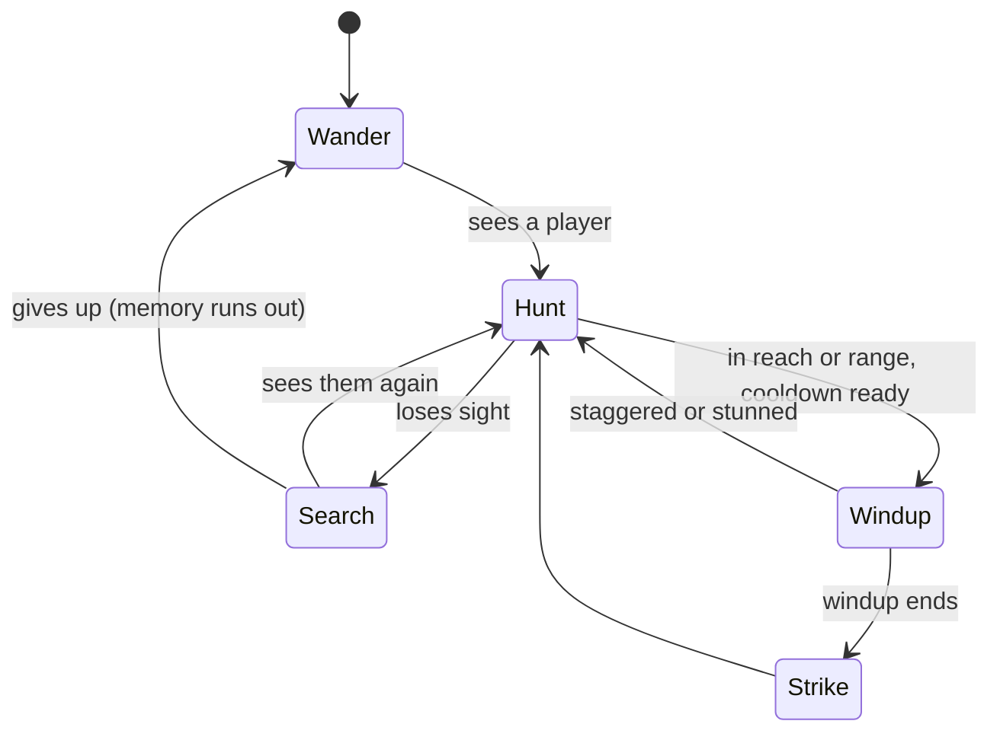

# Monsters

Stats live in `shared/src/monsters/` (`MONSTERS` in `monster-stats.ts`, each kind's own constants in `monsters/kinds/<kind>.ts`). The AI is `server/src/game/horde/` (`Horde` in `horde.ts`), with one class per kind in `horde/monsters/kinds/` (see [architecture.md](architecture.md#monster)). The TV models and animates each kind with a `MonsterAvatar` subclass in `packages/renderer/src/avatars/monsters/kinds/`.

## Roster

| Monster | HP | Speed | Damage | Windup | Cooldown | Reach / range | Sight | Moves like | Drops |
|---|---|---|---|---|---|---|---|---|---|
| Zombie | 10 | 1.6 | 2 | 0.35s | 0.9s | 1.1 | 7 | Shambler | 2 blood, 1 bone |
| Vampire | 18 | 4.8 | 3 | 0.25s | 0.7s | 0.85 | 14 | Shadow walker | 6 blood, 2 bones |
| Brute | 30 | 1.15 | 3.5 (max 4.5) | 0.65s | 1.3s | 1.0 | 7 | Shambler | 6 blood, 3 bones |
| Skeleton | 9 | 1.9 | 2 | 0.7s | 1.8s | shoots from 6.5 | 9 | Shambler | 4 bones |
| Witch | 14 | 1.8 | 1.5 (broom 3) | 0.9s | 2.6s | lobs from 6 | 8 | Shambler | 4 blood, 1 bone |
| Ghoul | 8 | 4.4 | 3.5 | 0.5s | 2s | pounces from 2 to 3.6 | 9 | Shambler | 2 blood, 2 bones |
| Demon | 22 | 2.6 | 6.5 | 0.45s | 1.4s | lunges from 3.6 | 12 | Shadow walker | 16 blood, 1 bone |
| Ghost | 8 | 1.3 | 1 (ectoplasm) | - | 4s | 5 | 6 | Floats through walls | 1 ectoplasm |

- **Shamblers** (`isShambler`) chase, path with A* (built structures costed by their HP), and chew through what's in the way.
- **Shadow walkers** (`isShadowWalker`) stay on dark tiles: they won't enter the brighter 75% of any light (`LIT_FRACTION`), wait at the edge, and dash in when a light dies.
- Health, damage, and blood all scale with the world level (see [difficulty.md](difficulty.md)).

## Attacks

Nothing hurts on contact. Every attack winds up, aiming at its target the whole time, then lands by its `ATTACK_STYLE`.

| Style | Who | What lands |
|---|---|---|
| `melee` | Zombie, vampire, brute | A hitbox: everyone within reach + 0.25 (`STRIKE_SLACK`) and its arc |
| `arrow` | Skeleton | An arrow at 9 tiles/s that stops at walls |
| `potion` | Witch | A potion lobbed to where the target stood; bursts over 1.2 tiles and leaves a puddle |
| `pounce` | Ghoul | A leap of 3.6 tiles in 0.32s, biting the first player it touches |
| `lunge` | Demon | A dash just past the target (at most 4 tiles in 0.24s) |
| `ecto` | Ghost | A slow ball of ectoplasm, through walls |

- **Aim lock:** ghouls and demons stop turning `lock` seconds before they strike (0.3s and 0.12s), so they can be dodged.
- **Player hits don't interrupt attacks**, except the morning star's stagger and the quarterstaff's stun (neither works on brutes).
- **Knockback** moves most monsters; brutes take none (the warhammer shoves them at half).

## Sight and wandering

| Rule | Value |
|---|---|
| Sees anyone within, any direction | 5 tiles (`NEAR_SIGHT`) |
| Sees further inside its facing cone | `sight` tiles, within 1.1 rad either side (`SIGHT_CONE`) |
| Blocks line of sight | Walls, doors, hedges, statues, ruins, the crypt, mausoleums |
| Doesn't block | Trees, gravestones, fences, rocks, lights |

- `Sight.look` (`horde/senses/sight.ts`) works sightings out once a tick, searching only around each player (monsters within 15 tiles, `SIGHT_SEARCH`).
- After losing sight, a monster heads for where it last saw someone, looks around, and gives up after its `memory` seconds. Being hit counts as being seen.
- **Wandering:** zombies shamble to a tile a few steps off at their own pace, weaving and stumbling now and then. Some (`lure`) drift toward where players have been lately or toward clusters of graves. Vampires prowl between dark spots. Ghosts meander with a sway.

## Kind by kind

### Zombie
- Goes for a scarecrow it can see within 8 tiles first.
- Chews walls, doors, fences, and lights in its way (2 damage a bite).
- About 1 in 8 carries junk (more at higher world levels) and hits 1 harder for it. Zombies and brutes can wear a helmet or plate.

### Vampire
- Smashes doors and fences (3 a hit) but is blocked by walls.
- Holy weapons wreck it; blood weapons do only 25%; the stake kills in one hit.
- Hisses when it spots someone and when it strikes.

### Brute
- One overhead slam per 1.3s with a 2.4-tile knockback, capped at 4.5 damage (`BRUTE_MAX_HIT`).
- 6 damage a bite to structures. Takes no knockback.
- A slow, lumbering gait; nearby trees shiver with each step and shake hard at a slam.

### Skeleton
- Shoots from 6.5 tiles and backs away inside 3.
- **Backing off** (`Kiter.backOff`, also the witch): it keeps its heading while that still gets it somewhere; when it stalls, or every 0.8s, it probes a fan of directions 2 tiles out (`FLEE_FAN`, `horde/config/ai.ts`) and takes the one ending furthest from its prey with the most room, so it slides along walls instead of pinning itself in a corner. Boxed in completely, it stands and shoots.
- **Cliffs:** chasing paths drop down any height (`canStep`), so monsters hop down to reach you. Backing off and a ghoul circling its prey move with `noDrop` (`monsterBlocked` in `horde/helpers/terrain.ts`): they never step onto a tile they couldn't climb back up from, so they don't escape (or stumble) off a cliff.

### Witch
- Lobs potions from 6 tiles and backs away inside 4.5, 30% faster than she walks (`FLEE_HASTE`, also skeletons).
- Taller than a person, with blazing yellow-green eyes, a fanged grin, a wart, and clawed fingers.
- The puddle lasts 5s: 1 damage a second and a slow for anyone in it (`PuddleSystem.puddles`).
- Within 1.3 tiles she swings her broom instead: 0.4s windup, 3 damage, 2.8-tile knockback, 2s slow (`WITCH_SWIPE`).

### Ghoul
- Circles its prey 3 tiles out (`GHOUL_ORBIT`), switching direction every few seconds or when it bumps into something, until it can pounce.
- Never pounces from closer than 2 tiles (`GHOUL_MIN_POUNCE`).
- Hunched, bounding on all fours at an unhurried stride even when hunting (`GAIT` 8.5); hisses while hunting, rattles quick clicks as it crouches to pounce (`ghoul-click`), and bites as it lands.

### Demon
- At most 2 at once (`MAX_DEMONS`).
- Lunges at anyone within 3.6 tiles, lit or not, then heads back to the dark.
- Every ~5s while hunting someone more than 3 tiles off, it steps through the shadows to a dark tile 1.7 behind its target (`shadowStep`, a `blink` event).
- On the TV: a see-through crawling shadow with smoke trails, fainter while stalking, solid while attacking. Its attack is a bite.
- Dies in an explosion of bright blood (`DEMON_BURST`) with a double screen shake.

### Ghost
- Light thieves: drift to the nearest burning built light and snuff it after 3s inside it. A player standing in the light scares them off for 4s. Ghost lamps, soul fires, and other `GHOSTPROOF` structures can't be snuffed.
- Every few seconds, lob ectoplasm at anyone within 5 tiles: 1 damage and 45% speed for 2.5s (the player glows green).
- A ghost that sees someone hunts them, hovering 2.5 tiles off with an angry face, until they're 9 tiles away.
- Weapons do 25% damage (at least 1) and 5x knockback. Knocked-back ghosts stop at the fence.

## Spawning and pacing

| Rule | Normal | Blood moon |
|---|---|---|
| Cap | 2 + 4 per living player (+ world level bonus), at most 60 | 2 + 7 per player |
| Spawn interval | 4.5s | 1s |
| Ghosts | 1 per 3 burning built lights, at most one every 20s | 1 per 2 lights |

- Monsters appear on dark tiles within 5 tiles of the map edge, at least 10 tiles from anyone.
- With nobody playing, 10 zombies keep wandering so the TV is never empty.
- **Huge worlds** (`Spawner.spawnNear`): monsters appear on a dark, open tile `SPAWN_MIN_DISTANCE` to `SPAWN_RING_MAX` (24) tiles from a random player and no closer to anyone else. One more than `DESPAWN_DISTANCE` (44) tiles from every player for `DESPAWN_AFTER` (8s) is removed (`Spawner.despawnStrays`). Nothing spawns, and no idle zombies wander, while nobody is playing.
- **Blood moon:** rises after 8 to 12 minutes of play (the clock only runs while someone is connected), lasts 90s, and fades in and out over about 8s. The TV turns red. The Game tab (or the B key on the TV) summons one.
- **Natural spawning** (`GameSettings.spawning`, the Game tab) stops the trickle, idle zombies, ghosts, the blood moon clock, and regrowth. A `quiet` preset starts with it off.

## Hit effects (`HitEffects`)

What a player's hit can do besides damage (`horde/types/hooks.ts`), applied in `Horde.hit` and the kind's `adjustDamage` / `adjustKnockback` overrides:

| Effect | From | Does |
|---|---|---|
| `crush` | Flail | Ignores helmet and plate |
| `cleave` | Battle axe | +25% per other monster in the swing (applied in `MeleeSystem.strike`) |
| `stagger` | Morning star | Chance to cancel a windup (not brutes) |
| `stun` | Quarterstaff | Chance to freeze for 1s and cancel the attack (not brutes) |
| `bruteBane` | Warhammer | x1.5 to brutes, and they take half knockback |
| `execute` | Greatsword | More damage under half health |
| `bleed` | Spiked gauntlet | Damage over 2s, credited to the attacker |

Other modifiers: the cursed obelisk makes monsters near it take 25% more; bone armor's thorns hit back attackers.
