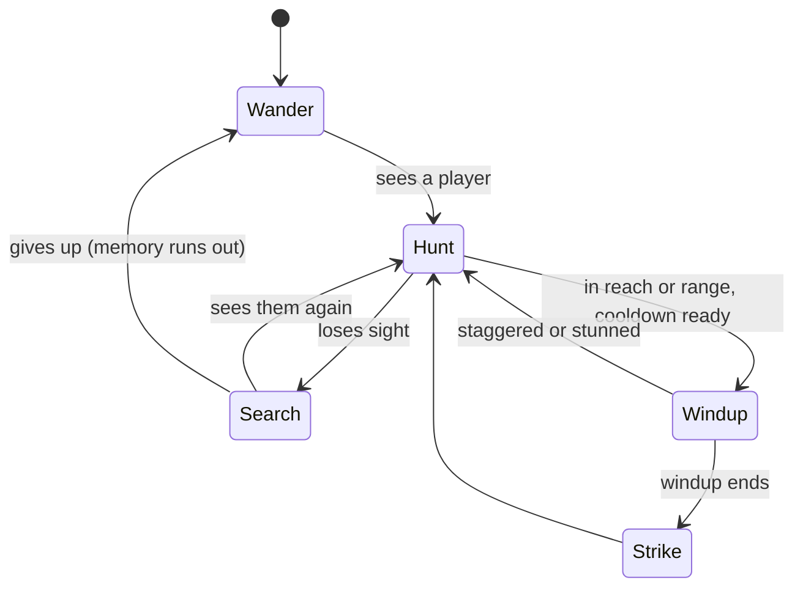

# Monsters

Stats live in `shared/src/monsters/` (`MONSTERS` in `monster-stats.ts`, each kind's own constants in `monsters/kinds/<kind>.ts`). The AI is `server/src/game/horde/` (`Horde` in `horde.ts`), with one class per kind in `horde/monsters/kinds/` (see [architecture.md](architecture.md#monster)). The TV models and animates each kind with a `MonsterAvatar` subclass in `packages/renderer/src/avatars/monsters/kinds/`.

## Roster

| Monster | HP | Speed | Damage | Windup | Cooldown | Reach / range | Sight | Moves like | Drops |
|---|---|---|---|---|---|---|---|---|---|
| Zombie | 10 | 1.6 | 2 | 0.35s | 0.9s | 1.2 (lunges from 2) | 7 | Shambler | 2 blood, 1 bone |
| Vampire | 18 | 6.2 | 3 | 0.25s | 0.7s | 0.85 | 14 | Shadow walker | 6 blood, 2 bones |
| Brute | 30 | 1.15 | 3.5 (max 4.5) | 0.65s | 1.3s | 1.0 | 7 | Shambler | 6 blood, 3 bones, 1 brute tendon |
| Skeleton | 9 | 1.9 | 2 | 0.7s | 1.8s | shoots from 6.5 | 9 | Shambler | 4 bones |
| Witch | 14 | 1.8 | 1.5 (broom 3) | 0.9s | 2.6s | lobs from 6 | 8 | Shambler | 4 blood, 1 bone, a hex shard 50% |
| Ghoul | 8 | 4.4 | 3.5 | 0.5s | 2s | pounces from 2 to 3.6 | 9 | Shambler | 2 blood, 2 bones, a ghoul fang 35% |
| Demon | 22 | 2.6 | 6.5 | 0.45s | 1.4s | lunges from 3.6 | 12 | Shadow walker | 16 blood, 1 bone, 1 brimstone |
| Ghost | 8 | 1.3 | 1 (ectoplasm) | - | 4s | 5 | 6 | Floats, but walls and terrain stop it | 1 ectoplasm |
| Bloater | 16 | 1.1 | 5 (burst) | 0.9s | 2s | bursts within 1.3 | 7 | Shambler | 8 blood, 1 bone |
| Necromancer | 40 | 1.7 | 2 (soul bolt), 4 (nova) | 1.2s | 5s | casts from 7, nova within 2 | 10 | Shambler (keeps away) | 5 blood, 4 bones, 1 hex shard |
| Werewolf | 45 | 6 | 3.5 | 0.3s | 0.8s | 1.05, pounces from 2.2 to 5.5 | 16 | Shambler | 14 blood, 3 bones, 1 ghoul fang |

- **Shamblers** (`isShambler`) chase, path with A* (built structures costed by their HP), and chew through what's in the way.
  - **Scent:** after losing sight of a player, a shambler keeps going for where they really are for 25s while they stay within 22 tiles (`Shambler.scent`, `SCENT_SECONDS`, `SCENT_RADIUS`), so it follows them home and chews through their door and walls after them.
  - **Raids:** in a blood moon, 75% of shamblers (picked by id, `EventModifiers.raid`) go for the nearest base structure within 50 tiles instead of the players (`Shambler.raid`, `raidTarget`, `RAID_TARGETS` in `server/src/game/horde/config/raid.ts`: tables, stations, fires, coffins, turrets, wards; never a storage chest), chewing through walls and doors on the way and repicking every 4s. A player within 5 tiles (`RAID_DISTRACT`) pulls a raider off to fight.
- **Shadow walkers** (`isShadowWalker`) stay on dark tiles: they won't enter the brighter 75% of any light (`LIT_FRACTION`), wait at the edge, and dash in when a light dies.
- **Burning monsters as lights:** a monster burning from Hell's Edge or Infernal Mandate (`burning.light`, `STATUS_GLOWING`) lights the tiles around it (`LightField.update` takes the roster; glows go in their own per-tile count, `_glow`). It's a light for every other monster, for spawning, and in the `lights` list, but not for itself: `LightField.isLit(tx, ty, self)` skips the asking monster's own glow, so a burning vampire or demon still hunts. Two burning shadow walkers side by side do light each other.
- Health, damage, and blood all scale with the world level (see [difficulty.md](difficulty.md)).
- Brutes, ghouls, witches, demons, necromancers, and werewolves also drop essences for [infusions](infusions.md) (`MONSTER_ESSENCE` in `shared/src/loot/monster-drops.ts`, rolled in `MonsterSpoilsSystem.onEvent`).

## Attacks

Nothing hurts on contact. Every attack winds up, aiming at its target the whole time, then lands by its `ATTACK_STYLE`.

| Style | Who | What lands |
|---|---|---|
| `melee` | Zombie, vampire, brute | A hitbox: everyone within reach + 0.25 (`STRIKE_SLACK`) and its arc |
| `arrow` | Skeleton | An arrow at 9 tiles/s that stops at walls |
| `potion` | Witch | A potion lobbed to where the target stood; bursts over 1.2 tiles and leaves a puddle |
| `pounce` | Ghoul | A leap of 3.6 tiles in 0.32s, biting the first player it touches |
| `lunge` | Demon | A dash just past the target (at most 4 tiles in 0.24s) |
| `ecto` | Ghost | A slow ball of ectoplasm, through walls |
| `burst` | Bloater | It bursts where it stands (see Bloater) |
| `raise` | Necromancer | Skeletons come up around it, or a soul bolt; up close, a nova |

- A werewolf's attack is `melee` (claws); its pounce runs on its own clock and is counted in `swipes`, like a witch's broom.

- **Aim lock:** ghouls, demons, and werewolves stop turning `lock` seconds before they strike (0.3s, 0.12s, and 0.18s), so they can be dodged.
- **Player hits don't interrupt attacks**, except the morning star's stagger, stuns, and pins (none work on brutes; see [Statuses](#statuses)).
- **Knockback** moves most monsters; brutes take none (the warhammer shoves them at half).

## Sight and wandering

| Rule | Value |
|---|---|
| Sees anyone within, any direction | 5 tiles (`NEAR_SIGHT`) |
| Sees further inside its facing cone | `sight` tiles, within 1.1 rad either side (`SIGHT_CONE`) |
| Blocks line of sight | Walls, doors, hedges, statues, ruins, the crypt, mausoleums |
| Doesn't block | Trees, gravestones, fences, rocks, lights |

- `Sight.look` (`horde/senses/sight.ts`) works sightings out once a tick, searching only around each player (monsters within 15 tiles, `SIGHT_SEARCH`).
- After losing sight, a monster heads for where it last saw someone, looks around, and gives up after its `memory` seconds. Being hit counts as being seen.
- **Wandering:** zombies shamble to a tile a few steps off at their own pace, weaving and stumbling now and then. Some (`lure`) drift toward where players have been lately or toward clusters of graves. Vampires prowl between dark spots. Ghosts meander with a sway.

## Kind by kind

### Zombie
- **Lunges:** once its next swing is ready it starts it from up to 0.8 tiles past its reach (`lunge`) and steps in over the windup until within reach (`Fighter.lungeIn`), so backing off after a hit draws a swing at you. On cooldown it closes in normally (`Fighter.inReach`). It starts swinging from further than the hammer reaches (1.8).
- Goes for a scarecrow it can see within 8 tiles first.
- Chews walls, doors, fences, and lights in its way (2 damage a bite).
- About 1 in 8 carries junk (more at higher world levels) and hits 1 harder for it. From world level 8 some carry a craftable weapon instead and hit 2 harder (`ZOMBIE_WEAPON_TIERS`, `ZOMBIE_WEAPON_DAMAGE`): spear, stake, quarterstaff from 8; short sword, battle axe, scythe, spiked gauntlet from 12; flail, warhammer, glaive, ritual knife from 16; greatsword, morning star from 20. Whatever it carries drops, partly worn, when it dies. Zombies and brutes can wear a helmet or plate.

### Vampire
- Smashes doors and fences (3 a hit) but is blocked by walls.
- Holy weapons wreck it; blood weapons do only 25%; the stake kills in one hit.
- Hisses when it spots someone and when it strikes.

### Brute
- One overhead slam per 1.3s with a 2.4-tile knockback, capped at 4.5 damage (`BRUTE_MAX_HIT`).
- 6 damage a bite to structures. Takes no knockback.
- A slow, lumbering gait; nearby trees shiver with each step and shake hard at a slam.

### Skeleton
- Shoots from 6.5 tiles and backs away inside 3.
- **Backing off** (`Kiter.backOff`, also the witch): it keeps its heading while that still gets it somewhere; when it stalls, or every 0.8s, it probes a fan of directions 2 tiles out (`FLEE_FAN`, `horde/config/ai.ts`) and takes the one ending furthest from its prey with the most room, so it slides along walls instead of pinning itself in a corner. Boxed in completely, it stands and shoots.
- **Cliffs:** chasing paths drop down any height (`canStep`), so monsters hop down to reach you. Backing off and a ghoul circling its prey move with `noDrop` (`monsterBlocked` in `horde/helpers/terrain.ts`): they never step onto a tile they couldn't climb back up from, so they don't escape (or stumble) off a cliff.

### Witch
- Lobs potions from 6 tiles and backs away inside 4.5, 30% faster than she walks (`FLEE_HASTE`, also skeletons).
- Taller than a person, with blazing yellow-green eyes, a fanged grin, a wart, and clawed fingers.
- The puddle lasts 5s: 1 damage a second and a slow for anyone in it (`PuddleSystem.puddles`).
- Within 1.3 tiles she swings her broom instead: 0.4s windup, 3 damage, 2.8-tile knockback, 2s slow (`WITCH_SWIPE`).

### Ghoul
- Circles its prey 3 tiles out (`GHOUL_ORBIT`), switching direction every few seconds or when it bumps into something, until it can pounce.
- Never pounces from closer than 2 tiles (`GHOUL_MIN_POUNCE`).
- Hunched on all fours with long reaching arms and short hind shins (`GhoulAvatar`), bounding at an unhurried stride even when hunting (`GAIT` 8.5); hisses while hunting, rattles quick clicks as it crouches to pounce (`ghoul-click`), and bites as it lands.

### Demon
- At most 2 at once (`MAX_DEMONS`).
- Lunges at anyone within 3.6 tiles, lit or not, then heads back to the dark.
- Every ~5s while hunting someone more than 3 tiles off, it steps through the shadows to a dark tile 1.7 behind its target (`shadowStep`, a `blink` event).
- On the TV: a see-through crawling shadow with smoke trails, fainter while stalking, solid while attacking. Its attack is a bite.
- Dies in an explosion of bright blood (`DEMON_BURST`) with a double screen shake.

### Ghost
- Light thieves: drift to the nearest burning built light and snuff it after 3s inside it. A player standing in the light scares them off for 4s. Ghost lamps, soul fires, and other `GHOSTPROOF` structures can't be snuffed.
- Every few seconds, lob ectoplasm at anyone within 5 tiles: 1 damage and 45% speed for 2.5s (the player glows green).
- A ghost that sees someone hunts them, hovering 2.5 tiles off with an angry face, until they're 9 tiles away.
- Weapons do 25% damage (at least 1) and 2x knockback (`GHOST_KNOCKBACK`). Ephemeral infusions hit them harder with less knockback (`ghostMult`, `ghostKnock` in `Ghost.adjustKnockback`).
- **Incense** (the Censer Flail and Thurible of Judgment) works on them like a silver bell: they're pushed out to its edge, scared, and skip lights inside it (`HordeContext.incense`, set by `Afflictions.setIncense`).
- **Statuses:** ghosts never burn, bleed, or get poisoned, but can be slowed and cursed; a curse ticks on a ghost at `GHOST_DAMAGE` (25%) of its rate (`Afflicted.afflict`).
- Walls, terrain, and closed doors stop ghosts like any other monster, whether drifting or knocked back (`Ghost.drift`, `Ghost.stepKnockback` use `moveWithCollision` with `monsterBlocked`). They don't path around them: they slide along whatever is in the way. Their ectoplasm still drifts through walls.

### Bloater
- A swollen zombie (`Bloater` in `horde/monsters/kinds/bloater.ts`). It shuffles up to its prey, swells for 0.9s, and bursts, dying.
- It bursts however it dies (`Monster.dying` queues it on `HordeContext.bursts`; `Bursts` in `horde/bursts.ts` sets each off on the next step), so killing one in the middle of the horde clears room, and kill-all sets them all off.
- **Burst** (`BLOATER_BURST`): within 2.2 tiles, players take 5 (scaled like any monster hit) and are thrown 2.2 tiles; every other walker takes 8, which sets off another bloater a step later. It leaves a green bile puddle that acts like a witch's (`PuddleSystem.spill`, `bile` on `PuddleState`).
- A stagger breaks off the swelling.
- On the TV: a huge round gut with glowing boils on short legs, heaving as it breathes, swelling and shuddering through its windup; bursts in green bile with a screen shake (`BILE_SPLASH`).

### Necromancer
- Keeps its distance like a witch (`Kiter`: casts from 7 tiles, backs away inside 5).
- **Raise** (`NECRO_RAISE`): each cast brings 2 skeletons up out of the ground within 2.5 tiles (`HordeContext.raise`, `Spawner.raise`, a `raise` event), while it has fewer than 4 up (`NECRO_MINIONS`). With 4 up, the cast is a soul bolt instead: an ectoplasm ball (2 damage and a slow).
- **Nova** (`Necromancer.nova`): when a player comes within 2 tiles (`NECRO_NOVA_RADIUS`), it stops and glows for 0.45s (`NECRO_NOVA_WINDUP`, a `raise` event as the tell), then blasts everyone that close for 4 damage (`NECRO_NOVA_DAMAGE`, scaled by world level) and 2.5 knockback, at most once every 3s (`NECRO_NOVA_EVERY`). A stun or stagger stops it. So rushing it in means stepping out of the ring when it glows. Each nova counts in `swipes`, and the avatar raises its staff over the windup and slams it down as it goes off (`NecromancerAvatar`).
- Raised skeletons leave nothing when they die (`raised` on `monster-death`), so a necromancer can't be farmed.
- **Ward:** other walkers within 4.5 tiles take 70% of hits (`NECRO_WARD_RADIUS`, `NECRO_WARD`, set each step in `Necromancer.act`). They pulse green on the TV (`STATUS_WARDED`, `WARD_GLOW`).
- On the TV: a tall robe with a bone trim, a deep hood over a skull with green eyes, and a staff topped with a skull and a glowing orb. It lifts the staff as the orb swells, then drives it into the ground.

### Werewolf
- **Blood moon only:** the moon's `spawn-mix` effect adds 8 weight of werewolves to the mix (`EventModifiers.spawnMix`, see [world-events.md](world-events.md)); they never come otherwise (the Game tab can still summon one).
- Runs prey down at 5 tiles a second, faster than a vampire. Chews through structures like a vampire (3 a blow).
- **Pounce:** from 2.2 to 5.5 tiles off, at most every 2s (`WEREWOLF_POUNCE_EVERY`), it crouches 0.45s, then leaps 5 tiles in 0.34s, biting the first player it touches. Up close it claws.
- **Strafe:** in pouncing distance while its next pounce is coming, it circles its prey instead of running straight in (`Werewolf.strafe`): sideways at 75% of its speed (`WEREWOLF_STRAFE_SPEED`), edging 0.35 rad inward (`WEREWOLF_STRAFE_IN`), switching sides every 0.8 to 1.6s (`WEREWOLF_STRAFE_FLIP`) or as soon as something blocks it.
- **Model:** its legs ride on `body` with the torso, and a blow rocks only the torso at the hips (`WerewolfAvatar.applyKick`), so a hit never swings it through the ground.
- Heavy: hits throw it half as far (`WEREWOLF_KNOCKBACK`).
- **Moonset:** once the moon that brought it has set, it runs from the nearest player and is gone in a puff of shadow when nobody is within 14 tiles, or after 12s (`Werewolf.runOff`). Summoned ones stay.
- On the TV: a hulking, hunched wolf-man with a long snout and burning eyes. Spotting someone, it throws its head back and howls (`werewolf-howl`), then drops to all fours and gallops; it rears to claw and crouches low to pounce.

## Spawning and pacing

| Rule | Normal | Blood moon |
|---|---|---|
| Cap | 2 + 4 per living player (+ world level bonus), at most 60 | 2 + 7 per player |
| Spawn interval | 4.5s, and never more than one walker every 6s anywhere on the server (`CALM_SPAWN_GAP`) | 1s (no server-wide limit) |
| Ghosts | 1 per 3 burning built lights, at most one every 20s | 1 per 2 lights |

- Monsters appear on dark tiles within 5 tiles of the map edge, at least 10 tiles from anyone.
- **Mix:** each spawn rolls a kind by its weight (`spawnWeights`, see [difficulty.md](difficulty.md#spawn-weights-by-world-level)), but only among kinds still under their share of the cap (weight over total weight, times the cap, rounded up; `pickKind` in `horde/helpers/spawn-mix.ts`). Kinds that live longer (vampires keep up with players and shrug off blood weapons) can't crowd out the rest. At a small cap a rare kind still gets one slot, so one long-lived demon or witch can be a bigger share than its weight. Demons also stop at `MAX_DEMONS` (2). A zombie when every kind is full.
- With nobody playing, 10 zombies keep wandering so the TV is never empty.
- **Huge worlds** (`Spawner.trickleNear`): every player has their own spawn clock and cap, so a player far from the rest still feels the horde. The server-wide 6s limit still holds, so many spread-out players share it.
- **Calm limit** (`Spawner.calmAllows`): outside a world event that sets the pace, at most one walking monster spawns every 6s across the whole server, whatever the player count, world size, or world level.
  - Their cap counts the walkers within `PRESSURE_RADIUS` (30) tiles of them, and is 2 plus the per-player number for every player within that reach, them included.
  - Their clock runs at the interval times that many players, so a group together gets the same pace and cap as on a small map, and split up, each gets a solo player's.
  - The mix holds in the walkers around each player. `MAX_MONSTERS` (60) still holds across the world.
  - Each monster appears on a dark, open tile `SPAWN_MIN_DISTANCE` to `SPAWN_RING_MAX` (24) tiles from the player it comes for and no closer to anyone else (`Spawner.spawnNear`). One more than `DESPAWN_DISTANCE` (44) tiles from every player for `DESPAWN_AFTER` (8s) is removed (`Spawner.despawnStrays`). Nothing spawns, and no idle zombies wander, while nobody is playing.
- **Blood moon:** a world event (see [world-events.md](world-events.md)). Rises after 8 to 12 minutes of play, lasts 90s, puts the built lights out, and while it's up most monsters swarm the nearest base and the rest go for the nearest player (see Raids above), they hit 1.25x harder, and moves 1.12x faster, and werewolves join the mix (about 7% of spawns). The Game tab (or the B key on the TV) summons one.

- **Natural spawning** (`GameSettings.spawning`, the Game tab) stops the trickle, idle zombies, ghosts, the world event clocks, and regrowth. A `quiet` preset starts with it off.

## Hit effects (`HitEffects`)

What a player's hit can do besides damage (`horde/types/hooks.ts`), applied in `Horde.hit` and the kind's `adjustDamage` / `adjustKnockback` overrides:

| Effect | From | Does |
|---|---|---|
| `crush` | Flail | Ignores helmet and plate |
| `cleave` | Battle axe | +25% per other monster in the swing (applied in `MeleeSystem.strike`) |
| `stagger` | Morning star | Chance to cancel a windup (not brutes) |
| `stun` | Quarterstaff | Chance to freeze for 1s and cancel the attack (not brutes) |
| `bruteBane` | Warhammer | x1.5 to brutes, and they take half knockback |
| `execute` | Greatsword | More damage under half health |
| `executeCursed` | Doomblade, Executioner's Oath | A cursed monster takes max(`executeCursed`, `execute`) at any health |
| `cursedKillBelow` | Executioner's Oath | A cursed monster under that share of its health dies outright; checked after the hit, so the hit that curses can also execute |
| `bleed` | Spiked gauntlet, Bloodletter | Damage over 2s, credited to the attacker |
| `burn`, `poison`, `curse`, `slowOnHit`, `pin`, `turn`, `raise` | Infused weapons | Statuses (see [Statuses](#statuses)) |
| `ghostKnock` | Ephemeral infusions | Replaces `GHOST_KNOCKBACK` on ghosts |
| `stunFor`, `bruteStagger` | Earthshaker fissure | Stun length in place of `STUN_SECONDS`; a stun roll on a brute staggers it instead |
| `tipped` | The Impaler, the thrown glaive | Counts the hit as on the tip for a tip-only pin |
| `fromMonster` | A turned monster's blow | The only hit a risen ally takes |

- Weapon fields share their names with `WeaponStats`, so melee's `{ ...weapon, by: p }` and a shot's `{ ...s.stats, by: s.owner }` carry them with no extra wiring.
- **Stuns** (`stun`, `stunFor`) never shorten a stun already running.
- **Kill credit:** `takeHit` passes `effects.by` to `HordeContext.kill`, so thorns kills go to the armor's wearer.
- **Knockback:** a hit with no knockback leaves one already in progress alone.

Other modifiers: the cursed obelisk makes monsters near it take 25% more; bone armor's thorns hit back attackers.

## Statuses

Every monster is an `Afflicted` (`horde/monsters/afflicted.ts`, between `MonsterCore` and `Monster`), which holds one state object per status (`horde/monsters/state/`). Hits apply them through `HitEffects`; other effects (patches, blasts, the flamethrower turret) through `Horde.afflictions` (`Afflictions`: `afflict`, `drain`, `turn`, `raiseAlly`). `MonsterState.status` sends them as bits (`shared/src/monsters/monster-status.ts`), and the TV tints and decorates each (`MonsterAfflictions`, see [tv.md](tv.md)).

| Status | Bit | From | Does |
|---|---|---|---|
| Burning | `STATUS_BURNING` | Enflamed weapons, scorch and fire patches, the flamethrower turret, Requiem Pyre | Damage a second (`Burning`); never on ghosts |
| Glowing | `STATUS_GLOWING` | Hell's Edge, Infernal Mandate | Burning that gives off light (see shadow walkers above) |
| Cursed | `STATUS_CURSED` | Hexed weapons | Damage a second, every hit x`taken`, speed x`slow` (`Cursed`); on a ghost it ticks at 25% |
| Poisoned | `STATUS_POISONED` | Ghoul Poker, The Impaler | Damage a second (`Poisoned`); never on ghosts |
| Bleeding | `STATUS_BLEEDING` | Spiked gauntlet, Bloodletter, Heart Devourer | Damage a second (`Bleeding`); never on ghosts |
| Slowed | `STATUS_SLOWED` | Phantom Edge, Spirit Bow, Wraithstring | Speed x`factor` (`Slowed`); works on ghosts |
| Pinned | `STATUS_PINNED` | The Impaler, Hunter's Arbalest | Held in place (`Pinned`) |
| Turned | `STATUS_TURNED` | Plague Knuckles, Grave Fists | Fights other monsters (`Turned`) |
| Warded | `STATUS_WARDED` | A nearby necromancer | Takes 70% of hits (see Necromancer) |

- **Wounds refresh, never stack:** burn, poison, curse, and bleed share the `Wound` base: a new one keeps the higher rate and the later end, and one with no `by` keeps the old credit. `Monster.update` ticks them through `Monster.drain`, crediting each wound's `by`; a wound kill dies with its cause (`'bleed'`, `'burn'`, `'poison'`, `'curse'`).
- **Slows:** the stronger of the curse slow and a hit slow wins (`Afflicted.slowFactor`), applied in `Walker.moveToward`, `Ghost.drift`, and `Fighter.leap`.
- **Pins:** never on brutes, and only `pin.kinds` when set. A tip-only pin needs the hit past `reach * TIP_FROM` (or `tipped`). It ignores the mid-leap stun block, cancels a leap or windup, stops knockback while it lasts, and makes hits from anyone but the pinner x`bonus`.
- **The curse's `taken` and a pin's `bonus`** apply to hits only, not to damage over time.

### Turned monsters and risen allies

- **Turned** (Plague Knuckles): only fighters can be turned (`Fighter.canTurn`), and only by a hit on a monster that was already bleeding. A turned monster goes for the nearest bodied, unturned monster within `TURNED_SIGHT` (8 tiles, `horde/config/turned.ts`), hits it every `def.cooldown` (knockback `TURNED_KNOCKBACK` 0.5) credited to the player who turned it, and never attacks players while turned.
- **Risen allies** (Grave Fists): a listed kind dying from the player's bleed rises on their side through `Spawner.raise` (a `raise` event; it drops nothing). It's turned for the whole of its life, takes only monster blows (`fromMonster`), and dies with cause `'expired'` when its time runs out.
- **Player side skips allies:** `Horde.targets` and `Horde.targetsAt` leave risen allies out, so player swings, shots, aim assist, chains, slams, blasts, the flame, and the glaive pass them by. Turrets skip them too (`TurretSystem.fireTurrets`).
- Monsters don't fight back against a turned one.

### Deaths

Every death (hits, wounds, traps, expiry) goes out through the optional `HordeHooks.died` hook as a `MonsterDeath` (`horde/types/death.ts`: id, kind, spot, killer, `cause`, `status` at death, `bleedBy`, `raised`, `ally`). The game's `GameHordeHooks.died` hands it to `InfusionSystem.onDeath` for on-kill effects.
