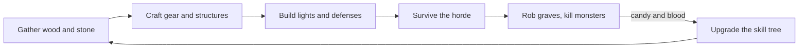

# Overview

Grave Robbers is a top-down, pixelated voxel horror party game. A TV shows the graveyard; everyone plays on their phone, which becomes a controller.

## Pillars

| Pillar | What it means |
|---|---|
| Drop-in, persistent world | No rounds and no lobby. The world keeps running; people join and leave whenever. |
| Gather, build, survive | Chop, mine, and rob graves for materials, build defenses and lights, and last the night. |
| Death hurts | You lose half your candy and blood, and your bag spills (only you can pick it back up). Equipped gear stays. |
| One screen | The whole map is always visible on the TV with a fixed camera. Max 8 players. |
| Always night | Zombies, vampires, ghosts, and worse. Light is safety. |

## Core loop

- **Candy** comes from graves, statues, crypts, and chests.
- **Blood** comes from monsters (and the sacrificial altar).
- Both are spent on skill tree upgrades, and on nothing else. Upgrades work anywhere; a research table makes them cheaper.

## Where to read more

| Topic | Doc |
|---|---|
| How the code is laid out, networking, saves | [architecture.md](architecture.md) |
| Where new code goes and how it's shaped | [organization.md](organization.md) |
| The map, terrain, and what grows back | [world.md](world.md) |
| Health, death, PvP, melee, and blocking | [combat.md](combat.md) |
| Every weapon and piece of armor | [weapons.md](weapons.md) |
| Monsters, AI, and spawning | [monsters.md](monsters.md) |
| Hidden player and world levels | [difficulty.md](difficulty.md) |
| Inventory, resources, structures, stations | [building.md](building.md) |
| The skill tree | [skill-tree.md](skill-tree.md) |
| The phone controller | [phone.md](phone.md) |
| The TV renderer and sidebar | [tv.md](tv.md) |
| Sound effects and music | [audio.md](audio.md) |

## Not built yet

Ideas from the original design that haven't been made:

- TV roster with hearts, weapon, and survival time.
- An all-time "Longest night" top 3, saved with the world.
- Floating damage numbers and a blood moon splash.
