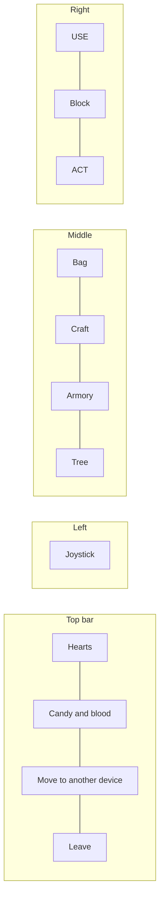

# Phone controller

The phone is `/`, the `apps/mobile` app (`controller-page.tsx`, the pad in `components/pad/controller-pad.tsx`, sticks in `components/sticks/`); its menus (bag, craft, Armory, tree, details) are in `packages/game-ui`, shared with /play. Landscape only; portrait shows a rotate prompt.

## Layout

| Control | What it does |
|---|---|
| Joystick (left half) | Move. You face the way you last moved. Sampled on an interval and only sent when it changes. |
| USE | Opens or works the first thing within 2.2 tiles the way you face (else the tile in front) without ever hurting it: a storage chest, a bone digger, station, or belt sorter (a panel, below), the skill tree at a research table, the Armory at an anvil; offers at an altar, loads a turret, waters, relights, opens a chest (see [building.md](building.md#structures)) |
| ACT (hold to repeat) | Hits and works the tile in front: attack, chop, dig, rob, smash, knock a structure down. Also a stick: drag from where the thumb lands (snapped to 8 ways) to turn and act that way while walking. |
| BLOCK (hold) | Shows with a shield beside a one-handed weapon: raises it |
| Bag | Equipped slots and the 24-slot bag |
| Craft | The Craft list |
| Armory | The Armory, full screen: browse and infuse weapons (see [Armory](#armory)). Hidden until an anvil is available: the player's anvil node is open, or an anvil (anyone's) is in reach (`armoryOpen` in `packages/game-ui/src/helpers/armory.ts`); if it stops being available while open, the panel closes |
| Tree | The skill tree, full screen (see [skill-tree.md](skill-tree.md#on-the-phone)) |
| Panic | On every panel: closes it and runs the player from nearby monsters |
| Move to another device | Opens `TransferMenu` with `TransferCode` (`packages/game-ui`): asks for a transfer code and shows it, to type with this name on another device's join form (good once, for 10 minutes; see [architecture.md](architecture.md#identity)) |
| Leave | Leaves the game (the character is saved and comes back when this phone joins under the name again); just putting the phone down doesn't |

The four panel buttons (`PANEL_TABS` in `apps/mobile/src/config/pad.ts`, `PanelTabs`) are 56px round buttons so all four fit down a landscape phone.

Pinch zoom, double-tap zoom, and page scrolling are blocked so two thumbs can't knock the page around.

The screen stays on while you're in the game (`useWakeLock`, from the first tap). Phones reach the game over plain HTTP on the LAN, where the Wake Lock API doesn't exist, so `nosleep.js` plays an invisible looping video instead.

The page can't be wider than the screen: `html` and `body` hide horizontal overflow, and the viewport meta sets `shrink-to-fit=no`, so nothing can make the phone zoom out.

## TV controllers

With game controllers plugged into the TV, a controller button shows in the top bar. It lists them to claim one (Use or Taken). See [tv.md](tv.md#controllers-on-the-tv).

While you hold one, the phone is just the menus:

- The controller walks, aims, hits, uses (A), blocks, and panics; the joystick, USE, Block, and Action are gone.
- The Bag, Craft, Armory, and Tree buttons sit on the far left and one is always open, the bag first. The tree and the Armory open in place (`TreePanel` and `ArmoryPanel` `embedded`, no Back) instead of full screen.
- Bag and Craft have no title or Panic button (B on the controller panics).
- Bag slots have a fixed size from the screen height (`BAG_SLOT_SIZE` in `apps/mobile/src/config/pad.ts`, at most 56px) and pack as many to a row as fit, so the equipped row and at least 2.5 bag rows always show. The craft grid is capped at 420px wide.
- The controller button (green while held) opens a dialog with the controller's name, its controls, and Release.
- The controller's left face button, top face button, and Back/Minus switch to the Bag, Craft, and Tree tabs (`pad-menu`), cancelling a build in progress.
- Craft lays the list out beside the picked recipe's details (`CraftPanel` `aside`, `ItemDetails` `inline`), shown as soon as it's tapped (cost included), with the count and Craft under them.
- The tree has no header (no research note or Panic).
- Building works as before, and the controller can do it too: RT places, LB and RB turn the structure a quarter turn.

## Panels

### Bag
- Tap an item to pick it up, then tap another slot to move it there (onto a matching stack, swapping, or into its equipped slot), or tap it again to use it (equip, put away, drink).
- The top row is the equipped slots, each right after a dim grey voxel label: an open hand for the main hand, a mirrored one for the off hand, and a breastplate for armor (`ui:hand-main`, `ui:hand-off`, `ui:armor`). They're the same size as the bag slots and don't stretch to fill the row.
- Candy and blood aren't in the bag; they're in the top bar.
- While something is picked up, a Drop button beside the hint throws it in front of you.
- While a piece of gear is picked up, the empty equipped slot it fits lights up (full-color fallback icon, dashed border) so it's obvious it can go there.
- A wear bar shows only under a stake.

### Building
Tapping a stack of structures in the bag goes straight to building:

| Right side shows | Does |
|---|---|
| Turn stick | Face where it should go (the left joystick still walks) |
| Rotate left / right (belts and walls) | Turns what's being built a quarter turn (`turn`) |
| Type popup, bottom left (wood wall, stone wall, bone wall) | Every look with its name, the picked one outlined; tap one to build in it (`WallStylePopup`, see [building.md](building.md#wall-looks-and-rotation)) |
| Back | Back to the bag |
| Build | Places one on the facing tile (pushed past you if you'd overlap it) |
| Hold (torches only) | Takes a torch in hand instead |

The TV previews it: a dim white outline where it will go, light red with whatever's in the way outlined if it can't.

### Storage chest
USE on any storage chest opens it full screen: your bag on the left, the chest on the right. Tap an item to move it to the other side. Pick up takes the empty chest back, and only shows on a chest you built. It closes on Back or when you walk away. See [building.md](building.md#storage-chests).

### Bone digger, station, and belt sorter
USE on your own bone digger or any station opens it full screen (`UsePanel` in `packages/game-ui/src/components/use/`): its icon, name and level, then for a digger what it has dug up (of 60), a bar to its next dig, and Collect; for a station what it turns into what, its batches as pips with a bar for the current one, its output slot (`StationOutputSlot`: what it has made, out of 99; tap to collect, and it stops when full), what it pulled from piles nearby, the cost of one batch against what you carry, and Feed 1 / Feed all (a quarry works on its own). It closes on Back, Panic, or when you walk away.

A belt sorter's panel (`SorterView`, no level) says "Pick what goes out each side. Everything else rolls on <forward>." and lists one row per side in `SORT_SIDES` order (Up, Down, Left, Right, labels in `SORT_SIDE_LABELS` in `packages/game-ui/src/config/sorting.ts`):

- The forward side (the way it was laid) reads "Everything else" and has no picker.
- Every other row shows what goes out it, its icon and name (`sortKeyLabel` in `helpers/sorting.ts`: `itemLabel`, or `GOODS_LABELS` for candy and blood), or Nothing. Tapping it opens a picker under it (`SortKeyPicker`, one open at a time): Nothing, then everything from `sortableKeys(tree)` grouped as Gear, Structures, and Goods (`sortGroups`), three icons to a row, each marked with the side it already goes out, if any.
- Tapping a thing sends `use-route` (`PlayerCommands.useRoute`) and closes the picker. The server moves a thing off any other side it was on, so it only ever goes one way.

### Craft
- Unlocked recipes as icons, dimmed if you're short or they need an anvil you aren't beside. Locked ones don't show at all unless Show locked is ticked, and then only as plain lock tiles that don't give away what they are.
- Sorted by category (the skill tree's branches), then tier (`nodeDepth`; ammo goes with its weapon, other material recipes with the node that opens them), then name.
- Tap one: a bar shows what one costs (anything you're short of in red, and Craft beside an anvil if it needs one you aren't near), then its name, a count with - and +, and Craft (with a hammering chime).
- Double tap (`DOUBLE_TAP_MS`, 350ms) or hold one for its details. The details scroll when they're taller than the screen; tap outside them or their X to close.
- Tap a material or candy or blood in any cost (craft bar, details, tree sidebar) to see its name above it for a moment (`HoverLabel`, `TAP_LABEL_MS`); a mouse shows it on hover.

### Armory
The anvil's infusion panel (`ArmoryPanel` in `packages/game-ui/src/components/armory/`), shared with /play. It also opens from USE on an anvil. What it shows, when Infuse lights up, and what happens on the server are in [infusions.md](infusions.md#the-armory).

### Details
Holding anything in the Bag, Craft, or Tree opens its details, spaced out in a card:
- **Infused gear** (a `GearItem` with an `infusion`) shows its variant name (`gearLabel`) with its prefix under it in the brand color (`gearPrefix`), the variant's blurb, stat bars with the infusion (`statsOf(recipe, tree, infusion)`), its variant model, and no craft cost. Bag and stash slots name and draw it the same way (`bagItemLabel`, `bagItemIcon`).
- Name, a short (often spooky) description (`itemBlurb`: `GEAR_BLURBS`, `STRUCTURE_BLURBS`, `GOODS_BLURBS` in `shared/src/inventory/item-blurbs.ts`; every item has one), and slowly turning model, with more room around it on wider screens.
- Stat bars: each stat has its own 3D icon and its own color on every item (`StatSheet`s set `icon` and `color`):

| Color | Stats |
|---|---|
| Red | Damage, damage a second, damage to walkers, thorns |
| Yellow | Swing speed, fire rate, work speed |
| Blue | Reach, range |
| Sky | Knockback |
| Brown | Gathering, dig speed |
| Tan | Lasts (hits), condition |
| Green | Toughness |
| Blood | Kill blood |
| Ecto | Ghost ward |
| Sun / orange | Light / brightness |
| Steel | Damage blocked |

- What a station turns into what.
- **Traits**, under their own heading, one sentence each with a 3D icon (`helpers/traits.ts`, `TraitList`): the weapon's trick (`WEAPON_TRICKS`), what it shoots, what it kills in one hit, holy damage, "Vampires take only 25% of its damage" for blood weapons, health costs and healing, a turret's ammo and how it fights, and for ammo (arrows, bolts, wood) what shoots or burns it (`ammoTraits`).
- Cost against what you carry (less an anvil's discount, `craftCost`), and what unlocks it. Hovering any ingredient (or a station's input or output) shows its name straight away (`HoverLabel` in `GoodsRow`).
- For anvil recipes, whether an anvil is in reach ("Craft beside an anvil" in red when not) and its discount.
- For a held stake, how much use is left.

### Stat and trait icons
- Pre-rendered images, never drawn live: `packages/game-ui/src/assets/stat-icons/` holds one PNG per icon (`STAT_ICONS`) and one stat bar block per color (`block-<color>`, `STAT_COLORS`, plus `block-empty`), looked up by `statIconUrl` and `statBlockUrl`.
- They're voxel pixel-art (`scripts/stat-icons/stat-art.ts`, `trait-art.ts`), pushed out into 3D with a flat back and a front that steps up toward the middle (`RISE`, `MOST_STEPS`), then drawn from the item icons' camera by a small ray caster (`VoxelRaster`) with no dependencies: low fill light so turned-away faces go dark, shadows cast by one part on another (`IN_SHADOW`), a little shading even on glowing parts (`GLOW_SHADE`), and a soft drop shadow below and right (`DROP_SHADOW`).
- After changing the art or the colors, run `npx tsx packages/game-ui/scripts/render-stat-icons.ts` and keep the new PNGs.

## Feedback

| Moment | Phone shows |
|---|---|
| Any gain of candy or blood | A "+6 candy" toast with the icon (`components/hud/pickup-toasts.tsx`). The candy and blood counts in the top bar (`PadHeader`) show while the phone's display settings (`PHONE_DISPLAY`, the defaults, in `apps/mobile/src/config/display.ts`) have Show candies & blood on |
| Hurt, death, respawn | Sounds and haptics from vitals changes |
| Healing from ritual knife kills | The hearts coming back strobe red until they're in (`Vitals.healing`, `heal-strobe` in `hearts.tsx`) |
| Overheal (Heart Devourer, Death's Harvest) | Brass hearts after the red ones in the top bar, a part heart at half opacity (`Vitals.overheal`, `ui:heart-over`, `Hearts` `overheal`; see [combat.md](combat.md#overheal)) |
| Death | Death screen: time survived, killer, respawn countdown |
| Killing another player | A huge shaking NAUGHTY with the candy draining to 0 (`components/screens/naughty-screen.tsx`) |
| Own actions | A `sounds` message plays them locally |

## Look

- **Icons** are little voxel models drawn once with the TV's own models (`renderer/src/icons/item-icons.ts` over `models/items/` and `models/gear/`, shown by `ItemIcon`): items, materials, candy, blood, the Bag/Craft/Tree buttons (a satchel, a hammer on an anvil, a bare tree with glowing buds), the bag's grey hand and breastplate slot labels, and the hearts (red, cracked scab-red for a fresh wound, dark when empty).
- **Font:** the studio theme's Geist everywhere (`font-sans`), medium weight for labels. There's no pixel font; the voxel icons carry the game's look.
- **Spacing:** 6px between an icon and its text (`gap-1.5`); 2px between a goods icon and its count.
