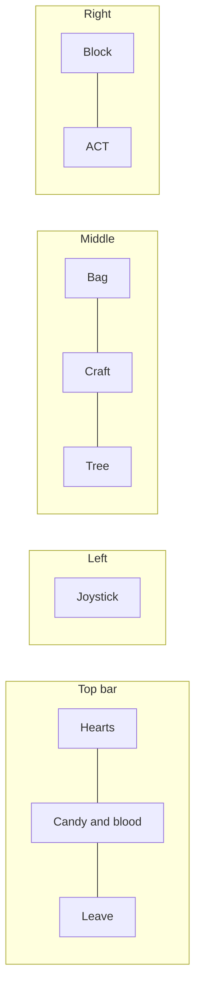

# Phone controller

The phone is `/`, the `apps/mobile` app (`controller-page.tsx`, the pad in `components/pad/controller-pad.tsx`, sticks in `components/sticks/`); its menus (bag, craft, tree, details) are in `packages/game-ui`, shared with /play. Landscape only; portrait shows a rotate prompt.

## Layout

| Control | What it does |
|---|---|
| Joystick (left half) | Move. You face the way you last moved. Sampled on an interval and only sent when it changes. |
| ACT (hold to repeat) | Acts on the tile in front: attack, chop, dig, rob, smash, open, refuel, relight, feed a station, offer at an altar, load a sentry. Also a stick: drag from where the thumb lands (snapped to 8 ways) to turn and act that way while walking. |
| BLOCK (hold) | Shows with a shield beside a one-handed weapon: raises it |
| Bag | Equipped slots and the 24-slot bag |
| Craft | The Craft list |
| Tree | The skill tree, full screen (see [skill-tree.md](skill-tree.md#on-the-phone)) |
| Panic | On every panel: closes it and runs the player from nearby monsters |
| Leave | Leaves the game; just putting the phone down doesn't |

Pinch zoom, double-tap zoom, and page scrolling are blocked so two thumbs can't knock the page around.

The screen stays on while you're in the game (`useWakeLock`, from the first tap). Phones reach the game over plain HTTP on the LAN, where the Wake Lock API doesn't exist, so `nosleep.js` plays an invisible looping video instead.

The page can't be wider than the screen: `html` and `body` hide horizontal overflow, and the viewport meta sets `shrink-to-fit=no`, so nothing can make the phone zoom out.

## TV controllers

With game controllers plugged into the TV, a controller button shows in the top bar. It lists them to claim one (Use or Taken). See [tv.md](tv.md#controllers-on-the-tv).

While you hold one, the phone is just the menus:

- The controller walks, aims, hits, blocks, and panics; the joystick, Block, and Action are gone.
- The Bag, Craft, and Tree buttons sit on the far left and one is always open, the bag first. The tree opens in place (`TreePanel` `embedded`, no Back) instead of full screen.
- Bag and Craft have no title or Panic button (B on the controller panics).
- Bag slots have a fixed size from the screen height (`BAG_SLOT_SIZE` in `apps/mobile/src/config/pad.ts`, at most 56px) and pack as many to a row as fit, so the equipped row and at least 2.5 bag rows always show. The craft grid is capped at 420px wide.
- The controller button (green while held) opens a dialog with the controller's name, its controls, and Release.
- The controller's left face button, top face button, and Back/Minus switch to the Bag, Craft, and Tree tabs (`pad-menu`), cancelling a build in progress.
- Craft lays the list out beside the picked recipe's details (`CraftPanel` `aside`, `ItemDetails` `inline`), shown as soon as it's tapped (cost included), with the count and Craft under them.
- The tree has no header (no research note or Panic).
- Building works as before, and the controller can do it too: RT places, LB and RB turn the structure a quarter turn.

## Panels

### Bag
- Tap an item to pick it up, then tap another slot to move it there (onto a matching stack, swapping, or into its equipped slot), or tap it again to use it (equip, put away, drink).
- The top row is the equipped slots, each right after a dim grey voxel label: an open hand for the main hand, a mirrored one for the off hand, and a breastplate for armor (`ui:hand-main`, `ui:hand-off`, `ui:armor`). They're the same size as the bag slots and don't stretch to fill the row.
- Candy and blood aren't in the bag; they're in the top bar.
- While something is picked up, a Drop button beside the hint throws it in front of you.
- While a piece of gear is picked up, the empty equipped slot it fits lights up (full-color fallback icon, dashed border) so it's obvious it can go there.
- A wear bar shows only under a stake.

### Building
Tapping a stack of structures in the bag goes straight to building:

| Right side shows | Does |
|---|---|
| Turn stick | Face where it should go (the left joystick still walks) |
| Back | Back to the bag |
| Build | Places one on the facing tile (pushed past you if you'd overlap it) |
| Hold (torches only) | Takes a torch in hand instead |

The TV previews it: a dim white outline where it will go, light red with whatever's in the way outlined if it can't.

### Storage chest
ACT on your own storage chest opens it full screen: your bag on the left, the chest on the right. Tap an item to move it to the other side. Pick up takes the empty chest back. It closes on Back or when you walk away. See [building.md](building.md#storage-chests).

### Craft
- Unlocked recipes as icons, dimmed if you're short or they need an anvil you aren't beside. Locked ones don't show at all unless Show locked is ticked, and then only as plain lock tiles that don't give away what they are.
- Sorted by category (the skill tree's branches), then tier (`nodeDepth`; ammo goes with its weapon, other material recipes with the node that opens them), then name.
- Tap one: a bar shows its name, a count with - and +, and Craft (with a hammering chime).

### Details
Holding anything in the Bag, Craft, or Tree opens its details:
- Name and slowly turning model.
- Stat bars colored by strength (red, amber, green).
- Traits in words, including the weapon's trick (`WEAPON_TRICKS`).
- Cost against what you carry (less an anvil's discount, `craftCost`), and what unlocks it.
- For anvil recipes, whether an anvil is in reach ("Craft beside an anvil" in red when not) and its discount.
- For a held stake, how much use is left.

## Feedback

| Moment | Phone shows |
|---|---|
| Any gain of candy or blood | A "+6 candy" toast with the icon (`components/hud/pickup-toasts.tsx`) |
| Hurt, death, respawn | Sounds and haptics from vitals changes |
| Healing from ritual knife kills | The hearts coming back strobe red until they're in (`Vitals.healing`, `heal-strobe` in `hearts.tsx`) |
| Death | Death screen: time survived, killer, respawn countdown |
| Killing another player | A huge shaking NAUGHTY with the candy draining to 0 (`components/screens/naughty-screen.tsx`) |
| Own actions | A `sounds` message plays them locally |

## Look

- **Icons** are little voxel models drawn once with the TV's own models (`renderer/src/icons/item-icons.ts` over `models/items/` and `models/gear/`, shown by `ItemIcon`): items, materials, candy, blood, the Bag/Craft/Tree buttons (a satchel, a hammer on an anvil, a bare tree with glowing buds), the bag's grey hand and breastplate slot labels, and the hearts (red, grey for a fresh wound, dark when empty).
- **Font:** the studio theme's Geist everywhere (`font-sans`), medium weight for labels. There's no pixel font; the voxel icons carry the game's look.
- **Spacing:** 6px between an icon and its text (`gap-1.5`); 2px between a goods icon and its count.
