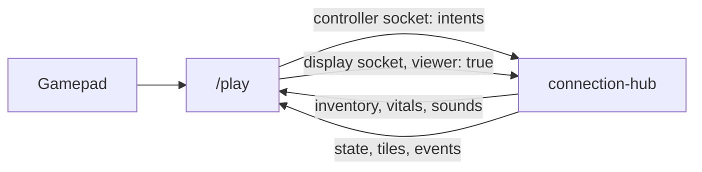

# Play screen (/play)

`/play` plays the game on a screen of its own (a PC monitor, a second TV) with a game controller or a keyboard and mouse, the `apps/play` app. It shows the graveyard up close, following the player, with the phone's menus covering the screen when opened.

## How it connects

- The player side is the phone's session (`useControllerSession` in `packages/game-ui/src/hooks/use-controller-session.ts`, shared with the phone), with its own token key, `graveyard.play.token` (`PLAY_TOKEN_KEY`), so a phone and a /play screen in the same browser stay different players.
- The view is a display that says `viewer: true` in `hello-display`. A viewer gets every state message but is never handed the TV's music and can't edit the map or save presets.
- `WorldRenderer.setFollow(id, view)` (through `CameraRig`) aims the camera at the player and zooms to `tall` tiles of ground top to bottom.
- The view sends `watch` with its player, so on a huge world it's sent only their surroundings and the TV leaves them out of its split screen (see [architecture.md](architecture.md#huge-worlds)).
- Your own player moves the moment you press (`Predictor`, `apps/play/src/prediction/predictor.ts`), and melee swings start on the press; see [architecture.md](architecture.md#latency). The top bar shows your ping (red over 120 ms). The camera eases after the player and stops a couple of tiles past the map's edge.

## Controls

A controller and the keyboard and mouse work at the same time. The on-screen hints and menu labels follow whichever was used last. Whichever connected controller was used last plays, and hurts, deaths, and pickups rumble it.

### In the world

Every button and key except the sticks and the mouse's aim can be rebound in Settings (`PlaySettings.keys` and `pad`, defaults `DEFAULT_KEYS` and `DEFAULT_PAD` in `apps/play/src/config/bindings.ts`, loaded and saved by `helpers/play-settings.ts`).

| Action | Keyboard and mouse | Controller |
|---|---|---|
| Walk | WASD | Left stick |
| Aim (turn and act that way) | The mouse, snapped to 8 ways | Right stick |
| Hit, and every other action on the tile in front (hold to repeat) | Left click | RT |
| Shield | Left Shift | LB |
| Rotate what's being built | R | LB / RB |
| Bag | E | West face button (X on Xbox) |
| Craft | Q | North face button (Y on Xbox) |
| Skill tree | T | Back |
| Settings | Esc | Start |

- The mouse aims only once it has moved since the right stick was last used, so a resting mouse doesn't fight the stick.
- Keys typed into a text field (the join form's name) don't count.

### The input loop

`usePlayInput` runs a `PlayInputLoop` (`apps/play/src/input/play-input-loop.ts`) once a frame. It finds the pad being played (`gamepad-frame.ts`), reads the keys and mouse (`keyboard-mouse.ts`), then runs one `InputMode` (`input/modes/`), and unless the mode halts the frame, steps the prediction.

| Mode | When |
|---|---|
| `CaptureMode` | Waiting for a pad button to rebind |
| `MenuMode` | A menu, a storage chest, or the join screen |
| `FightMode` (a `WalkMode`) | Out in the world with a weapon |
| `BuildMode` (a `WalkMode`) | Out in the world, building |
| `IdleMode` | Not joined, or dead |

### In a menu

| Input | Does |
|---|---|
| D-pad or left stick | Move the selection (held, it repeats) |
| A | Press the selection |
| Right stick | Scroll |
| LB / RB | Previous / next menu |
| B, Esc, or the menu's own button again | Close |
| Mouse | Click anything |

The selection is `SpatialNav` (`nav/spatial-nav.ts`): the nearest button in the pressed direction, favoring ones straight ahead, outlined with `.pad-focus`. It also gets real focus, so a keyboard can type into the join form's name field.

### Building

Picking a structure in the bag closes the menu and starts building it, with a banner at the bottom: aim, then Attack, A, or right click builds, and B (or Esc) goes back to the bag. /play has no Panic.

- **Mouse aim:** the build goes on the tile under the mouse, as long as it's within `BUILD_REACH` (2.5 tiles) of the player; past that, the furthest tile they can reach in the mouse's direction (`buildTarget` in `shared/src/world/targeting.ts`). The page sends the point (`build-aim`, `PlayerKit.buildAim`) and draws the preview there at once (`WorldRenderer.setBuildAim`). With the right stick (or a phone) it's the facing tile, as before.
- **Rotate:** R (or LB / RB) turns what's being built a quarter turn (`ControlSystem.turn`, `PlayerKit.buildFacing`), shown as a chevron over the preview for structures that face a way (conveyor belts, `TURNED`). It starts from where the player faces and resets when building stops.

## Screen

| Part | What it is |
|---|---|
| Top bar | Hearts, candy, and blood, over the view |
| Menu dialog | Bag, Craft, Skill tree, and Settings open in one dialog over the game: the game shows through its slightly see-through panel and a 40% dimmed backdrop (click it to close). Its tabs are icons with tooltips naming them and their key; an X closes it. Contents are centered. |
| Bag | The phone's bag (capped at 320px wide so it all fits) |
| Craft | The recipe list beside the picked recipe's details (`CraftPanel` `aside`); hover a cost for the material's name |
| Skill tree | The phone's tree panel in place (`TreePanel` `embedded`, no header), with the Upgrade button at the bottom of its side panel. With `hoverDetails` it pans by dragging, the scroll wheel (sideways when there's nothing to scroll down), and WASD, and resting the mouse on a node for a second shows its details beside it. |
| Settings | Sections one above the other: View (zoom, menu size), Keyboard and mouse, Controller, then Leave game |
| Overlays | Pickup toasts, the storage chest page (B closes it), NAUGHTY, the death screen (darkening the view only 25%, `seeThrough`, so you can see what killed you) |

- The UI is laid out for a phone-sized screen and scaled up to fit: screen height over 430 px, times the menu size (small 0.8, medium 1, large 1.25).
- Settings are kept in localStorage (`graveyard.play.settings`): zoom from 8 to 32 tiles tall in steps of 2 (default 20, `FOLLOW_TALL`; a zoom already saved stays), menu size (default small; one already saved stays), and bindings.
- To rebind, press an action's binding in Settings, then the new key, click, or controller button. Esc cancels a key binding; a key or button already used by another action swaps places with it. Each section has Defaults.
- The cursor is a crosshair over the world.
- The join form is the phone's, with the name prefilled ("Gamer") so a controller alone can join.
