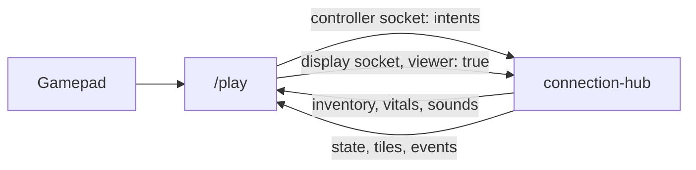

# Play screen (/play)

`/play` plays the game on a screen of its own (a PC monitor, a second TV) with a game controller or a keyboard and mouse, the `apps/play` app. It shows the graveyard up close, following the player, with the phone's menus covering the screen when opened.

## How it connects

- The player side is the phone's session (`useControllerSession` in `packages/game-ui/src/hooks/use-controller-session.ts`, shared with the phone), with its own token key, `graveyard.play.token` (`PLAY_TOKEN_KEY`), so a phone and a /play screen in the same browser stay different players.
- The view is a display that says `viewer: true` in `hello-display`. A viewer gets every state message but is never handed the TV's music and can't edit the map or save presets.
- `WorldRenderer.setFollow(id, view)` (through `CameraRig`) aims the camera at the player and zooms to `tall` tiles of ground top to bottom, from a lower camera than the TV's (the View angle setting, 47 degrees by default: `PLAY_DISPLAY_DEFAULTS`, applied with the other display settings by `setDisplaySettings`), so it looks a bit more across the ground. The camera leads the player: it sits ahead of them toward where they face by the Camera lead setting (default `PLAY_FOLLOW_LEAD`, 0.1 of half the ground in view), swinging round much more slowly than it follows at the Camera lead speed setting (default `LEAD_EASE`, 1.25 a second), so there's always a bit more room in front than behind without a quick turn whipping the view about (`CameraFollow.leadShare` and `leadEase`, `setFollowLead`, `setFollowLeadSpeed`). Near the map's edge the camera still stops short of it. Pixel size follows the zoom (`playPixelScale` sets it with `setPixelScale`): the Pixelation setting at the closest zoom, easing in a straight line to 3 px (`PIXEL_SIZE_FAR`, the game's original size) at the farthest.
- Aim isn't snapped on /play: the page sends `aim` with `free: true`, the server keeps the exact direction (`ControlSystem.setAim`), and the predictor faces it at once, so the player turns smoothly. Phones and claimed TV controllers still snap to 8 ways.
- The view sends `watch` with its player, so on a huge world it's sent only their surroundings and the TV leaves them out of its split screen (see [architecture.md](architecture.md#huge-worlds)).
- Your own player moves the moment you press (`Predictor`, `apps/play/src/prediction/predictor.ts`), and melee swings start on the press; see [architecture.md](architecture.md#latency). The top bar shows your ping (red over 120 ms). The camera eases after the player and stops a couple of tiles past the map's edge.

## Controls

A controller and the keyboard and mouse work at the same time. The on-screen hints and menu labels follow whichever was used last. Whichever connected controller was used last plays, and hurts, deaths, and pickups rumble it (unless Controller rumble is off: `padRumble` in `helpers/rumble.ts`).

### In the world

Every button and key except the sticks and the mouse's aim can be rebound in Settings, Controls (`PlaySettings.keys` and `pad`, defaults `DEFAULT_KEYS` and `DEFAULT_PAD` in `apps/play/src/config/bindings.ts`, loaded and saved by `helpers/play-settings.ts`).

| Action | Keyboard and mouse | Controller |
|---|---|---|
| Walk | WASD | Left stick |
| Aim (turn and act that way, any direction) | The mouse | Right stick |
| Hit and work the tile in front (hold to repeat) | Left click | RT |
| Use: open or work what's that way without hurting it (see [Use](#use) and [building.md](building.md#structures)) | Right click | A |
| Shield | Left Shift | LB |
| Rotate what's being built | R | LB / RB |
| Change a wall's look | G | D-pad left / right |
| Bag | E | West face button (X on Xbox) |
| Craft | Q | North face button (Y on Xbox) |
| Armory | F | none (LB / RB reach it inside the menu) |
| Skill tree | T | Back |
| Settings | Esc | Start |

- The mouse aims only once it has moved since the right stick was last used, so a resting mouse doesn't fight the stick.
- Keys typed into a text field (the join form's name) don't count.
- **New bindings on old saves:** `loadKeys` (`helpers/play-settings.ts`) gives a newly added action its default key, unless a saved binding already uses that key; then the new action starts unbound and shows as None (so a save that had F on something else keeps it, and the Armory has no key).

### Use

- **Pointing, not hovering:** right click sends `use` with the ground point under the mouse (`useAt`, set in `WalkMode` while the mouse aims). The server looks along that way from the player for the first thing USE finds from afar within `USE_REACH` (2.2 tiles), stopping at anything solid in the way (`useTarget` in `shared/src/world/use-target.ts`), so clicking anywhere past a chest opens it. With nothing found, it acts on the facing tile (lights, sprouts). A controller's A points along the facing.
- **Found from afar** (`useVerb`): storage chests, chests, bone diggers, belt sorters, stations, research tables, anvils (Open), altars (Offer at), and turrets (Load).
- **The prompt:** each frame `UsePrompt` (`input/use-prompt.ts`) runs the same `useTarget` from the predicted position and floats a tag over the target (`UsePromptTag`, `USE_PROMPT_LIFT` over the ground, placed with `WorldRenderer.screenOf`): the binding's icon (the mouse with its right button lit, or the pad's button while it aims) and what it does, such as Open Sawmill. It hands the page what to show only when that changes (`setUsePrompt`) and moves the element itself each frame. It shows only while fighting out in the world.

### The input loop

`usePlayInput` runs a `PlayInputLoop` (`apps/play/src/input/play-input-loop.ts`) once a frame. It finds the pad being played (`gamepad-frame.ts`), reads the keys and mouse (`keyboard-mouse.ts`), then runs one `InputMode` (`input/modes/`), and unless the mode halts the frame, steps the prediction.

| Mode | When |
|---|---|
| `CaptureMode` | Waiting for a pad button to rebind |
| `MenuMode` | A menu, a storage chest, a USE panel, or the join screen |
| `FightMode` (a `WalkMode`) | Out in the world with a weapon; its swing prediction times the next swing by the equipped item's cooldown with its infusion (`itemStats(s.weapon, s.tree)`) |
| `BuildMode` (a `WalkMode`) | Out in the world, building |
| `IdleMode` | Not joined, or dead |

### In a menu

| Input | Does |
|---|---|
| D-pad or left stick | Move the selection (held, it repeats) |
| A | Press the selection |
| Right stick | Scroll |
| LB / RB | Previous / next menu |
| B, Esc, or the menu's own button again | Close |
| Mouse | Click anything |

The selection is `SpatialNav` (`nav/spatial-nav.ts`): the nearest button in the pressed direction, favoring ones straight ahead, outlined with `.pad-focus`. It also gets real focus, so a keyboard can type into the join form's name field. Sliders are skipped (`data-pad-skip`); their - and + buttons step them. A selected button that turns disabled (a reset button once pressed) is still where the next move starts from.

### Building

Picking a structure in the bag closes the menu and starts building it, with a banner at the bottom: aim, then Attack, A, or right click builds, and B (or Esc) goes back to the bag. /play has no Panic.

- **Mouse aim:** the build goes on the tile under the mouse, as long as it's within `BUILD_REACH` (2.5 tiles) of the player; past that, the furthest tile they can reach in the mouse's direction (`buildTarget` in `shared/src/world/targeting.ts`). The page sends the point (`build-aim`, `PlayerKit.buildAim`) and draws the preview there at once (`WorldRenderer.setBuildAim`). With the right stick (or a phone) it's the facing tile, as before.
- **Rotate:** R (or LB / RB) turns what's being built a quarter turn (`ControlSystem.turn`, `PlayerKit.buildFacing`), shown as a chevron over the preview for structures that face a way (conveyor belts and walls, `TURNED`). It starts from where the player faces and resets when building stops.
- **Wall look:** G (or the D-pad's left and right) steps a wood wall, stone wall, or bone wall through its looks (`BuildMode`, `LiveState.cycleStyle`, `useWallStyle`), shown in the Type popup in the bottom right (`WallStylePopup`; clicking a look picks it). The preview is the wall itself in that look (see [building.md](building.md#wall-looks-and-rotation)).
- **Build banner:** what's being built and its hints for the device in hand (`BuildBanner`): Type, Rotate, Build, Back, each with its binding's icon (G, R, the mouse with its left button lit, Esc on the keyboard; the D-pad, LB and RB, RT, B on a controller), using the player's own bindings. Type shows only for walls with looks, Rotate only for what faces a way (`TURNED`).

### Binding icons

Wherever /play shows a key or button (the USE prompt, the build banner, the wall look popup, the menu tabs' LB and RB, the Controls settings, the join screen), it draws it with `BindingGlyph` (`components/bindings/binding-glyph.tsx`, a `Binding` from `types/play.ts`) instead of its name:

| Binding | Icon |
|---|---|
| Left, middle, right click | A mouse with that button lit |
| A, B, X, Y | A round face button in its Xbox color (`FACE_COLORS` in `config/binding-glyphs.ts`) |
| LB, RB / LT, RT | A bumper / trigger shape with its name |
| D-pad | A cross with the pressed arm (or left and right) lit |
| Sticks | A ring with L or R |
| Back, Start, Home | A pill with an icon |
| A key | A keycap with its name (`keyLabel`) |

Tooltips (`title`) still use the names.

## Screen

| Part | What it is |
|---|---|
| Top bar | Hearts (with brass overheal hearts after them, `Vitals.overheal`), candy, and blood, drawn pixelated, a little finer than the world; the ping stays crisp on top. The bar is laid out in HTML (`PlayHud`) with the hearts and counts invisible (`[data-hud-paint]`), and `usePixelHud` paints them each frame (only when they or the pixelation changed) onto a low-res canvas laid over the world and stretched without smoothing. Its pixels are half the world's (`HUD_PIXEL_SHARE` of `WorldRenderer.pixelScale`). They're drawn bigger than on the phone (`HUD_HEART_PX`, `HUD_RESOURCE_PX`) to stay readable once pixelated |
| Menu dialog | Bag, Craft, Armory, Skill tree, and Settings (`MENUS`, in that order) open in one dialog over the game (the Armory only once an anvil is available, as on the phone: `armoryOpen`, `LiveState.menus`; until then its tab, its key, and LB / RB skip it): the game shows through its slightly see-through panel and a 40% dimmed backdrop (click it to close). Its tabs are icons with tooltips naming them and their key; an X closes it. Contents are centered. |
| Bag | The phone's bag (capped at 320px wide so it all fits) |
| Craft | The recipe list beside the picked recipe's details (`CraftPanel` `aside`); hover a cost for the material's name |
| Armory | The phone's Armory in place (`ArmoryPanel` `embedded`): the weapon grid and the picked weapon's paths, each column scrolling on its own so the right stick and `SpatialNav` reach every button (see [infusions.md](infusions.md#the-armory)) |
| Skill tree | The phone's tree panel in place (`TreePanel` `embedded`, no header), with the Upgrade button at the bottom of its side panel. With `hoverDetails` it pans by dragging, the scroll wheel (sideways when there's nothing to scroll down), and WASD, and resting the mouse on a node for a second shows its details beside it. |
| Settings | Tabs down the left, each a 3D icon and its name, and the picked tab's settings to the right, scrolling on their own; see [Settings](#settings) |
| Overlays | Pickup toasts, the storage chest page (B closes it), the USE panel of a bone digger, station, or belt sorter (`UseLayer`, the phone's `UsePanel`), NAUGHTY, the death screen (darkening the view only 25%, `seeThrough`, so you can see what killed you) |

A belt sorter's pickers ([phone.md](phone.md#bone-digger-station-and-belt-sorter)) are plain buttons, so `SpatialNav` drives them: A on a side's row opens its picker, and A on a thing picks it but leaves the picker open, so the selection stays put (`SortKeyPicker` closes only on a pointer click, `detail` above 0). A on the row again closes it.

- The UI is laid out for a phone-sized screen and scaled up to fit: screen height over 430 px, times the UI scale.
- The TPS, FPS, and server ticks overlay (`PerfOverlay` from `packages/controls`) sits in the bottom right corner when its switches are on.

## Settings

The menu's gear tab (`ui:settings`, a 3D icon like the other menu tabs). Down the left are its tabs (`components/settings/settings-tabs.tsx`, icons `ui:gameplay`, `ui:graphics`, `ui:controls`, `ui:audio`), each its own component (`gameplay-settings.tsx`, `graphics-settings.tsx`, `controls-settings.tsx`, `audio-settings.tsx`). With a controller, A on a tab shows it and left and right move between the tabs and the settings. Every row has a small reset button (`ResetButton`) that puts that one setting back, hidden and disabled while it's already at its default. Sliders are `RangeSetting` (a slider with - and + buttons for the controller, and the value read out), switches `SwitchSetting`. Both are drawn with the voxel controls in `packages/ui` (`VoxelSlider`: a sunken channel, a brand fill, and a raised block handle, with the real range input invisible on top; `VoxelSwitch`: a raised block in a sunken socket, brand colored with a lit pip while on), shaded from theme tokens (`components/ui/controls/config/voxel.ts`). The TV and admin sidebar switches (`SwitchPill`) use `VoxelSwitch` too.

| Tab | Setting | Range | Default |
|---|---|---|---|
| Gameplay | Controller rumble (`rumble`) | on / off | on |
| Gameplay | Move to another device (`TransferCode`: a transfer code for this character) | button | |
| Gameplay | Leave game | button | |
| Graphics: View | View scale (`zoom`) | 8 to 22 tiles tall, steps of 2 | 20 (`FOLLOW_TALL`) |
| Graphics: View | View angle | `DISPLAY_RANGES` | 47 (`PLAY_DISPLAY_DEFAULTS`) |
| Graphics: View | UI scale (`uiScale`) | 0.8 to 1.25, steps of 0.05 (`UI_SCALE_*`) | 0.8 |
| Graphics: View | Camera lead (`cameraLead`) | 0 to 0.5 of half the view (`CAMERA_LEAD_RANGE`) | 0.1 (`PLAY_FOLLOW_LEAD`) |
| Graphics: View | Camera lead speed (`cameraLeadSpeed`, read out as a share of the default) | 0.25 to 5 a second, steps of 0.25 (`CAMERA_LEAD_SPEED_RANGE`) | 1.25 (`LEAD_EASE`) |
| Graphics: Lighting | Brightness, Glow | `DISPLAY_RANGES` | `PLAY_DISPLAY_DEFAULTS` (the shared defaults) |
| Graphics: Models | Blood (0 is no blood at all), Turn speed (the fastest a player's model turns, shown in degrees a second), Small details (stored; nothing uses it yet) | `DISPLAY_RANGES` | `PLAY_DISPLAY_DEFAULTS` |
| Graphics: Filters | Pixelation (`pixelSize`, at the closest zoom) | 1 (smooth) to 12 px | 8 (`PIXEL_SIZE_DEFAULT`) |
| Graphics: Filters | Chromatic aberration, Fog, Screen shake | `DISPLAY_RANGES` | `PLAY_DISPLAY_DEFAULTS` |
| Graphics: UI | Show candies & blood (the candy and blood counts in the top bar, `showResources`; the floating pickup icons always show), Show names, Show my name, Show health bars, Show my health bar, Show TPS, Show FPS, Show server ticks (`DISPLAY_SWITCHES`) | on / off | on, except the last three |
| Controls | Keyboard and mouse, then Controller bindings, each section with Defaults | | `DEFAULT_KEYS`, `DEFAULT_PAD` |
| Audio | Sound effects (`sfxVolume`, `sfx.setVolume` from `usePlaySettings`) | 0 to 1 | 0.8 (`SFX_VOLUME_DEFAULT`) |

- Graphics is split into View, Lighting, Models, Filters, and UI, each under a small heading (`SubsectionTitle`), and has Reset all, for the whole tab.
- The display settings (`PlaySettings.display`, a `DisplaySettings`) go to the renderer with `setDisplaySettings`, and this player with `setLocalPlayer`, when the renderer is ready and whenever they change (`usePlayView`), along with `setFollowLead`, `setFollowLeadSpeed`, and the pixel size.
- Settings are kept in localStorage (`graveyard.play.settings`, `loadPlaySettings` in `helpers/play-settings.ts`): every value is checked and clamped into range on load, with the default for anything missing, so older saves still load. A save from before Camera lead speed that still holds the old 0.35 Camera lead default gets the new one (`CAMERA_LEAD_OLD_DEFAULT`). A saved menu size (small, medium, large) becomes its UI scale (`MENU_SIZES`).
- To rebind, press an action's binding in Controls, then the new key, click, or controller button. Esc cancels a key binding; a key or button already used by another action swaps places with it.
- The cursor is a crosshair over the world.
- The join form is the phone's, with the name prefilled ("Gamer") so a controller alone can join. A name another device has asks for its transfer code (see [architecture.md](architecture.md#identity)).
