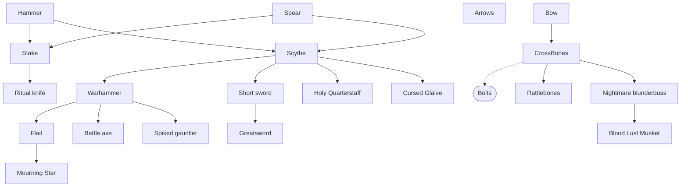
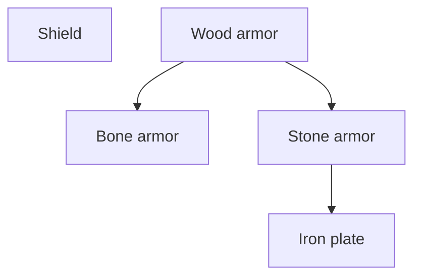
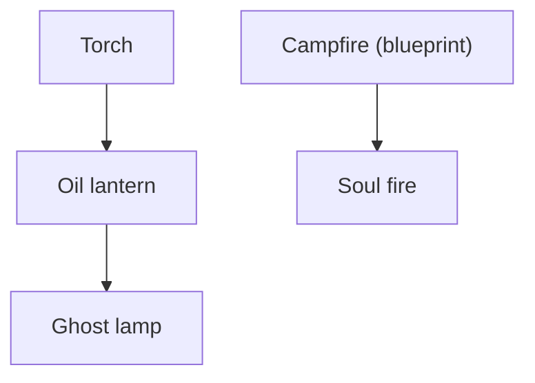
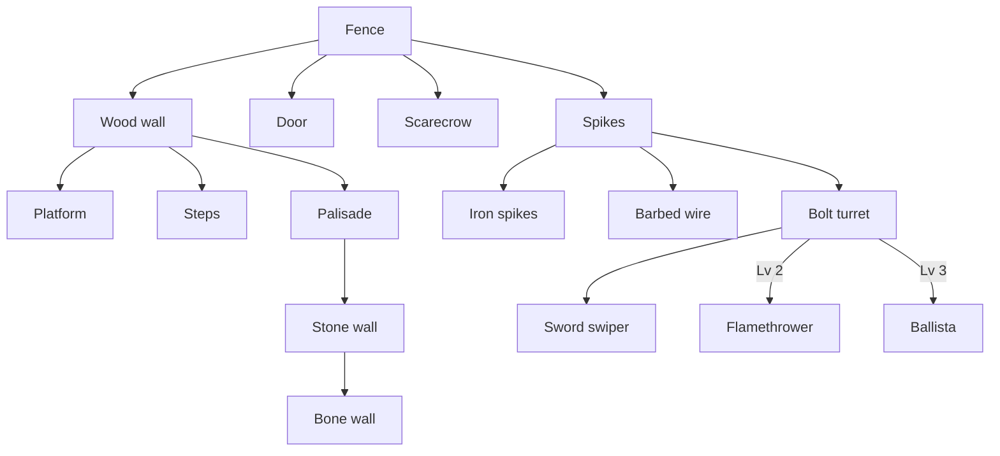
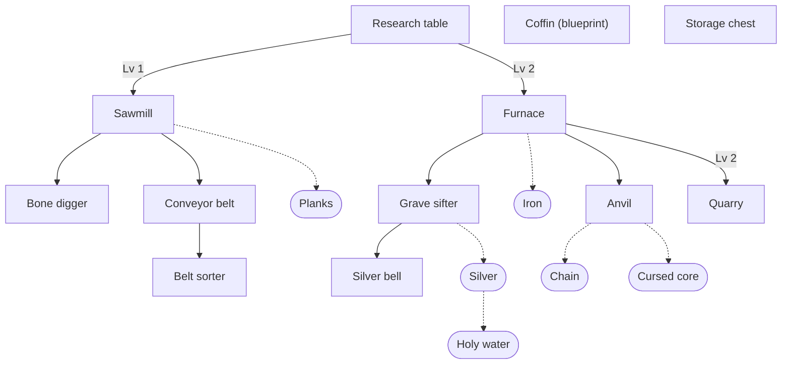
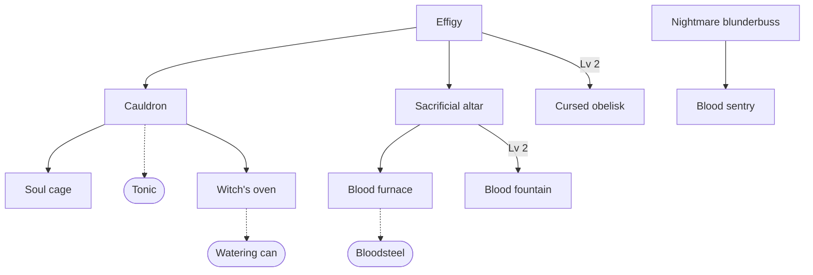

# Skill tree

Defined in `shared/src/skill-tree/` (`TREE` in `nodes.ts`, branches in `branches.ts`, unlocks and depth in `progress.ts`, prices in `upgrade-cost.ts`, what levels do in `upgrades/`). Every piece of gear and every structure is a node, and so are the materials stations make and the parts you craft (see Materials).

## How it works

- **Per player:** each player has their own tree, kept through death, on leave, and across restarts (saved with their character, see [architecture.md](architecture.md#persistence)).
- **Unlocks:** a node is known from the start, opened by a dug-up blueprint, or opened by upgrading the node it grows from to a level. "Lv 1" below means that parent at level 1. A few nodes have two possible parents (`Unlock.or`).
- **Upgrades:** 3 levels per node, paid in candy and blood from the phone's Tree panel, anywhere. Nothing requires a research table; it only makes upgrades cheaper.

## Materials

Materials hang under what makes them, or what they're crafted for, so the tree shows where everything comes from. Each is a `fixed` node (`madeBy` in `nodes.ts`): it opens the moment its parent opens (an unlock at parent level 0), has no levels, and costs nothing (`upgradeCost` returns null). Its sidebar shows what it is and what it comes with instead of an Upgrade button (`TreeSidebar`), and its button has no level pips. Arrows are the exception: a start node with its own upgrade (Steady supply).

| Material | Hangs under | Where it comes from |
|---|---|---|
| Planks | Sawmill | 1 wood in, 1 plank out |
| Iron | Furnace | 1 stone in, 1 iron out |
| Silver | Grave sifter | 2 stone in, 1 silver out |
| Holy water | Silver | Crafted: 1 silver, 4 blood |
| Chain | Anvil | Crafted at an anvil: 2 iron |
| Cursed core | Anvil | Crafted at an anvil: 1 bloodsteel, 1 silver |
| Bloodsteel | Blood furnace | 1 iron and 2 blood in, 1 bloodsteel out |
| Tonic | Cauldron | 3 candy, 1 blood, and 1 bone in, 1 tonic out |
| Watering can | Witch's oven | Crafted: 2 iron, 1 bone |
| Bolts | CrossBones | Crafted: 1 wood makes 3 |

## Costs

Every level costs more, and deeper nodes cost more (`upgradeCost`): the base price (`UPGRADE_COSTS`: 5, 12, 22 candy and 1, 3, 6 blood) times `1 + 0.45 x (depth - 1)` for candy (`CANDY_DEPTH_SCALE`) and `1 + 0.35 x (depth - 1)` for blood (`DEPTH_SCALE`), rounded up, at least 1 blood. Depth is 1 for a start node, 2 for a blueprint, and one more per step down an upgrade chain (`nodeDepth`); the deepest nodes are depth 5.

| Upgrade to | Depth 1 | Depth 2 | Depth 3 | Depth 4 | Depth 5 |
|---|---|---|---|---|---|
| Level 1 | 5 / 1 | 8 / 2 | 10 / 2 | 12 / 3 | 14 / 3 |
| Level 2 | 12 / 3 | 18 / 5 | 23 / 6 | 29 / 7 | 34 / 8 |
| Level 3 | 22 / 6 | 32 / 9 | 42 / 11 | 52 / 13 | 62 / 15 |

Candy / blood, full price.

### Research table discount

Standing within 2.5 tiles of a research table (`RESEARCH_RADIUS`) takes 25% off, plus 10% per level of the best table in reach (its builder's research table level), up to 55% (`researchDiscount`). The phone's Tree panel header shows the discount, and prices update live.

## What levels do

| Node kind | Each level |
|---|---|
| Weapons | Their own perk (see [weapons.md](weapons.md#tricks-and-upgrades)), applied before any infusion. The infused hammer has no node: it levels with the Hammer node (`weaponStats`). Infusing needs no node at all (see [infusions.md](infusions.md)); the Hellmouth's spray grows with Wider bore |
| Armor and shield | Block 0.05 more (shield 0.03) |
| Lights | 15% wider, 10% brighter, 30% more health |
| Other structures | 30% more health (new ones; a structure keeps its builder's level) |
| Spikes, iron spikes, barbed wire | 30% more damage |
| Stations | Half again as fast |
| Bone digger | A third faster (twice as fast at level 3) |
| Anvil | 15% off the parts and late gear crafted beside it, and off infusions done there |
| Turrets (bolt turret, sword swiper, blood sentry, flamethrower, ballista) | +20% damage, +30% health |
| Blood fountain | Drains 30% faster (and pumps that much more blood) |
| Research table | 10% more off upgrades nearby |
| Altar | Kills near it while awake bleed +0.5x more |
| Effigy, obelisk, silver bell, soul cage | +0.5 tiles of reach |
| Arrows | Steady supply: +20% chance any arrow or bolt shot is free |

The TV feed shows each upgrade and anything it opened.

## Branches

### Weapons

Start nodes: Hammer, Spear, Bow, Arrows. All solid links are at level 1; a dotted link to a rounded node is a material that opens with its parent (see Materials).

### Armor

### Light

### Fortifications

### Tables and processing

### Occult

## On the phone

The Tree panel (`packages/game-ui/src/components/tree/tree-panel.tsx`, laid out by `tree/tree-layout.ts`, fog from `helpers/tree-sight.ts`) shows the tree full screen, top to bottom, with a resizable details sidebar (`TreeSidebar`): the selected node's icon and name, what it is (`itemBlurb`, from `shared/src/inventory/item-blurbs.ts`), what one costs to craft (To craft, before any anvil discount, with what you're short of in red), its level, what the next level does, and Upgrade.

| A node is | Shown as |
|---|---|
| Open | Its icon, with level pips |
| Locked, in sight (a root, or its parent is open) | A question mark with a lock; tap for a heavily blurred icon and what opens it |
| One row past that (its parent is locked) | Only the line from its parent, fading out |
| Deeper | Nothing |

- New rows fade in over `REVEAL_SECONDS` (`game-ui/src/config/tree.ts`) as they come into sight, so nobody knows how deep it goes.
- Holding any node in sight opens its details (`ItemDetails`, in `mystery` mode for locked ones).
