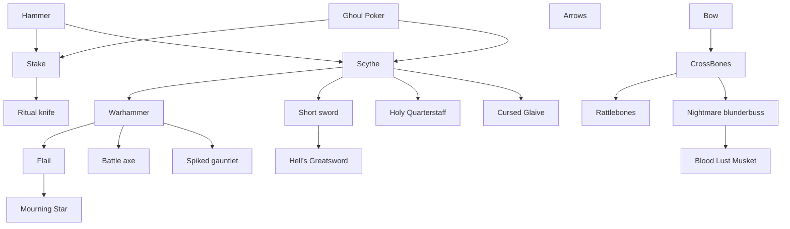
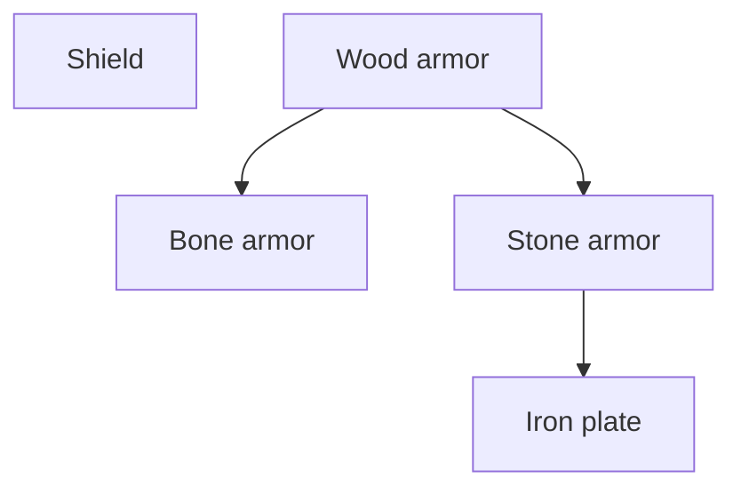
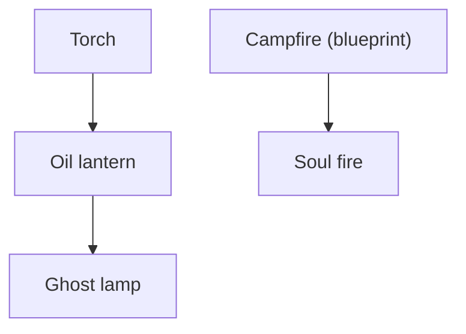
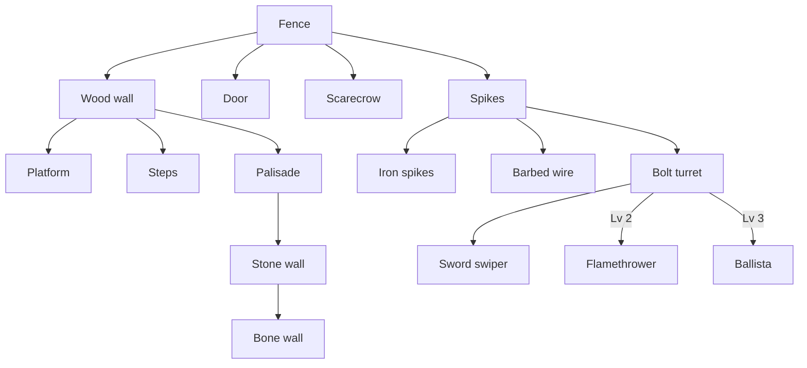
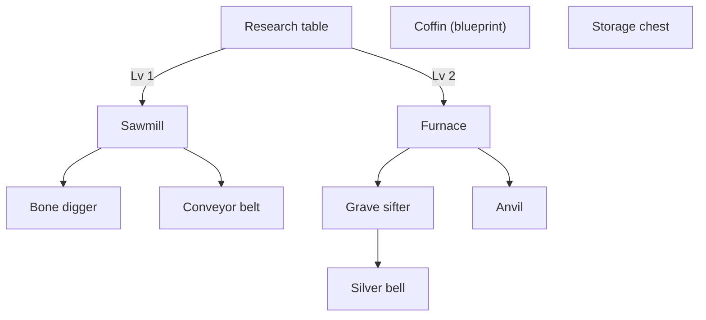
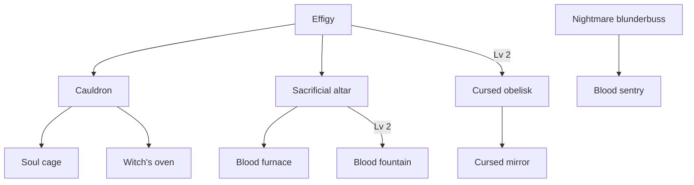

# Skill tree

Defined in `shared/src/skill-tree/` (`TREE` in `nodes.ts`, branches in `branches.ts`, unlocks and depth in `progress.ts`, prices in `upgrade-cost.ts`, what levels do in `upgrades/`). Every piece of gear and every structure is a node.

## How it works

- **Per player:** each player has their own tree, kept through death and on leave, but not saved (it lasts while the server runs).
- **Unlocks:** a node is known from the start, opened by a dug-up blueprint, or opened by upgrading the node it grows from to a level. "Lv 1" below means that parent at level 1. A few nodes have two possible parents (`Unlock.or`).
- **Upgrades:** 3 levels per node, paid in candy and blood from the phone's Tree panel, anywhere. Nothing requires a research table; it only makes upgrades cheaper.

## Costs

Every level costs more, and deeper nodes cost more (`upgradeCost`): the base price times `1 + 0.35 x (depth - 1)` (`DEPTH_SCALE`), rounded up, at least 1 blood. Depth is 1 for a start node, 2 for a blueprint, and one more per step down an upgrade chain (`nodeDepth`); the deepest nodes are depth 5.

| Upgrade to | Depth 1 | Depth 2 | Depth 3 | Depth 4 | Depth 5 |
|---|---|---|---|---|---|
| Level 1 | 4 / 1 | 6 / 2 | 7 / 2 | 9 / 3 | 10 / 3 |
| Level 2 | 9 / 3 | 13 / 5 | 16 / 6 | 19 / 7 | 22 / 8 |
| Level 3 | 16 / 6 | 22 / 9 | 28 / 11 | 33 / 13 | 39 / 15 |

Candy / blood, full price.

### Research table discount

Standing within 2.5 tiles of a research table (`RESEARCH_RADIUS`) takes 25% off, plus 10% per level of the best table in reach (its builder's research table level), up to 55% (`researchDiscount`). The phone's Tree panel header shows the discount, and prices update live.

## What levels do

| Node kind | Each level |
|---|---|
| Weapons | Their own perk (see [weapons.md](weapons.md#tricks-and-upgrades)) |
| Armor and shield | Block 0.05 more (shield 0.03) |
| Lights | 15% wider, 10% brighter, 30% more health |
| Other structures | 30% more health (new ones; a structure keeps its builder's level) |
| Spikes, iron spikes, barbed wire | 30% more damage |
| Stations, bone digger | Half again as fast |
| Anvil | 15% off the parts and late gear crafted beside it |
| Turrets (bolt turret, sword swiper, blood sentry, flamethrower, ballista) | +20% damage, +30% health |
| Blood fountain | Drains 30% faster (and pumps that much more blood) |
| Research table | 10% more off upgrades nearby |
| Altar | +1 blood per offering |
| Effigy, obelisk, silver bell, soul cage | +0.5 tiles of reach |
| Arrows | Steady supply: +20% chance any arrow or bolt shot is free |

The TV feed shows each upgrade and anything it opened.

## Branches

### Weapons

Start nodes: Hammer, Spear, Bow, Arrows. All links are at level 1.

### Armor

### Light

### Fortifications

### Tables and processing

### Occult

## On the phone

The Tree panel (`packages/game-ui/src/components/tree/tree-panel.tsx`, laid out by `tree/tree-layout.ts`, fog from `helpers/tree-sight.ts`) shows the tree full screen, top to bottom, with a resizable details sidebar.

| A node is | Shown as |
|---|---|
| Open | Its icon, with level pips |
| Locked, in sight (a root, or its parent is open) | A question mark with a lock; tap for a heavily blurred icon and what opens it |
| One row past that (its parent is locked) | Only the line from its parent, fading out |
| Deeper | Nothing |

- New rows fade in over `REVEAL_SECONDS` (`game-ui/src/config/tree.ts`) as they come into sight, so nobody knows how deep it goes.
- Holding any node in sight opens its details (`ItemDetails`, in `mystery` mode for locked ones).
