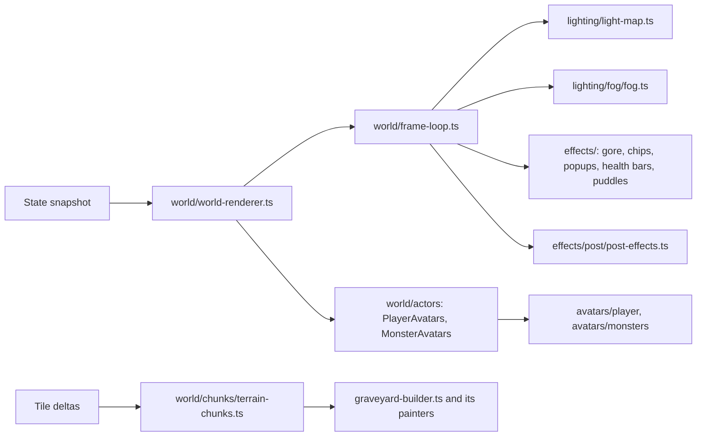
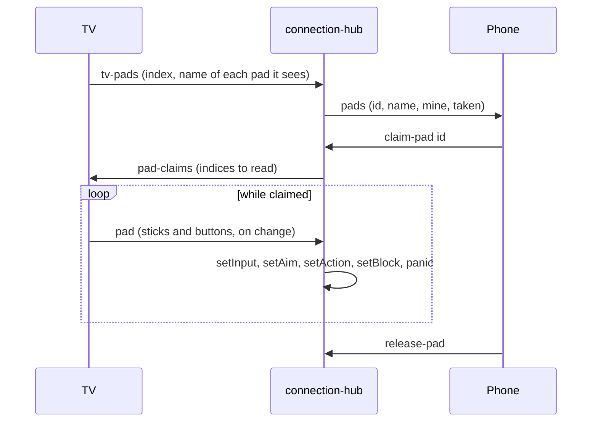

# TV display

The TV is `/tv`, the `apps/tv` app. The three.js scene lives in plain TS classes in `packages/renderer`, fed snapshots directly (not through React state), and the sidebar's controls in `packages/controls`, both shared with the admin console ([admin.md](admin.md)). The TV shows only the map, the kill feed, and a small faded join QR.

## Renderer

### World voxels
- `WorldScene` (`world/world-scene.ts`) owns the three.js scene and its parts, each a `ScenePart` holding the shared `WorldContext` (scene, map, camera); `WorldRenderer` extends it with input, prediction, and the editor. `FrameLoop` runs every frame's body. See [architecture.md](architecture.md#scenepart).
- The map is built in `CHUNK` (16) tile square chunks (`TerrainChunks`, constants in `world/chunks/config/chunks.ts`). A map of up to `SMALL_MAP_CHUNKS` (24) chunks is built whole; a bigger one builds only the chunks in view plus `CHUNK_LOAD_MARGIN`, at most `CHUNK_BUILDS_PER_FRAME` (2) a frame, and drops those past `CHUNK_KEEP_MARGIN`.
- A tile change rebuilds its chunk (and its neighbours, for walls and undergrowth that cross the seam: `TerrainChunks.markDirty`). `graveyard/graveyard-builder.ts` paints each tile with its `TilePainter` (`graveyard/painters/`, looked up in `painter-registry.ts`), seeded per tile so rebuilds don't reshuffle the rest.
- Something that just grew (trees, chests, gravestones) is drawn on its own by `buildTile` while it rises or swells, then baked in.
- Breaking tiles burst into chunks of themselves (`buildTilePieces` in `graveyard-builder.ts`).
- Trees side by side get undergrowth between them (`shrubBetween` in `graveyard/shrubs.ts`), which sinks when either tree falls.
- Trees are baked into their own mesh; `effects/tree-sway.ts` patches its vertex shader so brutes shake nearby trees without a rebuild.
- `buildOutskirts` (`graveyard/outskirts.ts`, placed by `Scenery`) fills the rest of the screen with woods beyond the fence (not on a huge world, whose edge is chasm).
- The watchtower's upper walls are a separate model whose front half hides while a player is inside.

### Light and fog
- **No PointLights.** `lighting/light-map.ts` rebuilds a small quantized texture each frame from every light, and patched Lambert materials multiply by it, so darkness costs the same however many lights exist.
- On a big map the light map and fog cover a window (`WINDOW_TILES_W` x `WINDOW_TILES_H`, 80x60) that follows the camera (`LightMap.setCenter`, `Fog.setCenter`, the `lightWindow` uniform); past `SIM_MAX_TILES` the fog is drawn procedurally instead of simulated. The moon and its shadow follow the camera too.
- Lights flicker slowly, each on its own rhythm. The blood moon tints the ambient. Glowing Basic materials (flames, pumpkin faces, build ghosts) stay bright.
- `lighting/fog/fog.ts` simulates a density grid (3 cells per tile) that walkers push aside, lights thin, and ghosts thicken, drawn as three dithered sheets (`FogGrid`, stepping the `FogField` base's density grid).
- `effects/post/post-effects.ts`: bloom, then saturation, focus, and chromatic aberration scaling with distance from the nearest living player.

### Avatars

Every avatar extends `Avatar` (`avatars/avatar.ts`); see [architecture.md](architecture.md#avatars) for the families.

- **Players** (`avatars/player/player-avatar.ts`, with `PlayerRig`, `PlayerGear`, `PlayerSwing`, `PlayerLocomotion`): gear in hand from `models/gear/` (`buildGearModel`). Whatever is drawn for a moment (`PlayerState.drawn`: the hammer for a job, a stake for a vampire) replaces the weapon. Heavy weapons' swings are stretched to their windup.
- **Swings** are `WeaponMotion` subclasses in `avatars/player/motions/`, picked per weapon by `pickMeleeMotion` (`motion-picker.ts`):

| Motion | Weapon | Does |
|---|---|---|
| `AxeSwingMotion` | Most melee | The overhead chop |
| `StabMotion` | Spear | Drops level, draws back, and drives straight ahead as the blow lands |
| `SweepMotion` | Scythe | A `grip` group turns the blade flat, then the arm and body whip it level from about 11 o'clock to 1 o'clock, passing dead ahead as the blow lands, blade leading (`SWEEP_OUT`, `SWEEP_ACROSS`) |
| `LashMotion` | Morning star | The jointed chain whip (`buildWhip`): pulled back low, swung up over the head, and cracked straight out in front (`PlayerGear.curl`, `whipBend`) |
| `StaffMotion` | Quarterstaff | Held across the body in both hands; plays its combo: top, bottom, twirl |
| `FistsMotion` | Spiked gauntlets | Both fists (`PlayerGear` shows a left fist) with a charge glow (`ChargeGlows`); jab, punch, uppercut, and a launching super uppercut (a high `jump`) |
| `DigMotion` | Digging a grave (`PlayerState.digging`) | A spade (`buildSpade`) instead of the hammer, raised blade-down, driven into the ground with a crouch as the blow lands, then heaved up overhead (`DIG_LIFT`/`DIG_STAB`/`DIG_TOSS`) |
| `ShotMotion` (`SHOT_MOTION`) | Guns | The gun kicks up and the body rocks back, then settles |

- The glaive alternates the scythe's sweep and the spear's stab. Pose constants live in `avatars/player/config/player-poses.ts`.
- A crossbow taking aim is held level, leaning in, and a dim red target (`CrossbowReticles`, drawn after bloom over everything) turns above the monster it's locked onto (`PlayerState.aimTarget`); after a shot it tips muzzle-down while the free hand cranks it (`ReloadMotion`). The repeating crossbow's drum (`GearModel.spinner`) spins as it fires (`PlayerGear.spinDrum`); both crossbows show the crank reload while `PlayerState.reloading`.
- Guns (blunderbuss, musket) throw fire, a flash, and smoke at the muzzle (`MUZZLE_*` in `world/config/muzzle-colors.ts`) with a small shake. The shield moves in front of the chest while blocking.
- Each dig also throws a shovelful of dirt up and back over the nearest digger's shoulder a beat later (`EventEffects.tossDirt`, `ChipBursts.fling`).
- **Monsters** (`avatars/monsters/`): one `MonsterAvatar` subclass per kind in `kinds/` (each kind's constants in `kinds/config/<kind>.ts`), made by `createMonsterAvatar` and then `assemble()`d. Each overrides `build` and `animate`; `ChargingMonsterAvatar` times wind-ups by `attackPhase`, `ArmedMonsterAvatar` mounts held junk. Gaits (`MonsterGait`, `GAIT`) keep pace with real speed. Brute slams bump `impactCount` for dust and screen shake.
- **Swooshes** (`SwooshTrail` in `avatars/shared/swoosh-trail.ts`, `addSource`, `update`): melee attacks leave a faint pale streak (`SWOOSH`) behind every striking point: both brute fists, both zombie hands (one if one-armed), both vampire claws, and ghoul and demon jaws through their pounce or lunge (`SWOOSH_TIME`). The witch's broom leaves a purple one. A kind picks its trail with `trailStyle`.
- Avatars follow `WorldMap.elevationAt` (through `ActorLift`), so they rise smoothly on stairs.

### Effects

| File | Does |
|---|---|
| `effects/gore/gore.ts` (`BloodSplats`, `Gibs`) | Blood splats that dry away; dead monsters torn apart and thrown along the killing blow |
| `effects/chip-bursts.ts` | Wood and stone chips from hits; a flamethrower's gout of fire (`jet`) and a sword swiper's ring of blade glints (`whirl`), from `turret` events |
| `effects/pickup-popups.ts` | A small spinning model of whatever someone picks up |
| `effects/health-bars.ts` | A DOM bar over anything that survives a hit, fading after |
| `effects/altar-gauges.ts` | A glowing blood trough on lit altars |
| `effects/puddles.ts` | Witches' puddles |
| `items/item-piles.ts` | Ground items, each a `GroundDrop` (`items/drops/`: `ResourcePile`, `GearDrop`, `CrateDrop`); gear lies flat with a glint; materials without a heap of their own (`MODELED` in `items/config/piles.ts`: ectoplasm, chain, cursed cores, pumpkins, watering cans) show their bag model; piles follow their item as belts carry it |
| `avatars/shared/dangle.ts` | Rag-doll swing for anything the mouse lifts |

Anything flat on the ground (blood splats `SPLAT_LIFT`, puddles `PUDDLE_LIFT`, blood piles) must sit above 0.05: grass tiles are four sub-voxels whose tops jitter up to +0.05, and anything lower gets patches of grass poking through it.

Pickup popups are unlit (`MeshBasicMaterial`) so they read in the dark; the blood drop's highlight boxes are left off them (`resourceModel(..., shine = false)` in `models/items/resource-models.ts`), since bloom turned them into white blotches.

## Split screen

On a huge world the TV follows its players instead of framing the map (`apps/tv/src/display-page.tsx`, panes from `usePanes` and `helpers/panes.ts`).

| Local players | Layout |
|---|---|
| None | One pane on the spawn (`setFollow(null, tall, at)`) |
| 1 | One pane following them |
| 2 | Side by side |
| 3 or 4 (`MAX_PANES`, `apps/tv/src/config/tv.ts`) | A 2x2 grid |

- A local player is a connected one no /play screen is watching (`state.watched`).
- Each pane is its own `WorldRenderer` labelled with the player's name; every message goes to all of them. The mouse works the first pane.
- **TV view** (Game tab, Map card, TV only) sets how much ground each pane shows (`TV_VIEWS` in `packages/controls/src/config/tv-view.ts`, saved per browser under `graveyard.tvView` by `helpers/tv-view.ts`):

| Preset | Shows |
|---|---|
| Classic (default) | A `MAP_WIDTH` x `MAP_HEIGHT` (56x34) area, fitted like a classic map |
| Close | `FOLLOW_TALL` (20) tiles top to bottom, like /play |

- `WorldRenderer.setFollow` takes a `FollowView`: a number of tiles tall, or a `w` x `h` area to fit.
- The TV sends `watch` with its panes' players, so it's sent only their surroundings.
- The map editor goes back to one pane framing the whole map.

## Sidebar

Hover the top-right corner and click the chevron. Clicking outside closes it. The admin console (`/admin`, [admin.md](admin.md)) has the same controls minus Music, beside its own view of the world.

| Tab | Holds |
|---|---|
| Overview | A short roster with hidden levels and each player's ping; a Controllers card (game controllers on the TV and who holds each); server TPS, tick time, TV fps, this screen's ping, KB/s sent to each screen, world level, monster and item counts |
| Music | See [audio.md](audio.md) |
| Game | Testing controls and the map (below) |

### Game tab

| Card | Controls |
|---|---|
| Switches | Aggressive monsters, All unlocks, Free crafting, Natural spawning, Test player, Lights off, Mouse picks up, Mouse light; World level boost |
| Spawn objects | Tree, pumpkin, chest, rock, loot |
| Spawn monsters | Every monster kind |
| Actions | Summon blood moon, Make it day / Back to night, Kill all monsters |
| Map | Map Editor and TV view (TV only); Regenerate Map: Map Preset, random map settings, confirm, New world |

- `GameSettings` are held by `Game`, sent back in every state message, and not saved.
- All unlocks and Free crafting apply per player through `GameTabSystem.treeOf`.
- Daytime only changes the TV's look.
- Spawns use `ConjureSystem.spawn` (`Regrowth.spawnTile`, `Horde.summon`), inside the preset's `view` if it has one.

### Keyboard shortcuts

Not while typing or in the map editor. The Game tab shows each letter beside its control (TV only).

| Key | Does |
|---|---|
| U | All unlocks |
| F | Free crafting |
| A | Aggressive monsters |
| T | Test player |
| L | Lights off |
| D | Day / night |
| B | Summon a blood moon |
| K | Kill all monsters |
| I | Incognito |
| Esc | Leave Incognito, close the map editor |

### Incognito

`apps/tv/src/components/incognito-screen.tsx` shows the album art, title, and artist over the live graveyard, hides the QR and kill feed, and mutes SFX. Off when the page opens; fades away when a new player connects.

## Controllers on the TV

Game controllers plugged into the TV machine can be claimed from a phone (`apps/tv/src/hooks/use-tv-pads.ts`, `input/pad-relay.ts`; the server side is `PadRegistry` and `PadHandler`), so the phone becomes just the menus.

| Input | Does |
|---|---|
| Left stick | Walk |
| Right stick | Aim |
| RT | Hit, and every other action |
| LB or LT | Block with a shield |
| B | Panic |
| Left face button (X on Xbox, Y on Switch) | Opens the Bag on the player's phone (`pad-menu`) |
| Top face button (Y on Xbox, X on Switch) | Opens Craft on the player's phone |
| Back / Minus / View | Opens the skill tree on the player's phone |

- Pad ids are `<tv>-<index>`, per TV page. Some browsers only show a pad once a button on it has been pressed.
- One pad per player; claiming another lets go of the first. A pad someone holds shows as taken.
- While a pad is held, the player stays connected even if the phone sleeps. Releasing it (or unplugging it, or closing the TV page) stops the player, and slumps them if their phone is gone too.
- Leaving the game releases the pad.
- Every display (TV, admin console) gets `tv-pad-list` on hello and whenever a pad or claim changes, for the Overview tab's Controllers card (`components/overview/controllers-panel.tsx`): each pad with the player holding it, or Free, and the TV number when more than one TV page has controllers.
- On the TV page only, the card also lists the controllers this computer's browser sees, each with a light that comes on while it's pressed or moved (`components/overview/pad-monitor.tsx`). A controller that's listed but never lights up is connected but sending nothing (often Steam holding it).
- The TV page logs what the browser reports about its controllers to the console as `[pads]` lines whenever it changes (`input/pad-logger.ts`: focus, visibility, socket, each pad's id, mapping, pressed buttons, and axes), plus connects, disconnects, and phone claims. Filter the console on `[pads]` when a controller isn't seen or does nothing.
- **Building with a controller:** while the holder's phone has a structure picked (`BuildSystem.isBuilding`), RT places it (`BuildSystem.placeBuild`, on the press) instead of swinging, LB and RB turn the structure being built a quarter turn left or right (`ControlSystem.turn`, `PlayerKit.buildFacing`; a chevron over the preview shows a belt's way), and Block does nothing. Build errors still show on the phone.
- Buttons go by position (`PadRelay`), so they work whatever the labels say. The TV counts presses of B and the three menu buttons in each `pad` message, starting from 0 at the claim on both sides; the server turns a new B into a panic and a new menu press into `pad-menu` to the holder's phone, which switches to that tab.
