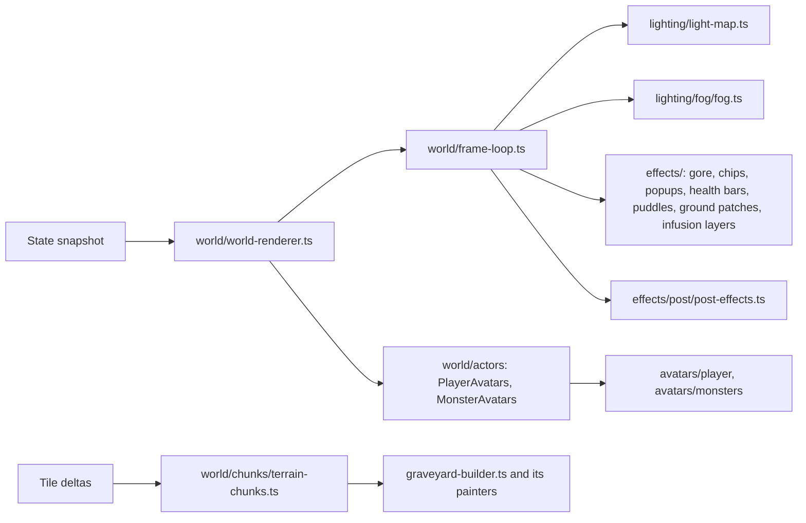
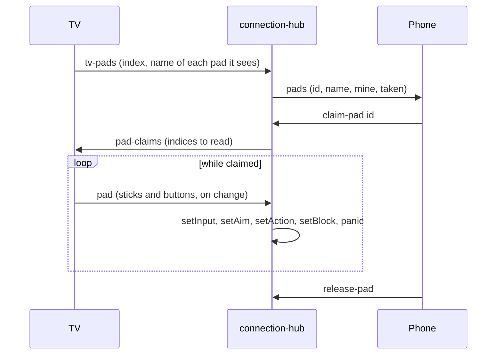

# TV display

The TV is `/tv`, the `apps/tv` app. The three.js scene lives in plain TS classes in `packages/renderer`, fed snapshots directly (not through React state), and the sidebar's controls in `packages/controls`, both shared with the admin console ([admin.md](admin.md)). The TV shows only the map, the kill feed, and a faint join QR in the bottom-left corner (`JoinPanel`: 60px at 35% opacity on a soft dark glow, no box or label; hover brightens it). It's meant to be found, not advertised.

- **Display settings:** the TV holds its own `DisplaySettings` (`DEFAULT_DISPLAY_SETTINGS`, with no menu to change them) and gives them to every split-screen pane's renderer with `setDisplaySettings`, with no player of its own (`setLocalPlayer(null)`, `PaneGrid`).
- **Overlay:** when its Show TPS, Show FPS, or Show server ticks flags are on, `PerfOverlay` (`packages/controls/src/components/hud/perf-overlay.tsx`) shows the server's ticks per second, the first pane's frames per second, and ms per server tick under the sidebar's corner, refreshed once a second (`usePerfReadout`), not per snapshot. The admin console and /play use the same overlay.

## Renderer

### Pixels and camera

- The scene renders at low resolution and is scaled up nearest-neighbor for the chunky look: `PIXEL_SCALE` (3) screen pixels per rendered pixel at the reference framing (`PIXEL_REFERENCE_HALF_HEIGHT`, about a whole classic map on the TV).
- Zoomed in past that (/play, a split-screen pane following a player, a preset's small `view`), each pixel grows with the zoom, rounded to whole screen pixels (`pixelScaleFor`, `WorldScene.syncPixelScale`), so a pixel covers about the same patch of world, but never past `DEFAULT_PIXEL_LIMIT` (4) on admin, or past the TV's Pixel Size (below). A view can instead fix its own pixel size (`WorldRenderer.setPixelScale`; /play does, from its zoom and Pixel size setting, see [play.md](play.md)); 1 turns pixelation off.
- Pixels are counted in CSS pixels (the renderer's pixel ratio is 1), so a big TV or a 4K screen the browser reports as 1920 wide shows each game pixel physically bigger than a desktop monitor does.
- **Pixel Size:** the Music tab's TV Look card (`TvLookCard`) caps the TV's pixels at 1 (Sharp) to 6 screen pixels (`TV_PIXEL_SIZE`, default `DEFAULT_PIXEL_LIMIT`), kept per browser (`useTvPixelSize`, `TV_PIXEL_SIZE_STORAGE_KEY`) and given to every pane (`WorldRenderer.setPixelLimit`). Below `PIXEL_SCALE` it's that size at every zoom; Incognito's pixelation multiplies on top.
- The camera looks down at `CAMERA_ELEVATION` (55 degrees) on the TV and admin; a view can set its own with `WorldRenderer.setCameraElevation` (/play's View angle setting, 47 degrees by default, through `setDisplaySettings`). The map editor's top view tilts to `TOP_VIEW_ELEVATION` and back to the view's own elevation.

### World voxels
- `WorldScene` (`world/world-scene.ts`) owns the three.js scene and its parts, each a `ScenePart` holding the shared `WorldContext` (scene, map, camera); `WorldRenderer` extends it with input, prediction, and the editor. `FrameLoop` runs every frame's body. See [architecture.md](architecture.md#scenepart).
- The map is built in `CHUNK` (16) tile square chunks (`TerrainChunks`, constants in `world/chunks/config/chunks.ts`). A map of up to `SMALL_MAP_CHUNKS` (24) chunks is built whole; a bigger one builds only the chunks in view plus `CHUNK_LOAD_MARGIN`, at most `CHUNK_BUILDS_PER_FRAME` (2) a frame, and drops those past `CHUNK_KEEP_MARGIN`.
- **Zoomed far out** (the admin's wheel), detail drops in steps (`world/chunks/config/overview.ts`, switched in `FrameLoop` by how many tiles tall the camera sees):

| Tiles tall | What draws |
|---|---|
| Up to `OVERVIEW_TALL` (64) | Everything |
| Past `OVERVIEW_TALL` | The voxel chunks stop building and hide, along with flames, piles, chips, gore, pickups, altar gauges, fountain victims, puddles, and fog; a flat overview map stands in (`MapOverview`: one pixel per tile, colored by `OVERVIEW_COLORS`, lighter per terrain level, repainted every `OVERVIEW_REPAINT` 0.25s). The outskirts stop growing |
| Past `DOTS_TALL` (150) | Monster and player figures hide too; monsters are red dots and players 3x3 dots in their color on the overview. Name labels stay |

- The camera's clipping range widens with the zoom (`NEAR`, `FAR`, `VIEW_DEPTH_SLACK` in `CameraRig.fit`), so a far-out view still draws whole.
- A tile change rebuilds its chunk (and its neighbours, for walls and undergrowth that cross the seam: `TerrainChunks.markDirty`). `graveyard/graveyard-builder.ts` paints each tile with its `TilePainter` (`graveyard/painters/`, looked up in `painter-registry.ts`), seeded per tile so rebuilds don't reshuffle the rest.
- Something that just grew (trees, hedges, chests, gravestones) is drawn on its own by `buildTile` while it rises or swells, then baked in.
- Breaking tiles burst into chunks of themselves (`buildTilePieces` in `graveyard-builder.ts`).
- Trees side by side get undergrowth between them (`shrubBetween` in `graveyard/shrubs.ts`), which sinks when either tree falls.
- Trees are baked into their own mesh; `effects/tree-sway.ts` patches its vertex shader so brutes shake nearby trees without a rebuild.
- `buildOutskirts` (`graveyard/outskirts.ts`, placed by `Scenery`) fills the rest of the screen with woods beyond the fence (not on a huge world, whose edge is chasm).
- The watchtower's upper walls are a separate model whose front half hides while a player is inside.

### Light and fog
- **No PointLights.** `lighting/light-map.ts` rebuilds a small quantized texture each frame from every light, and patched Lambert materials multiply by it, so darkness costs the same however many lights exist.
- On a big map the light map and fog cover a window (`WINDOW_TILES_W` x `WINDOW_TILES_H`, 80x60) that follows the camera (`LightMap.setCenter`, `Fog.setCenter`, the `lightWindow` uniform); past `SIM_MAX_TILES` the fog is drawn procedurally instead of simulated. The moon and its shadow follow the camera too.
- Lights flicker slowly, each on its own rhythm. A world event's `sky` effect (the blood moon) tints the ambient. Glowing Basic materials (flames, pumpkin faces, build ghosts) stay bright.
- `lighting/fog/fog.ts` simulates a density grid (3 cells per tile) that walkers push aside, lights thin, and ghosts thicken, drawn as three dithered sheets (`FogGrid`, stepping the `FogField` base's density grid).
- `effects/post/post-effects.ts`: bloom, then saturation, focus, and chromatic aberration scaling with distance from the nearest living player. `WorldScene.pixelScale` and `WorldScene.container` let an app lay its own pixelated overlay over the world (/play's top bar, see [play.md](play.md)). World events add to it on top of the Aberration setting (`PostEffects.setEventAberration`).
- World events: `WorldEventLook` eases each event in and out and resolves their effects into `WorldContext.look`, which the sky, fog, grade, and monster eyes (boxes made with `VoxelParts.eye`) read. A light the server marks `dying` cuts out at random (`helpers/sputter.ts`) until it goes out. See [world-events.md](world-events.md).

### Avatars

Every avatar extends `Avatar` (`avatars/avatar.ts`); see [architecture.md](architecture.md#avatars) for the families.

- **Players** (`avatars/player/player-avatar.ts`, with `PlayerRig`, `PlayerGear`, `PlayerSwing`, `PlayerLocomotion`): gear in hand from `models/gear/` (`buildGearModel(kind, box, infusion)`, `buildHeldModel`). Whatever is drawn for a moment (`PlayerState.drawn`: the hammer for a job, a stake for a vampire) replaces the weapon. Heavy weapons' swings are stretched to their windup, with the infusion applied (`PlayerSwing.duration`); a Headsman's Axe swing that skipped its windup (`PlayerState.quickSwing`) plays at the plain `SWING_TIME`.
- **Infused gear** (`PlayerState.gearInfusion`): `HeldModels` builds each model the first time it's shown and caches it per kind and infusion. One key, `gearKeyOf` (`helpers/gear-key.ts`: kind, infusion, drawn, digging, thrown), decides when `PlayerGear.refresh` rebuilds. `PlayerGear.step` runs the models' own `animate` (drips, flames, halos, Moonsilver dimming while `PlayerState.dimmed`).
  - The infused hammer is two-handed: the off hand hides and the lantern moves to the belt (`PlayerOffhand`).
  - A thrown glaive (`PlayerState.thrown`) hides the weapon and its swing streak.
  - Holy gauntlets' charge glows turn gold (`ChargeGlows`); the left gauntlet matches the right one's infusion.
  - Infused torches and shields get the matching front shield; the Mirror Shield's face glints.
  - Translucent pieces (ecto) use the `BoxFactory` opacity, kept in `material.userData.opacity` so `PlayerShading` multiplies rather than overwrites it.
- **Turning:** a player's model turns toward their facing on a spring (`PlayerTurn`, `avatars/player/config/player-turn.ts`): at most `MAX_TURN_SPEED` (12 rad/s; the Turn speed setting, `DisplaySettings.turnSpeed`, 4 to 40 rad/s, sets it per screen through `PlayerTurn.maxSpeed`), lagging a moment behind, and slightly underdamped (`TURN_DAMPING` 0.7), so a quick turn swings a few degrees past and settles back. It applies to /play's own predicted player too, which used to snap.
- **Swings** are `WeaponMotion` subclasses in `avatars/player/motions/`, picked per weapon by `pickMeleeMotion` (`motion-picker.ts`):

| Motion | Weapon | Does |
|---|---|---|
| `AxeSwingMotion` | Most melee | The overhead chop |
| `StabMotion` | Spear | Drops level, draws back, and drives straight ahead as the blow lands |
| `SweepMotion` | Scythe, glaive (its sweeping hits) | A `grip` group turns the blade flat, then the arm and body whip it level from one side across to the other, passing dead ahead as the blow lands, blade leading. Each weapon has its own spread: the scythe's blade travels about 120 degrees each way (`SCYTHE_SWEEP`), the glaive's about 75 (`GLAIVE_SWEEP`) |
| `LashMotion` | Morning star | The jointed chain whip (`buildWhip`): pulled back low, swung up over the head, and cracked straight out in front (`PlayerGear.curl`, `whipBend`). After a lash it hangs loose, then winds back into a coil by the hand over `COIL_IN` (`coilBend`), which is how it rests (`PlayerSwing.curlPhase` keeps counting past the swing's end so it gets there). A new lash unwinds it from wherever the coil was (`PlayerSwing.from`) as it's pulled back; its bag and ground model is the same coil |
| `StaffMotion` | Quarterstaff | Held across the body in both hands; plays its combo: top end down sweeping across, bottom end up sweeping back (`STAFF_SWEEP`), twirl |
| `FistsMotion` | Spiked gauntlets | Both fists (`PlayerGear` shows a left fist) with a charge glow (`ChargeGlows`); jab, punch, uppercut, and a launching super uppercut (a high `jump`) |
| `DigMotion` | Digging a grave (`PlayerState.digging`) | A spade (`buildSpade`) instead of the hammer, raised blade-down, driven into the ground with a crouch as the blow lands, then heaved up overhead (`DIG_LIFT`/`DIG_STAB`/`DIG_TOSS`) |
| `ShotMotion` (`SHOT_MOTION`) | Guns | The gun kicks up and the body rocks back, then settles |
| `ThrowMotion` | The glaive's stab step with `throwStab` (Soulbound, Wraith Glaive) | A throw instead of the stab |
| `SprayMotion` | The Hellmouth (`spray`), picked by `pickShotMotion` | Held level and braced while spraying, for `SPRAY_HOLD` (0.6s) after the last pulse (`MotionContext.swingAge`) |

- The glaive alternates the scythe's sweep and the spear's stab. Pose constants live in `avatars/player/config/player-poses.ts`.
- A crossbow taking aim is held level, leaning in, and a dim red target (`CrossbowReticles`, drawn after bloom over everything) turns above the monster it's locked onto (`PlayerState.aimTarget`); after a shot it tips muzzle-down while the free hand cranks it (`ReloadMotion`). The repeating crossbow's drum (`GearModel.spinner`) spins as it fires (`PlayerGear.spinDrum`); both crossbows show the crank reload while `PlayerState.reloading`.
- Guns (blunderbuss, musket) throw fire, a flash, and smoke at the muzzle (`MUZZLE_*` in `world/config/muzzle-colors.ts`) with a small shake (`PlayerAvatars.swung`). A Hellmouth's spray skips the muzzle blast, smoke, and shake; its flame is the `flame-spray` event. The shield moves in front of the chest while blocking.
- A Flesh-Sprung Maul swing (infused hammer, tendons level 2) kicks up dust chips along its arc (`MAUL_DUST`: 5 puffs across about ±100°, at 0.75 of its reach, in `PlayerAvatars.swung`).
- Each dig also throws a shovelful of dirt up and back over the nearest digger's shoulder a beat later (`EventEffects.tossDirt`, `ChipBursts.fling`).
- **Monsters** (`avatars/monsters/`): one `MonsterAvatar` subclass per kind in `kinds/` (each kind's constants in `kinds/config/<kind>.ts`), made by `createMonsterAvatar` and then `assemble()`d. Each overrides `build` and `animate`; `ChargingMonsterAvatar` times wind-ups by `attackPhase`, `ArmedMonsterAvatar` mounts held junk. Gaits (`MonsterGait`, `GAIT`) keep pace with real speed. Brute slams bump `impactCount` for dust and screen shake.
- **Monster statuses** (`MonsterState.status`, see [monsters.md](monsters.md#statuses)): `MonsterAfflictions` (owned by `MonsterAvatar`, colors in `config/afflictions.ts`) fades each in and out (`AFFLICTION_FADE`) and feeds the body tint through `MonsterGlow`; the hurt flash and the necromancer ward pulse still win. Its pieces are on `NO_BLOOM_LAYER`.

| Status | Body | Pieces |
|---|---|---|
| Burning or glowing | Orange, fast flicker | 5 rising embers and a flame from the shared pool; glowing ones also light the ground (`BURN_LIGHT`) |
| Cursed | Purple, slow pulse | 6 circling purple wisps |
| Poisoned | Green pulse | 4 falling green drips |
| Slowed | Pale ecto green | 4 drifting wisps |
| Pinned | | 4 iron spikes at the feet |
| Turned or risen | Steady teal | |

- Bleeding isn't drawn.
- **Swooshes** (`SwooshTrail` in `avatars/shared/swoosh-trail.ts`, `addSource`, `update`; a monster's built by `MonsterSwoosh`): melee attacks leave a faint pale streak (`SWOOSH`) behind every striking point: both brute fists, both zombie hands (one if one-armed), both vampire claws, and ghoul and demon jaws through their pounce or lunge (`SWOOSH_TIME`). The witch's broom leaves a purple one. A kind picks its trail with `trailStyle`.
- Avatars follow `WorldMap.elevationAt` (through `ActorLift`), so they rise smoothly on stairs.

### Effects

| File | Does |
|---|---|
| `effects/gore/gore.ts` (`BloodSplats`, `Gibs`) | Blood splats that dry away; dead monsters torn apart and thrown along the killing blow |
| `effects/chip-bursts.ts` | Wood and stone chips from hits; a flamethrower's gout of fire (`jet`) and a sword swiper's ring of blade glints (`whirl`), from `turret` events |
| `effects/pickup-popups.ts` | A small spinning model of whatever someone picks up |
| `effects/health-bars.ts` | A DOM bar over anything that survives a hit, fading after |
| `effects/altar-gauges.ts` | A glowing blood trough on awake altars, draining over `ALTAR_AWAKE_SECONDS` |
| `effects/fountain-victims.ts` | Blood in a fountain that holds a monster, with the victim's head bobbing in it (`FountainVictims`, see [building.md](building.md#the-blood-fountains-victim)) |
| `effects/puddles.ts` | Witches' puddles |
| `effects/ground-patches.ts` (`GroundPatches`) | Infusion ground patches (`PatchState`, `WorldScene.setPatches`), pooled (48), sized by `radius`, fading with `life`: `scorch` a charred disc with a pulsing orange middle and embers; `fire` a glowing disc with licks of flame; `incense` a faint pale disc with slow smoke. Scorch and fire each get a flame and a dim light, at most 16 each (`PATCH_FLAMES`, `PATCH_LIGHT`) |
| `effects/chain-bolts.ts`, `fissures.ts`, `shock-rings.ts` | `ChainBolts` (jagged arcs through a chain's points), `Fissures` (a zigzag crack with a glowing seam that opens and closes), `ShockRings` (expanding rings) for the infusion events |
| `world/effects/infusion-event-effects.ts` | `InfusionEventEffects`: draws the infusion events (below) |
| `items/drops/gear-drop.ts` | Infused gear on the ground and in icons shows its variant model (`GearItem.infusion`) |
| `items/item-piles.ts` | Ground items, each a `GroundDrop` (`items/drops/`: `ResourcePile`, `GearDrop`, `CrateDrop`); gear lies flat with a glint; materials without a heap of their own (`MODELED` in `items/config/piles.ts`: ectoplasm, chain, cursed cores, pumpkins, watering cans, and the infusion essences, modeled in `models/items/essence-models.ts`) show their bag model; piles follow their item as belts carry it |
| `avatars/shared/dangle.ts` | Rag-doll swing for anything the mouse lifts |

**Infusion events** (`InfusionEventEffects`, handed every event by `EventEffects.play`; sounds in [audio.md](audio.md)):

| Event | Shows |
|---|---|
| `chain` | Crackling jagged arcs (white core, gold outside) through all its points for 0.26s, sparks at each jump |
| `death-blast` | Sparks, smoke, a ring out to `radius`, a spinning ring of sparks (darker embers when `ignite`), a light flash, a shake |
| `wail` | A pale green ring and an inner ring, a spinning ring of sparks |
| `slam` | A dusty ring, dirt puffs around it, a half-strength shake |
| `fissure` | A zigzag crack along `angle` for `length`, open 2.2s then closing, dirt puffs along it, a shake |
| `flame-spray` | `chips.jet` like the flamethrower turret |
| `nova` | A gold ring, spinning sparks, a gold light flash, a shake |
| `reflect` | Silver sparks and a small ring |
| `infused` | Sparks in the essence's color (`ESSENCE_GLOW`) and gold, a ring, a light flash |

- **Light flashes** (`WorldContext.flashes`, `LightFlash`): blasts, novas, and infusing push a short light into the light map; each frame fades them.
- **Infused shots** (`ProjectileMaterials.buildInfused`, drawn by `Projectiles`): `glaive` two crossed steel blades around a purple core, spinning flat; `fire-arrow` a burning head and a flickering fire tail; `spirit-arrow` a see-through green shaft with a glowing head; `ghost-bullet` a pale core in a green halo with a wavering wisp.
- **Lights** (`LightCollector`): burning monsters get a flame each (at most `BURN_FLAME.budget`, 24) and glowing ones a light; a Brimstone Torch's light is x its `lightMult`; a weapon with `lightRadius` (the Moonsilver Saber) gives a faint cold light, dimmer while `dimmed`. The flame pool (`effects/flames.ts`) holds 136, structure flames first, so torches and fires are never crowded out.
- **Kill feed:** an infusion shows as "<player> [sparkles] <variant name> forged" (`FeedEvent` `'infused'`, `kill-feed.tsx`).

Anything flat on the ground (blood splats `SPLAT_LIFT`, puddles `PUDDLE_LIFT`, blood piles) must sit above 0.05: grass tiles are four sub-voxels whose tops jitter up to +0.05, and anything lower gets patches of grass poking through it.

Pickup popups are unlit (`MeshBasicMaterial`) so they read in the dark; the blood drop's highlight boxes are left off them (`resourceModel(..., shine = false)` in `models/items/resource-models.ts`), since bloom turned them into white blotches.

## Split screen

On a huge world the TV follows its players instead of framing the map (`apps/tv/src/display-page.tsx`, panes from `usePanes` and `helpers/panes.ts`).

| Local players | Layout |
|---|---|
| None | One pane on the spawn (`setFollow(null, tall, at)`) |
| 1 | One pane following them |
| 2 | Side by side |
| 3 or 4 (`MAX_PANES`, `apps/tv/src/config/tv.ts`) | A 2x2 grid |

- A local player is a connected one no /play screen is watching (`state.watched`).
- Each pane is its own `WorldRenderer` labelled with the player's name; every message goes to all of them. The mouse works the first pane.
- **TV view** (Game tab, Map card, TV only) sets how much ground each pane shows (`TV_VIEWS` in `packages/controls/src/config/tv-view.ts`, saved per browser under `graveyard.tvView` by `helpers/tv-view.ts`):

| Preset | Shows |
|---|---|
| Classic (default) | A `MAP_WIDTH` x `MAP_HEIGHT` (56x34) area, fitted like a classic map |
| Close | `FOLLOW_TALL` (20) tiles top to bottom, like /play |

- `WorldRenderer.setFollow` takes a `FollowView`: a number of tiles tall, or a `w` x `h` area to fit.
- The TV sends `watch` with its panes' players, so it's sent only their surroundings.
- The map editor goes back to one pane framing the whole map.

## Sidebar

Hover the top-right corner and click the chevron. Clicking outside closes it. The admin console (`/admin`, [admin.md](admin.md)) has the same controls minus Music, split into pages from a menu, beside its own view of the world.

| Tab | Holds |
|---|---|
| Overview | A short roster with hidden levels and each player's ping; a Controllers card (game controllers on the TV and who holds each); server TPS, tick time, TV fps, this screen's ping, KB/s sent to each screen, world level, monster and item counts |
| Music | See [audio.md](audio.md) |
| Game | Testing controls and the map (below) |

### Game tab

| Card | Controls |
|---|---|
| Switches | Aggressive monsters, All unlocks, Free crafting, Natural spawning, Test player, Lights off, Mouse picks up, Mouse light, Background threads; World level boost |
| Spawn: Objects | Tree, pumpkin, chest, rock, loot (a random piece of gear) |
| Spawn: Monsters | Every monster kind |
| Spawn: Gear | Every piece of gear but the infused hammer (only made by infusing: `GearDef.infused`, filtered from `SPAWN_KINDS` and `GEAR_SPAWNS`), dropped on the ground at full condition |
| Spawn: Buildables | Every structure, built at level 0 by no one (`BuildSystem.conjure`, by the same rules as a player's build) |
| Actions | Summon each world event (blood moon), Make it day / Back to night, Kill all monsters |
| Map | Map Editor and TV view (TV only); Regenerate Map: Map Preset, random map settings, confirm, New world (a huge one shows a Generating world popup until it's ready, see [world.md](world.md#sizes)) |

- `GameSettings` are held by `Game`, sent back in every state message, and not saved.
- All unlocks and Free crafting apply per player through `GameTabSystem.treeOf`. Free crafting also needs no anvil: anvil recipes and infusions work anywhere, as if beside a level 0 anvil (`CraftSystem.craft` and `infuse`; on the phone, `useCraftSelection`, `levelState`, and the details' anvil note).
- Free crafting also makes candy and blood unlimited (`BagSystem.unlimited`): upgrades, blood ammo, the flamethrower, and watering cost none (`BagSystem.has` and `pay`), and phones are told `UNLIMITED` (999999) of each (`ViewSystem.carried`), which the counters show as ∞ (`InventoryBar`). The real counts are never touched, so turning it off gives players back exactly what they had. Dropping and dying still use the real counts.
- Daytime only changes the TV's look.
- Spawns use `ConjureSystem.spawn` (`Regrowth.spawnTile`, `Horde.summon`), inside the preset's `view` if it has one. Each button shows the thing's own 3D model (`itemIconUrl`: `tile:` and `monster:` icon keys besides gear). On the TV a click spawns at a random spot; the admin's Spawn page picks instead and can place it (`spawn` with `at`: right on the clicked tile past the usual rules, never on top of something; see [admin.md](admin.md#pages). `Horde.summonAt`, `BuildSystem.conjure` with `anyway`, `FREE_FLOORS` in `server/src/game/tv/config/conjure.ts`).

### Keyboard shortcuts

Not while typing or in the map editor. The Game tab shows each letter beside its control (TV only).

| Key | Does |
|---|---|
| U | All unlocks |
| F | Free crafting |
| A | Aggressive monsters |
| T | Test player |
| L | Lights off |
| D | Day / night |
| B | Summon a blood moon |
| K | Kill all monsters |
| I | Incognito |
| Esc | Leave Incognito, close the map editor |

### Incognito

`apps/tv/src/components/incognito-screen.tsx` shows the album art, title, and artist over the live graveyard, hides the kill feed, and mutes SFX; the join QR stays up so people can still jump in. Off when the page opens. It's a mode: turned on (I, the music panel, a remote control), it shows only while no player is connected. It fades away as soon as one connects and comes back once all have left, as long as the mode is still on; Escape or the toggle turns the mode off (`incognitoMode` and `playersHere` in `display-page.tsx`). While the music shows, the graveyard behind it turns more scenic over the screen's 1.5s fade, and back to the TV's own settings when it hides (`useScenicLook`, `SCENIC_FADE_MS`): chromatic aberration eases up to 0.9 (`SCENIC_ABERRATION`), and brightness, contrast, fog, its shade, and pixelation to the Incognito look.

#### Incognito look

The Music tab's Incognito Look card (`IncognitoLookCard`) has a slider for each, kept per browser once one moves (`useIncognitoLook`, `INCOGNITO_LOOK_STORAGE_KEY`). Moving one while the music screen shows applies at once.

| Slider | Range | Default | What it sets |
|---|---|---|---|
| Incognito Brightness | 30% to 160% | 80% | Canvas `brightness()` filter |
| Incognito Contrast | 50% to 180% | 105% | Canvas `contrast()` filter (`DisplaySettings.contrast`) |
| Incognito Pixelation | 1.0x to 4.0x | 1.3x | The zoom's pixel size times this (`WorldRenderer.setPixelBoost`) |
| Incognito Fog | 0% to 300% | 160% | Ground fog thickness; past 100% is heavier than the Fog setting allows |
| Incognito Fog Color | 20% to 300% | Normal (100%) | The fog's color times this: under 100% darker, over lighter (`DisplaySettings.fogShade`, `Fog.setShade`) |

Ranges and defaults are `INCOGNITO_LOOK_RANGES` and `DEFAULT_INCOGNITO_LOOK` in `packages/controls/src/config/incognito-look.ts`.

## Controllers on the TV

Game controllers plugged into the TV machine can be claimed from a phone (`apps/tv/src/hooks/use-tv-pads.ts`, `input/pad-relay.ts`; the server side is `PadRegistry` and `PadHandler`), so the phone becomes just the menus.

| Input | Does |
|---|---|
| Left stick | Walk |
| Right stick | Aim |
| RT | Hit and work |
| A | USE on the tile in front (`PadState.use`; panels and menus it opens show on the phone) |
| LB or LT | Block with a shield |
| B | Panic |
| Left face button (X on Xbox, Y on Switch) | Opens the Bag on the player's phone (`pad-menu`) |
| Top face button (Y on Xbox, X on Switch) | Opens Craft on the player's phone |
| Back / Minus / View | Opens the skill tree on the player's phone |

- Pad ids are `<tv>-<index>`, per TV page. Some browsers only show a pad once a button on it has been pressed.
- One pad per player; claiming another lets go of the first. A pad someone holds shows as taken.
- While a pad is held, the player stays connected even if the phone sleeps. Releasing it (or unplugging it, or closing the TV page) stops the player, and slumps them if their phone is gone too.
- Leaving the game releases the pad.
- Every display (TV, admin console) gets `tv-pad-list` on hello and whenever a pad or claim changes, for the Overview tab's Controllers card (`components/overview/controllers-panel.tsx`): each pad with the player holding it, or Free, and the TV number when more than one TV page has controllers.
- On the TV page only, the card also lists the controllers this computer's browser sees, each with a light that comes on while it's pressed or moved (`components/overview/pad-monitor.tsx`). A controller that's listed but never lights up is connected but sending nothing (often Steam holding it).
- The TV page logs what the browser reports about its controllers to the console as `[pads]` lines whenever it changes (`input/pad-logger.ts`: focus, visibility, socket, each pad's id, mapping, pressed buttons, and axes), plus connects, disconnects, and phone claims. Filter the console on `[pads]` when a controller isn't seen or does nothing.
- **Building with a controller:** while the holder's phone has a structure picked (`BuildSystem.isBuilding`), RT places it (`BuildSystem.placeBuild`, on the press) instead of swinging, LB and RB turn the structure being built a quarter turn left or right (`ControlSystem.turn`, `PlayerKit.buildFacing`; a chevron over the preview shows a belt's or wall's way, and a wall with looks previews as itself, see [building.md](building.md#wall-looks-and-rotation)), and Block does nothing. Build errors still show on the phone.
- Buttons go by position (`PadRelay`), so they work whatever the labels say. The TV counts presses of B and the three menu buttons in each `pad` message, starting from 0 at the claim on both sides; the server turns a new B into a panic and a new menu press into `pad-menu` to the holder's phone, which switches to that tab.
