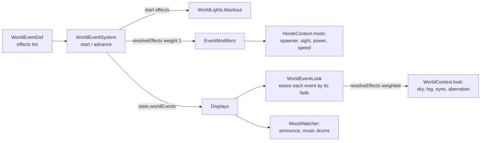

# World events

Timed events that change how several systems behave while they're up. The blood moon is the only one so far. Code: `shared/src/world-events/` (definitions, effect types, the resolver), `server/src/game/progression/world-event-system.ts` (`WorldEventSystem`), and `packages/renderer/src/world/lights/world-event-look.ts` (`WorldEventLook`).

## How it works

- An event is a `WorldEventDef` in `WORLD_EVENTS` (`world-event-catalog.ts`): `name`, `duration`, `fade` (display ease in and out), optional `every` (comes on its own after `min` to `min + spread` seconds of play), and a list of `effects`.
- Each effect is one `EventEffect` naming the system it changes (`on`). Systems never check for a particular event. They read `EventModifiers`, which `resolveEffects` builds from every active event.
- The server resolves at full weight. Displays resolve with each event's eased weight, so looks fade in and out while gameplay switches at once.
- `WorldEventSystem.start` also runs the start-only effects (`blackout`); the TV plays `announce` when an event shows up in a snapshot it didn't have before.
- The calm before an event that comes on its own only counts while someone is connected and natural spawning is on. Starting it any way restarts its calm.
- The state snapshot carries `worldEvents` (kind and seconds left). The Game tab has a button per event (`WORLD_EVENT_BUTTONS` in `packages/controls/src/config/world-events.ts`); the TV's B key starts the blood moon. Both send `start-world-event`.

## Effects

| `on` | Fields | Combines as | Read by |
|---|---|---|---|
| `spawning` | `interval`, `perPlayer`, `lightsPerGhost` (each optional) | Overrides; heaviest event wins per field | `Spawner.spawn` |
| `spawn-mix` | `mix` (weight per kind, in the percent points of `SPAWN_MIX`) | Adds, each by its event's weight, into `spawnMix` | `pickKind` (the blood moon's werewolves; `Werewolf` reads it to run off at moonset) |
| `monster-power` | `scale` | Multiplies | `MonsterCore.power` (hits, arrows, potions) |
| `monster-speed` | `scale` | Multiplies | `Walker.moveToward`, `Ghost.drift` |
| `raid` | `share` | The highest, by its event's weight | `Shambler.raid`: that share of shamblers go for the nearest base structure (the blood moon: 0.75) |
| `monster-hunt` | | Any | `Sight.perceive` (walkers see the nearest player anywhere), `Ghost.act` (stalks them) |
| `blackout` | `within`, `sputter` | On start | `WorldLights.blackout`: relightable, non-`GHOSTPROOF` burning lights sputter (`LightState.dying`) and go out, each within `within` seconds |
| `sky` | `moon`, `ambient` (linear rgb), `fog`, `fogThicken` | Heaviest wins | `SkyLighting` (moon), `LightMap.setSky`, `Fog.setTint` |
| `eyes` | `color` | Heaviest wins | `MonsterAvatar.tintEyes` (boxes made with `VoxelParts.eye`) |
| `aberration` | `add` | Adds | `PostEffects.setEventAberration` |
| `music` | `drums` | Highest | `partLevel` (drums outside a fight) |
| `announce` | `sound`, `duck`, `seconds` | On start | `MoodWatcher` |

## Blood moon

`shared/src/world-events/kinds/blood-moon.ts`. Comes after 8 to 12 minutes of play, lasts 90s, fades over 8s.

| Effect | Value |
|---|---|
| Spawning | 1s interval, 7 per player, 1 ghost per 2 lights |
| Monster power | 1.25x |
| Monster speed | 1.12x |
| Hunt | Yes |
| Blackout | Within 7s, sputtering 1.4s |
| Sky | Moon `#ff7a66`, ambient `[0.26, 0.09, 0.12]`, fog `#6e3640`, 60% thicker |
| Eyes | `#ff2414` |
| Aberration | +0.0035 |
| Music | Drums at 0.5 |
| Announce | `blood-moon` horn, music ducked to 25% for 3s |

## Adding an event

1. Add its kind to `WorldEventKind` and a `WorldEventDef` in `kinds/`, then list it in `WORLD_EVENTS`.
2. Give it a button in `WORLD_EVENT_BUTTONS`.
3. If it needs a new kind of effect, add it to `EventEffect` and `EventModifiers`, combine it in `resolveEffects`, and read it in the system it changes.
