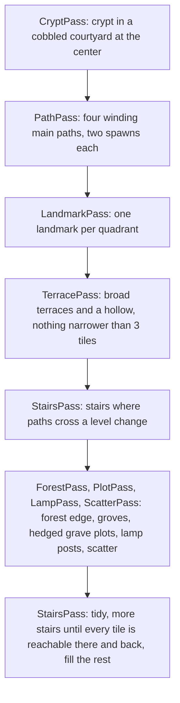
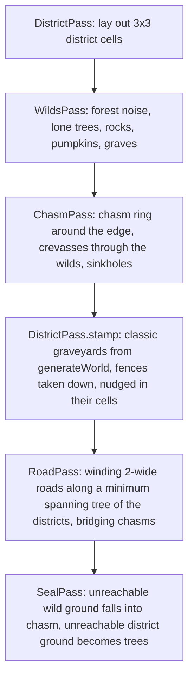

# World

The map is a tile grid with a fixed terrain level per tile. It's server-mutable: building, breaking, and regrowth change tiles, and the server broadcasts the deltas.

## Sizes

| Size (`MapGenSettings.size`) | Tiles | Edge |
|---|---|---|
| Classic (default) | 56x34 (`MAP_WIDTH`, `MAP_HEIGHT`) | A fence; off-map reads as `fence` |
| Huge | 256x256 (`HUGE_SIZE`) | A ring of chasm; off-map reads as `chasm` |

- `WorldMap` carries its own `width`, `height`, and `edge`; nothing assumes the classic size. `WorldMap.decode` takes the width, and the `world` message, saves, and presets carry it.
- The TV's Regenerate Map card picks the size (Classic or Huge) next to the random map knobs.
- A huge world is meant for players spread out over it: monsters spawn around each player ([monsters.md](monsters.md#spawning-and-pacing)), each screen gets only what's near the players it shows ([architecture.md](architecture.md#huge-worlds)), and the TV splits its screen ([tv.md](tv.md#split-screen)).

## Terrain levels

| Level | What |
|---|---|
| -1 | Sunken hollows |
| 0 | The ground |
| 1 | Terraces |
| 2 | Higher terrace cores |
| up to 3 | The watchtower's floors |

- Each level is 1.5 high.
- Every drop is a rough stone retaining wall with a broken capstone rim and a shadow line at its foot.
- Grass is lighter the higher it is and darker in hollows.
- Stairs have pale treads over dark risers and a stepped stone wall up each open side. They can be turned (`TileGrid.setRamp`; 0 lets `WorldMap.rampUp` choose).

### Moving between levels

- Walkers step up at most `STEP_UP` (0.4), so only stairs and built steps climb a level. Anyone can drop off an edge.
- A walker stands on the highest ground under any part of them, so they only drop once clear of the edge.
- Monsters path by the same rule. `WorldMap.roundTrip` checks that a tile can be reached and left again.

### Height in combat

| Rule | Value |
|---|---|
| Melee reach down / up | 1.8 / 0.6 (`MELEE_REACH_DOWN`, `MELEE_REACH_UP`) |
| High-ground bonus | +1 damage swinging at a target at least 0.5 lower |
| Ranged shots | +2 tiles of range per level above the ground; stop at ground rising above them |
| Fall damage | 1 heart per level fallen, when knocked off a drop of at least 0.6 (vampires too; zombies take none) |

### Chasms

- `chasm` (`~`) is solid ground at `MIN_LEVEL` that nobody walks into: `walkerBlocked` treats it as a wall.
- Only knockback can push someone over the edge (`walk(..., intoChasm)`). A player knocked in dies to `CHASM_DEATH` ("the abyss"); a monster knocked in is gone.
- The TV draws it as stone cliffs dropping into black (`CHASM_DEPTH` in `graveyard/config/terrain-shape.ts`, `CHASM_FLOOR` in `graveyard/config/palette/ground.ts`), and skips the outskirts woods when the map's edge is chasm.

## Collision

- Height-aware (`shared/src/world/collision.ts` `walkerBlocked`). `moveWithCollision` slides a mover heading straight past a corner it barely clips.
- Players and walking monsters can't overlap; walking into a zombie shoves it.
- Trees are passable but slow whoever is within `TRUNK_RADIUS` of the trunk: players to `TREE_SLOW` (50%), zombies and vampires to `MONSTER_TREE_SLOW` (70%).

## The random map generator

`server/src/game/world-gen/generate-world.ts` `generateWorld`, seeded, shaped by `MapGenSettings` (`shared/src/map-gen/settings.ts`, sent with `reset-world`). Each step is a `ClassicPass` (a `GenPass` over one `GenCanvas`: map, seeded rand, knobs) in `world-gen/classic/passes/`, run in the order below; constants live in `world-gen/config/classic.ts`.

**Landmarks** (one per quadrant, `Landmark` subclasses in `world-gen/classic/landmarks/`):
- A round walled chapel (`Chapel`, a `CourtyardLandmark`, random size from `COURTYARD_SIZES`).
- A round well plaza (`WellPlaza`, random size).
- One to three separate mausoleums (`Mausoleums`).
- The hill with the watchtower (`Hill`).

**The watchtower** is a 5x5 roofless ruin on the hill: a doorway toward the center, a pillar in the middle, and stairs spiraling up three floors. Its walls crumble to uneven heights. While a player is inside, the TV hides the front half of its upper walls. A candle on the pillar lights it.

**No roofs.** Everything is an open ruin seen from above.

**Trees** come in dead, pine, and autumn variants. Hedges can be chopped for wood.

### Huge worlds

`world-gen/generate-huge-world.ts` `generateHugeWorld`, about 180 ms. Each step is a `GenPass` in `world-gen/huge/`.

- Only the middle district keeps its spawn.
- Knobs are constants in `world-gen/config/huge.ts`: `DISTRICT_GRID`, `DISTRICT_EDGE`, `RING_MIN`, `RING_WOBBLE`, `CREVASSE_WIDTH`, `CREVASSE_CLEARANCE`, `SINKHOLES`, `FOREST_FROM`, `LONE_*`, `ROAD_REACH`.
- `perArea` (`world/helpers/tiles.ts`) scales the pumpkin and chest targets to the map's area.

## Presets

New worlds start from a map preset in `server/presets/<id>.json` unless the TV picks Random.

| Field | Meaning |
|---|---|
| `seed`, `tiles`, `levels`, `ramps` | The map |
| `view` (optional) | The part of the map the TV frames; `World.inView` (over `inView` in `world/helpers/tiles.ts`) keeps Game tab spawns inside it |
| `quiet` (optional) | Starts the world with Natural spawning off |
| structures (optional) | Built structures; a new world gives them fresh state |

- `king-of-the-hill` is the default (`WORLD_PRESET` overrides it).
- `sandbox` is a fenced 10x10 test arena using `view` and `quiet`.
- `game/storage/presets.ts` lists and loads them (`server/src/config/paths.ts` names the folder); `DisplaySessionHandler` sends the list to the TV in `display-welcome`.
- The map editor's Save as map writes one via `savePreset` (`PRESET_DIR` overrides the folder).

## Regrowth

The map keeps itself stocked toward fixed targets, so a server left alone never fills up or empties out.

| What | How |
|---|---|
| Trees | Rise beside other trees (mostly toward the middle) every ~12s, up to as many as the map started with (stumps count) |
| Stumps | Rot away after 2 to 4 minutes |
| Pumpkins | Swell up beside paths every ~40s, up to 10 |
| Chests | Surface beside graves and hedges every ~60s, up to 3 |
| Rocks | Top up to 20 |
| Graves | A dug grave leaves an open mound; a new gravestone rises 3 to 5 minutes later |

- Nothing grows on a spawn, a person, an item, or anywhere a flood fill says would cut off a reachable tile.
- The Game tab's Natural spawning switch stops all regrowth.

## Ground items

| Kind | Picked up by |
|---|---|
| Resource piles (materials, candy, blood) | Walking over them |
| One bag item (gear, or a crate of structures) | Walking over it, into the bag, never equipped |

- What you just dropped waits 2 seconds before you can pick it back up.
- What spills from a dead player can only be picked up by that player (`GroundItem.ownerId` in `world/types/items.ts`, not saved).
- Ground gear glints so it can be found in the dark.
